# Concepts

The concept map of the simulator. It links to [CODE](CODE.md), [DEFINITIONS](DEFINITIONS.md),
[TESTS](TESTS.md) and [BENCHMARKS](BENCHMARKS.md).

## How to read the diagrams

L1 is the whole project. Each L1 node opens one L2 diagram; a deeper level exists only where
a node splits into at least three parts the Captain could want to point at, or where a node
is a rule whose steps are worth seeing. Structure diagrams use solid arrows labelled with what
flows and dotted arrows for one node checking, driving or limiting another. Rule diagrams are
terminal flowcharts: diamonds ask a question and arrows carry the answer. Colours give the
status: green `implemented` (built), yellow `partial` (in the current work unit), uncoloured
with a dashed border `planned` (not started), grey and dotted `external` (owned by another
diagram, shown for context). A parent takes the highest status of its children, in the order
planned < implemented < partial. Node IDs are stable references; every term in a Terms cell is
defined in [DEFINITIONS](DEFINITIONS.md). Check the map with `python3 Planning/DBC/check_dbc.py`.

## L1 · Coupled nodal neutronics and thermal-hydraulics PWR simulator
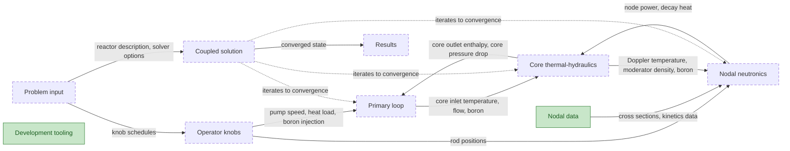

| Node | Meaning | Terms | Status |
| --- | --- | --- | --- |
| `ProblemInput` | Everything a run is given: the reactor description, the operating state, the knob settings or schedules and the solver options, read from one input file and checked before anything is solved. | problem input, reactor description, operating state, solver options | planned |
| `Knobs` | The four controls a student may change: control rod insertion, boron, primary coolant flow and steam generator heat load, each a constant or a schedule in time. | knob, knob schedule | planned |
| `NodalLibrary` | Homogenized cross sections and kinetics data for every composition and branch state, how they are generated with OpenMC, and the full-core reference solutions that check the nodal results. | nodal library, branch state, composition, OpenMC | implemented |
| `Neutronics` | Two-group nodal diffusion with eight delayed-neutron precursor groups: eigenvalue and critical boron, transient kinetics, xenon and samarium, decay heat, control rods, edits and pin powers. | two-group nodal diffusion, delayed-neutron precursor, eigenvalue | planned |
| `CoreThermalHydraulics` | Fuel rod conduction and one coolant channel per assembly on the neutronic axial mesh, giving the Doppler temperature, moderator density and boron of every node. | fuel rod, coolant channel, Doppler temperature, moderator density | planned |
| `PrimaryLoop` | The closed coolant path outside the core: plena, hot and cold legs, steam generator primary side and pump. It sets the core inlet temperature, flow and boron. | primary loop, heat load | planned |
| `Coupling` | The fixed-point iteration that brings neutronics, core thermal-hydraulics and loop to one consistent state, at steady state and in every time step, and the choice of the time steps. | Picard iteration, time step | planned |
| `Results` | What a run returns: solution fields, time histories, edits, and the record of convergence, table clamps and balances that every result carries. | run record, convergence state | planned |
| `Tooling` | The repository's own tools: the pinned toolchain, build presets, local checks and the agents' usage guard. | toolchain pin, usage guard | implemented |

### L2 · Problem input (`ProblemInput`)
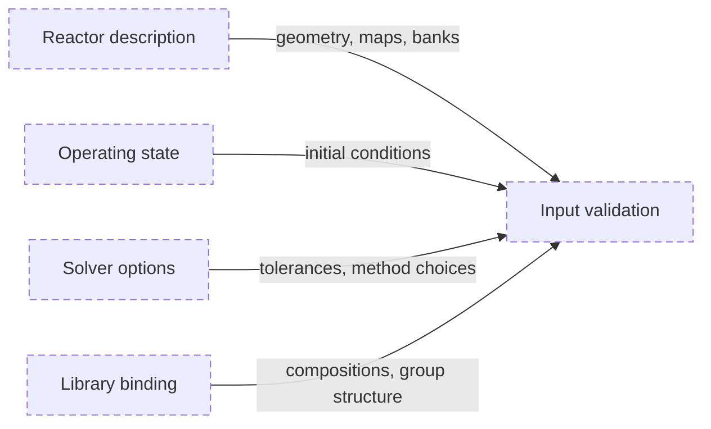

| Node | Meaning | Terms | Status |
| --- | --- | --- | --- |
| `ReactorDescription` | The reactor as built: core layout, node mesh, composition map, rod banks and their absorber zones, channel geometry and loop geometry. | reactor description, node, composition, rod bank | planned |
| `OperatingState` | The state a run starts from: power level, system pressure, core inlet temperature and flow, boron and rod positions. | operating state, system pressure | planned |
| `SolverOptions` | Tolerances, iteration limits and method choices, such as the nodal kernel, the kernel switch threshold, the fine-mesh resolution of the cusping correction and the coupling sequence. | solver options, tolerance | planned |
| `LibraryBinding` | Which nodal library the run uses and which library composition each node of the composition map refers to. | nodal library, composition | planned |
| `InputValidation` | Rejects an inconsistent input before solving, including any library whose group structure is not two energy groups and eight delayed groups. | input validation, group structure | planned |

### L2 · Operator knobs (`Knobs`)
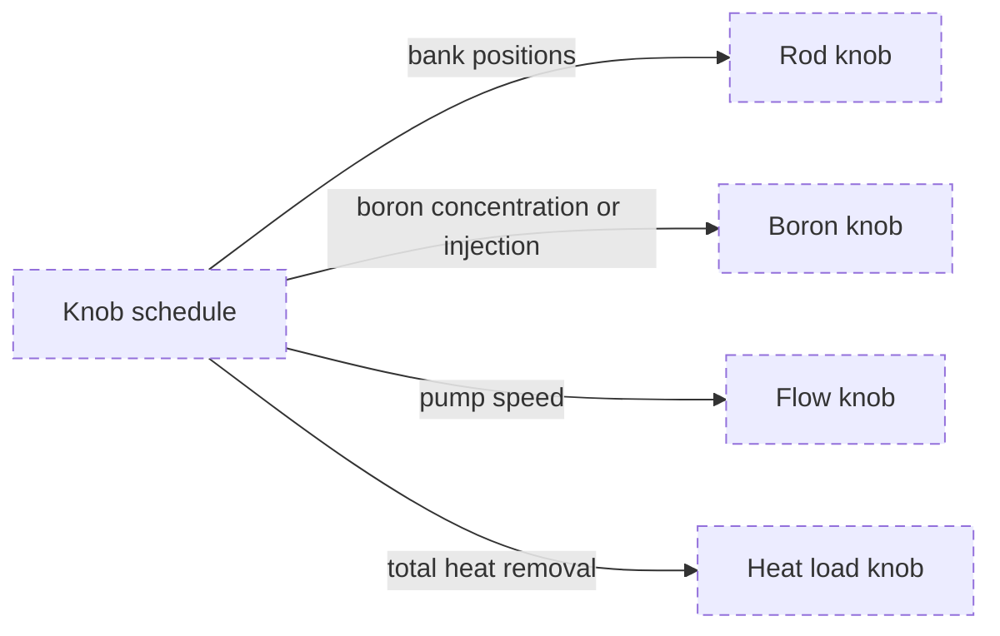

| Node | Meaning | Terms | Status |
| --- | --- | --- | --- |
| `KnobSchedule` | The value of each knob over time: a constant or a table. An instant where a knob jumps is a discontinuity the time stepping must land on. | knob schedule, time step | planned |
| `RodKnob` | Positions of the rod banks, which become the rodded fraction of every node. | knob, rod bank, rodded fraction | planned |
| `BoronKnob` | Boron as an operator control: imposed uniform concentration, or boron injected into the loop and carried with the coolant. Injection is the target; uniform concentration comes first. | knob, boron, boron transport | planned |
| `FlowKnob` | Primary coolant flow as an operator control, given as pump speed. Imposed flow comes first. | knob, pump speed | planned |
| `HeatLoadKnob` | Total heat removed by the steam generator. | knob, heat load | planned |

### L2 · Nodal data (`NodalLibrary`)
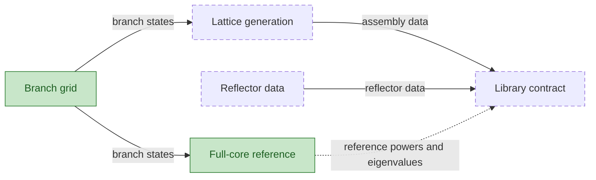

| Node | Meaning | Terms | Status |
| --- | --- | --- | --- |
| `BranchGrid` | The set of branch states data are generated at: a tensor grid in fuel temperature, moderator state, boron and rod state. The present grid has no boron axis. | branch state, tensor grid | implemented |
| `LatticeGeneration` | Single-assembly OpenMC calculations with reflective boundaries, one per assembly type and branch state, giving cross sections, kinetics data, discontinuity factors and form functions. | lattice calculation, OpenMC, discontinuity factor, form function | planned |
| `ReflectorData` | Cross sections of the radial, top and bottom reflectors from fuel-and-reflector models. | reflector, composition | planned |
| `FullCoreReference` | Full-core OpenMC runs at library states with node-wise tallies. They produced the present library and are kept as the reference solution the nodal results must reproduce. | full-core reference, OpenMC, tally | implemented |
| `LibraryContract` | The file layout the engine reads: quantities per composition and branch state, units, statistical uncertainties and validity flags for empty tallies. | nodal library, library contract, validity flag | planned |

### L2 · Nodal neutronics (`Neutronics`)
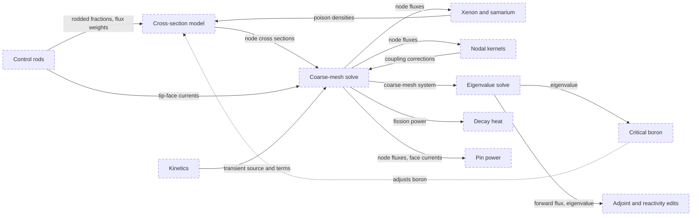

| Node | Meaning | Terms | Status |
| --- | --- | --- | --- |
| `CrossSectionModel` | The cross sections of every node at its state: multilinear interpolation in the library table, rodded mixing and the xenon and samarium absorption. A state outside the table is clamped and counted. | cross section, multilinear interpolation, table clamp | planned |
| `ControlRods` | Rod banks inside the core: where the tips are, how a partly rodded node is homogenized, and the correction that removes rod cusping. | rod bank, rodded fraction, rod cusping | planned |
| `CmfdSolve` | The global coarse-mesh finite-difference problem over all nodes, made exact by the coupling corrections from the nodal kernels. | CMFD, coupling correction | planned |
| `NodalKernels` | Two-node problems across every interface that give the accurate face currents, and from them the coupling corrections. | nodal kernel, transverse leakage, coupling correction | planned |
| `EigenvalueSolve` | The steady-state eigenvalue and fundamental-mode flux, by shifted inverse iteration on the coarse-mesh system. | eigenvalue, Wielandt shift | planned |
| `CriticalBoron` | The search for the uniform boron concentration that makes the core critical. | critical boron, boron | planned |
| `AdjointEdits` | The adjoint flux, the dynamic reactivity split by cause, and the point-kinetics parameters, used as edits and for point-kinetics checks. | adjoint flux, reactivity, point kinetics | planned |
| `XenonSamarium` | Iodine, xenon, promethium and samarium densities per node: equilibrium and their exact change over a time step. | xenon, samarium | planned |
| `Kinetics` | Time-dependent neutronics: the theta method with exponential transform and second-order precursor integration, turning each time step into a fixed-source problem. | theta method, exponential transform, delayed-neutron precursor | planned |
| `DecayHeat` | Heat released by fission products after fission, carried as decay-heat groups with the power linear over a step. | decay heat, decay-heat group | planned |
| `PinPower` | The power of each pin, reconstructed from the nodal solution and the form functions. | pin power, form function | planned |

#### L3 · Control rods (`ControlRods`)
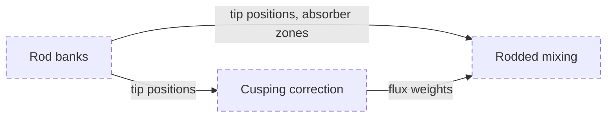

| Node | Meaning | Terms | Status |
| --- | --- | --- | --- |
| `RodBanks` | Banks of rods moving in steps, each rod a stack of absorber zones, giving the rodded fraction of every node. | rod bank, rodded fraction | planned |
| `RoddedMixing` | Cross sections of a partly rodded node as a mix of its rodded and unrodded compositions, weighted by volume and by the axial flux in each part. | rodded fraction, flux weight | planned |
| `CuspingCorrection` | The three-node axial problem around a tip that gives the flux weights and the face currents of a partly rodded node. Fine-mesh finite differences first; the kernel form is adopted only after it passes its tests. | rod cusping, three-node problem | planned |

#### L3 · Nodal kernels (`NodalKernels`)
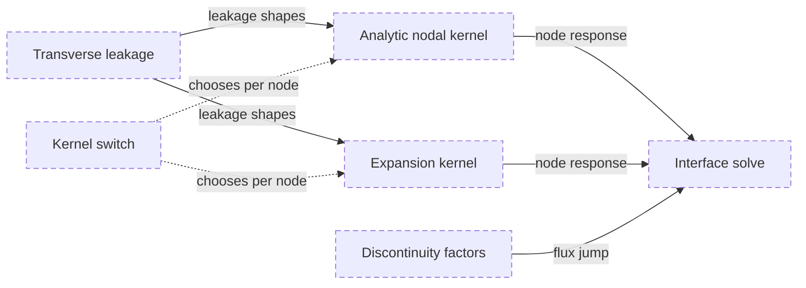

| Node | Meaning | Terms | Status |
| --- | --- | --- | --- |
| `TransverseLeakage` | The leakage in the two directions a one-dimensional problem leaves out, approximated by a quadratic over three neighbouring nodes. | transverse leakage | planned |
| `AnmKernel` | The analytic nodal method: the exact solution of the two-group one-dimensional equation inside a node. | analytic nodal method, node response | planned |
| `NemKernel` | The nodal expansion method: a fourth-order polynomial flux with weighted-residual moments. | nodal expansion method, node response | planned |
| `KernelSwitch` | The rule that uses the expansion method in nodes too close to critical for the analytic kernel to be well conditioned. | kernel switch, analytic nodal method | planned |
| `DiscontinuityFactors` | Assembly factors that let the homogeneous flux jump at an interface so that the nodal model keeps the heterogeneous reaction rates and leakage. | discontinuity factor | planned |
| `InterfaceSolve` | Flux and current continuity at an interface, solved for the face current and turned into the coupling correction. | coupling correction, node response | planned |

#### L3 · Kinetics (`Kinetics`)
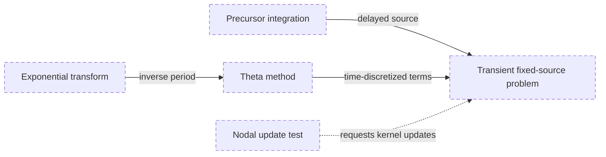

| Node | Meaning | Terms | Status |
| --- | --- | --- | --- |
| `ThetaMethod` | Time differencing of the flux equation that weights the two ends of a step by theta; one half for second order, one on steps with a discontinuity. | theta method, time step | planned |
| `ExponentialTransform` | Factoring out an exponential with the current inverse period so that the theta method differences only the slowly varying part. | exponential transform, inverse period | planned |
| `PrecursorIntegration` | Exact integration of the eight precursor groups over a step with the fission source quadratic in time. | delayed-neutron precursor | planned |
| `TransientFixedSource` | The coarse-mesh problem a time step reduces to, with the transient terms in the removal and the source. | transient fixed-source problem, CMFD | planned |
| `NodalUpdateTest` | The test that decides when the coupling corrections must be recomputed inside a step. | coupling correction, nodal update | planned |

### L2 · Core thermal-hydraulics (`CoreThermalHydraulics`)
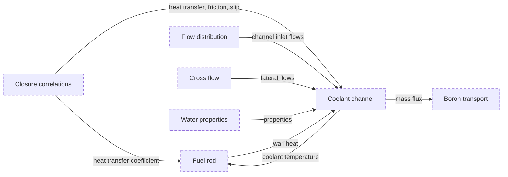

| Node | Meaning | Terms | Status |
| --- | --- | --- | --- |
| `FuelRod` | Radial heat conduction through fuel, gap and cladding of the average pin of a node, steady and transient, giving the Doppler temperature. | fuel rod, gap conductance, Doppler temperature | planned |
| `CoolantChannel` | One flow channel per assembly solving mass, energy and momentum on the neutronic axial mesh, with the drift-flux model for two-phase states. | coolant channel, drift-flux model, enthalpy | planned |
| `FlowDistribution` | Division of the core flow among the channels so that every channel has the same pressure drop. | flow distribution, pressure drop | planned |
| `CrossFlow` | Optional lateral flow between neighbouring assemblies. | cross flow | planned |
| `WaterProperties` | Water and steam properties from IAPWS-IF97. | IAPWS-IF97 | planned |
| `Closures` | The empirical relations the balances need: wall heat transfer, friction and form losses, drift-flux parameters and the departure-from-nucleate-boiling monitor. | closure correlation | planned |
| `BoronTransport` | Boron carried with the coolant through the channels, so that a change of inlet boron reaches each node after its transit time. | boron transport, boron | planned |

#### L3 · Closure correlations (`Closures`)
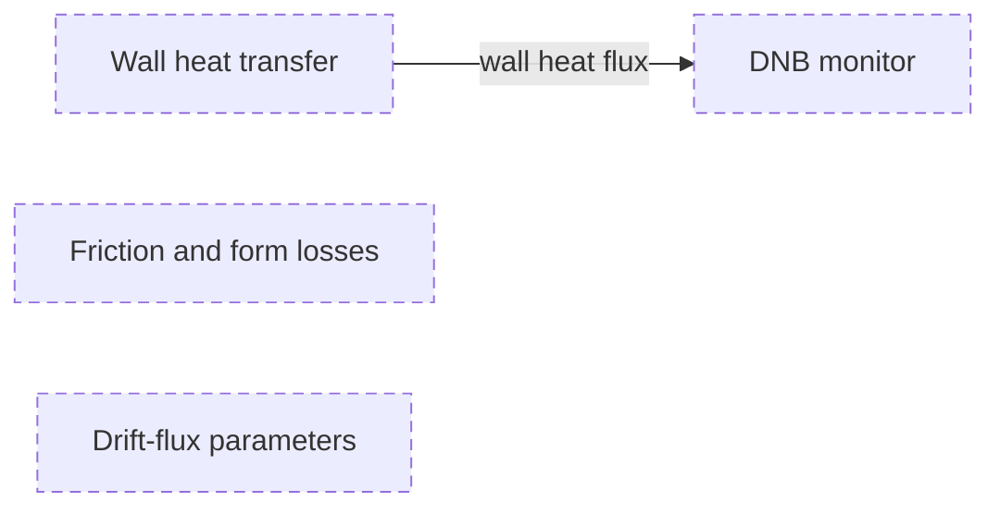

| Node | Meaning | Terms | Status |
| --- | --- | --- | --- |
| `WallHeatTransfer` | The heat transfer coefficient between cladding and coolant in single-phase and subcooled boiling flow. | heat transfer coefficient | planned |
| `WallFriction` | Wall friction and the form losses of grids and nozzles. | pressure drop, form loss | planned |
| `DriftFluxParameters` | The distribution parameter and drift velocity of the drift-flux model; no slip until a correlation valid at PWR pressure is chosen. | drift-flux model | planned |
| `DnbMonitor` | The ratio of critical to actual heat flux, reported as a margin; it does not change the solution. | DNB ratio | planned |

### L2 · Primary loop (`PrimaryLoop`)
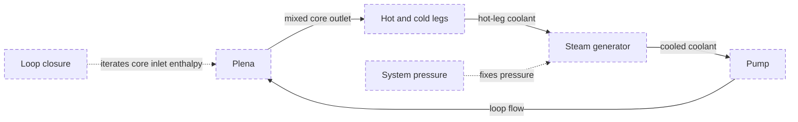

| Node | Meaning | Terms | Status |
| --- | --- | --- | --- |
| `Plena` | Lower and upper plenum: mixing volumes between the loop and the core channels. | plenum | planned |
| `LoopLegs` | Hot and cold legs: pipes that carry energy and boron with a transport delay. | hot leg, cold leg, transport delay | planned |
| `SteamGenerator` | Primary side of the steam generator: tube cells that remove the imposed heat load, shared by conductance against a solved secondary temperature. | steam generator, heat load, secondary temperature | planned |
| `Pump` | The reactor coolant pump: head and torque from a two-branch homologous curve, and the loop flow that results. | pump, homologous curve, pump speed | planned |
| `LoopClosure` | Making the loop and the core agree inside each coupled pass: the core inlet enthalpy is iterated until the loop returns the same value. | loop closure, enthalpy | planned |
| `SystemPressure` | The primary pressure, imposed rather than modelled with a pressurizer. | system pressure | planned |

### L2 · Coupled solution (`Coupling`)
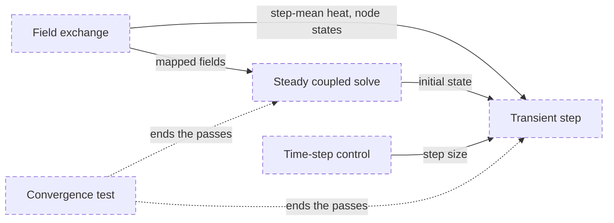

| Node | Meaning | Terms | Status |
| --- | --- | --- | --- |
| `FieldExchange` | What the solvers hand each other: node power and the step-mean heat to the fuel and channels; Doppler temperature, moderator density and boron to the cross sections. | field exchange, node power, step-mean heat | planned |
| `SteadyCoupledSolve` | Outer iteration to the coupled steady state, with the critical boron search when requested. | Picard iteration, critical boron | planned |
| `TransientStep` | One time step with neutronics, fuel, channels and loop iterated to convergence, then committed. | time step, Picard iteration | planned |
| `TimeStepControl` | The size of each step: the schedule's discontinuities, limits from the input, and optional halving when a step's error estimate is too large. | time-step control, time step | planned |
| `ConvergenceTest` | The criteria that end a coupled iteration: changes of node power, Doppler temperature and moderator density, and the neutronic residual, each below its tolerance. | convergence state, tolerance | planned |

#### L3 rule · Transient step (`TransientStep`)
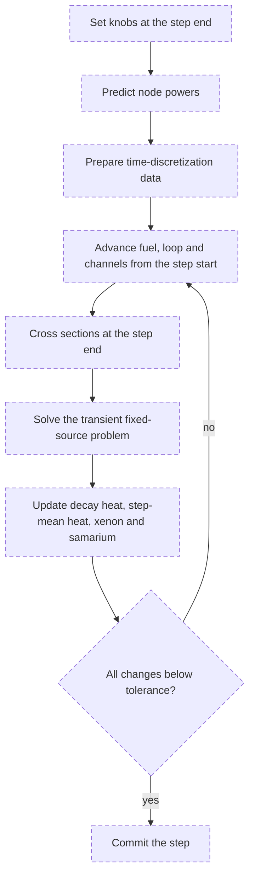

| Node | Meaning | Terms | Status |
| --- | --- | --- | --- |
| `TsSetKnobs` | Rod positions, boron, pump speed or flow, heat load and pressure are set to their values at the end of the step. | knob, time step | planned |
| `TsPredict` | Node powers at the step end are first estimated by extrapolating the last two steps. | node power | planned |
| `TsTimeData` | Inverse periods, precursor weights and transient source terms are prepared for the step. | exponential transform, delayed-neutron precursor | planned |
| `TsAdvanceThermal` | Every pass restarts fuel rods, loop and channels from the state at the step start and advances them with the current step-mean heat. | step-mean heat, Picard iteration | planned |
| `TsCrossSections` | Node cross sections are rebuilt from the new thermal state and poison densities; the nodal update test runs. | cross section, nodal update | planned |
| `TsSolveNeutronics` | The transient fixed-source problem is solved, with kernel updates when requested. | transient fixed-source problem | planned |
| `TsUpdate` | Decay heat, node powers, the step-mean heat and the xenon and samarium densities are recomputed from the new flux, without being committed. | decay heat, step-mean heat, xenon | planned |
| `TsConverged` | Asks whether node power, Doppler temperature, moderator density and the residual all changed less than their tolerances. | convergence state, tolerance | planned |
| `TsCommit` | Precursors, decay-heat groups, stored sources and poison densities become the state at the step end. | delayed-neutron precursor, decay-heat group | planned |

### L2 · Results (`Results`)
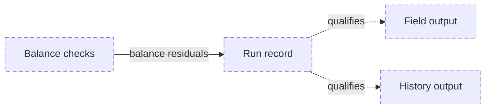

| Node | Meaning | Terms | Status |
| --- | --- | --- | --- |
| `FieldOutput` | Node and pin fields at the requested times: fluxes, powers, temperatures, densities, flows and boron. | solution field | planned |
| `HistoryOutput` | Quantities over time: power, reactivity by cause, temperatures, flows, knob values. | time history, reactivity | planned |
| `RunRecord` | The record that makes a result a valid one: convergence state of every solve, table clamp counts, the methods used, and the input. A run whose converged state is clamped is not valid. | run record, convergence state, table clamp | planned |
| `BalanceChecks` | Neutron, energy and mass balances evaluated and reported, including the energy of the loop and the steam generator. | balance check | planned |

### L2 · Development tooling (`Tooling`)
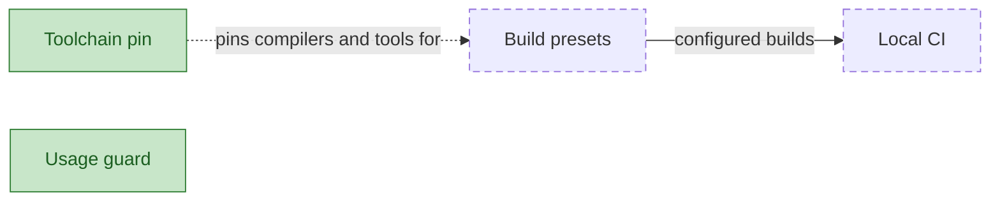

| Node | Meaning | Terms | Status |
| --- | --- | --- | --- |
| `ToolchainPin` | The recorded versions of every compiler and tool the project relies on, and the check that the machine still has them. | toolchain pin | implemented |
| `UsageGuard` | The check agents run at batch boundaries that reads the cached usage of the model provider and says whether to continue, wait or stop. | usage guard | implemented |
| `BuildPresets` | Named build configurations: compilers, warnings as errors, sanitizers, release and debug. | build preset, sanitizer | planned |
| `LocalCi` | One local script that builds the presets, runs the tests, formatters, linters and the concept-map check, and reports pass or fail. | local CI | planned |
