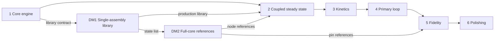

# Project Plan

The overall plan: the milestones from an empty engine to the student-ready simulator, what
each one delivers, and what has to be in hand before it can close. Written 2026-11-17 from
[the vision](VISION.md) and [the theory manual](THEORY_MANUAL.md) ("TM §n"). The vision wins
over the theory manual, and both win over this plan. Terms are defined in
[DEFINITIONS](DBC/DEFINITIONS.md); concept nodes are those of [CONCEPTS](DBC/CONCEPTS.md).

Each milestone gets a folder `Planning/MILESTONE_<n>/` when it starts, holding its plan
`MILESTONE_<n>_PLAN.md` and any other document of that milestone. That plan splits it into
sub-milestones (one per session), freezes the contracts, and sets every tolerance with its
justification. This plan says what and in which order; it does not set tolerances. It
changes only by the Captain's decision, recorded in §7.

## 1. Shape

Six engine milestones carry the numbers of the six stages of `VISION.md` §7, so that "stage n"
in TM §21 and §22 and "milestone n" mean the same thing. Two data milestones, DM1 and DM2,
produce the nodal data and the reference solutions with OpenMC. They run beside the engine
milestones; each one gates the engine milestone that first needs its output.

| Milestone | The Captain can then | Concept nodes it builds |
|---|---|---|
| 1 Core engine | Run any Cartesian core from HDF5 input to a steady-state eigenvalue and node fluxes, verified against analytic and published benchmarks | `ProblemInput`, `LibraryContract`, `CrossSectionModel`, `CmfdSolve`, `NodalKernels`, `EigenvalueSolve`, adjoint part of `AdjointEdits`, `FieldOutput`, `RunRecord`, `BuildPresets`, `LocalCi` |
| DM1 Single-assembly library | Hand the engine a BEAVRS library made the way PARCS and SIMULATE-5 libraries are made, with every quantity the later milestones read | `LatticeGeneration`, `ReflectorData`, `BranchGrid` (extended) |
| DM2 Full-core references | Compare nodal node and pin powers with Monte Carlo solutions free of measurement uncertainty | `FullCoreReference` (extended) |
| 2 Coupled steady state | Compute BEAVRS at hot zero power and hot full power with feedback, critical boron, equilibrium xenon and rods, and compare with the plant | `CoreThermalHydraulics` (single phase), `SteadyCoupledSolve`, `FieldExchange`, `ConvergenceTest`, `CriticalBoron`, `RodBanks`, `RoddedMixing`, equilibrium part of `XenonSamarium` |
| 3 Kinetics | Run transients driven by rods and boron with the core inlet held fixed, including scram, decay heat and xenon over days | `Kinetics`, `DecayHeat`, `AdjointEdits`, `XenonSamarium`, `TransientStep`, `TimeStepControl`, `KnobSchedule`, `HistoryOutput` |
| 4 Primary loop | Use all four knobs as a student will: flow and heat load act through the loop, boron is injected and transported | `PrimaryLoop`, `BoronTransport`, `FlowKnob`, `HeatLoadKnob`, `BoronKnob` |
| 5 Fidelity | Trust partial rod insertions, pin powers and detector signals, and see boiling, cross flow and DNB margin | `CuspingCorrection`, `DiscontinuityFactors` with data, `PinPower`, `CrossFlow`, `DriftFluxParameters`, `DnbMonitor` |
| 6 Polishing | Give students a Python package, documentation and worked scenarios | New concepts for the package, added when its contract freezes |

## 2. What closes a milestone

The gate of every milestone, engine or data, on one verified snapshot (`.omp/AGENTS.md`,
Review and Deliver):

1. Every affected build preset builds; the local CI passes, including the concept-map check.
2. Every benchmark family the milestone names in §3 or §4 has been run as a test or a
   recorded run, with its reference, its tolerance justified in the milestone plan, and the
   convergence state of TM §18.4 attached. A benchmark whose reference cannot be obtained is
   reported as not run; it is never counted as passed.
3. Every new capability is also run on at least one core that is not BEAVRS (different size,
   layout and axial zoning), so that nothing about BEAVRS is built in (`VISION.md` §5).
4. Reviewers approve the final snapshot.
5. The concept nodes it built are `implemented`, the DBC files are current, and
   `CURRENT_PROJECT_STATE.md` records the gate results.

Two standing rules: no validation claim rests on the present library (TM §19.3, its
statistics support code exercise only), and no OpenMC run starts before the Captain approves
the run list of DM1 or DM2.

## 3. Engine milestones

Inside each milestone the order is the order in which a later item can be tested against an
earlier one (TM §22).

### Milestone 1 · Core engine: steady-state nodal neutronics

**Outcome.** The engine reads a problem input and a nodal library, solves the steady-state
two-group eigenvalue problem with CMFD and the ANM/NEM hybrid, and writes the node fluxes,
powers and the run record. BEAVRS runs end to end on the present library, as an exercise of
the code path only.

**Scope.**
1. Foundations: `CODING_STANDARDS.md`, `CURRENT_PROJECT_STATE.md`, build presets (GCC and
   Clang, warnings as errors, address and undefined-behaviour sanitizers, thread sanitizer,
   release), the local CI script, and the C++ standard (§6, P6).
2. Input and output: problem input layout and input validation (rejects any group structure
   other than two and eight); the library contract, including units, statistical
   uncertainties and validity flags (TM §19.3 items L12–L14); the submodule's library writer
   re-extracts the present library from its 72 statepoints and writes it under the contract,
   with the empty corner tallies flagged invalid, replacing the present file; field output
   and run record.
3. Cross-section model: multilinear interpolation with clamp counting (TM §7.1–§7.5).
4. CMFD with zero coupling corrections: assembly and boundary conditions, outer iteration
   with Wielandt shift, linear solver, normalization (TM §3.3, §4).
5. Nodal kernels: transverse leakage, NEM, ANM, kernel switch, interface solve with
   discontinuity factors (one by default), nonlinear iteration and its safeguards (TM §5,
   §6.1–§6.2).
6. Adjoint flux (TM §9.1).

**Closes on.** Bare homogeneous slab and cuboid; one-dimensional fuel and reflector slab;
two-region slab with discontinuity factors; cross-section table interpolation; IAEA two- and
three-dimensional PWR benchmarks; forward and adjoint eigenvalues equal (adjoint and
reactivity edits). A converged BEAVRS run on the present library.

**Prerequisites.** §5.1.

### Milestone 2 · Coupled steady state

**Outcome.** BEAVRS at hot zero power and hot full power with fuel and coolant feedback,
critical boron, equilibrium xenon and samarium, and rod banks, on the DM1 library. Core inlet
temperature, flow and pressure are imposed, as in PARCS and SIMULATE-5. First comparison with
the plant and with the published PARCS results.

**Scope.**
1. Water properties, IAPWS-IF97 (TM §16.1).
2. Coolant channels, single phase, steady, with flow distribution; wall heat transfer and
   pressure drop, single phase (TM §15.1–§15.4, §15.6, §15.8, §16.2–§16.3).
3. Fuel rod, steady, with gap conductance, material properties and Doppler temperature
   (TM §14.1–§14.4, §14.6–§14.8).
4. Field exchange and the steady coupled solve with its convergence test (TM §18.1–§18.2).
5. Rod banks and volume- and flux-weighted rodded mixing (TM §8.1–§8.2). Partial insertion
   carries the rod cusping error until milestone 5, and results say so.
6. Critical boron search (TM §6.3).
7. Equilibrium xenon and samarium (TM §10.1–§10.2, §10.4).

**Closes on.** Water properties; fuel rod conduction (steady part); coolant channels;
critical boron search (verification, and BEAVRS hot zero power, 975 ppm with bank D at step
213, BEAVRS Table 21); xenon and samarium (equilibrium); coupled steady state (verification,
and BEAVRS hot zero power and hot full power with the power defect, NUREG §3.3); full-core
OpenMC reference at library states (node powers and eigenvalue against DM2). Fully inserted
bank worths against BEAVRS §3.2 and NUREG §3.3.1.

**Prerequisites.** §5.4. Also DM1 closed before scope item 6 (boron axis, xenon data,
reflectors, rodded compositions) and the DM2 node references before close.

### Milestone 3 · Kinetics

**Outcome.** Transients driven by rod and boron schedules with fuel and coolant feedback,
the core inlet held at its imposed state: rod withdrawal and ejection, scram with decay heat,
xenon and samarium over hours and days. Every step converged (D1); the PARCS sequence
available for code-to-code comparison. Reactivity split by cause.

**Scope.**
1. Knob schedules for rods and uniform boron; time-step control with schedule breakpoints
   (TM §18.5).
2. Precursor integration, theta method, exponential transform, transient fixed-source
   problem, nodal update test (TM §11).
3. Fuel rod and channel transients (TM §14.5, §15.5).
4. Decay heat (TM §12, D4) and xenon and samarium over a step (TM §10.3, D3).
5. The transient step and the null transient (TM §18.3, §18.6).
6. Dynamic reactivity and point-kinetics parameters (TM §9.2–§9.3); history output.

**Closes on.** Null transient; precursor integration weights; infinite-medium kinetics
ramps; point-kinetics equivalence; decay heat; xenon and samarium (transient part, shutdown
peak); LMW and NEACRP transient benchmarks; coupled transients (step refinement, energy
balance, PARCS sequence against the converged iteration).

**Prerequisites.** §5.5. Both kinetics benchmarks use six delayed groups; they enter as
eight-group data with two groups of zero abundance (P7).

### Milestone 4 · Primary loop

**Outcome.** The closed loop sets the core inlet temperature, flow and boron, so all four
knobs act where they act in a plant: load change through the heat load, pump speed changes
and coastdown, boron injection with its transport delay, rod moves with loop feedback.
Nothing in PARCS or SIMULATE-5 to compare with; the evidence is balances, refinement and
limiting cases.

**Scope.**
1. Plena, hot and cold legs with transport delay, steam generator primary side with the
   conductance-weighted heat load (O14), imposed system pressure (O4) (TM §17.1–§17.5).
2. Loop steady state and its initialization from the core (TM §17.6).
3. Loop time integration and loop closure inside each coupled pass (TM §17.8).
4. Flow knob: imposed flow first, then pump speed with the homologous curves (O3).
5. Boron knob: uniform first, then injection with transport in channels and loop (O6;
   TM §15.7, §17.7).
6. Heat load knob.

**Closes on.** Primary loop checks (TM §17.9, including natural circulation); null transient
with the loop; coupled transients with the loop (step refinement, energy, mass and boron
balances). One scenario per knob with the response's sign and time constant checked against
a hand estimate stated in the milestone plan.

**Prerequisites.** §5.6.

### Milestone 5 · Fidelity

**Outcome.** Partial rod insertion without cusping, pin powers and detector signals
reconstructed and compared with Monte Carlo and the plant, subcooled boiling, cross flow, and
the DNB margin reported.

**Scope.**
1. Cusping correction: fine-mesh three-node problem first; the kernel form only after its
   two tests (D5; TM §8.3).
2. Discontinuity factors with data, assessed against the DM2 references (TM §5.9).
3. Pin power reconstruction and detector response (TM §13).
4. Two-phase channels: subcooled boiling and drift flux, after the Captain chooses the
   correlations (O13; TM §15.3, §16.4).
5. Cross flow (TM §15.9) and the DNB monitor (TM §16.5).
6. The scan that fixes the default kernel switch threshold on IAEA 3D and BEAVRS (O8).

**Closes on.** Rod cusping (smoothness and split-node match; integral bank worths against
BEAVRS §3.2 and NUREG §3.3.1); pin power reconstruction (analytic mode, DM2 pin references,
BEAVRS hot zero power flux maps, BEAVRS §3.1–§3.3); full-core OpenMC reference rerun with
discontinuity factors; coupled steady state rerun with the two-phase model.

**Prerequisites.** §5.7. Also DM1 items L1, L6, L10 and the DM2 pin references.

### Milestone 6 · Polishing

**Outcome.** Students use the simulator through a Python package that writes the problem
input, runs the engine and reads the output, depending only on the HDF5 contract; the engine
does not change for it (`VISION.md` §1). User documentation of the input and output contract
and of the knobs. Worked scenarios: one per knob, and combined ones.

**Closes on.** Package round trip against the engine on every scenario; every scenario
converges and carries its run record; documentation reviewed against the contract.

**Prerequisites.** §5.8.

## 4. Data milestones

### DM1 · Single-assembly library (O1)

**Outcome.** A BEAVRS nodal library from single-assembly OpenMC lattice calculations, one per
assembly type and branch state, plus fuel-and-reflector models for the reflectors, written
under the library contract. Work happens in `external/BEAVRS_minimal` through its own
commits, then a pointer update here.

**Scope.**
1. The milestone plan, approved before any OpenMC run except the sizing campaign: the assembly
   types (nine in BEAVRS cycle 1, NUREG Table 2-3); the tensor grid with a boron axis and
   separate moderator temperature and density (L4, L5), sized so that D2 needs no fallback;
   rodded data per composition and absorber type (L6); statistics target; run count and
   compute estimate. The sizing campaign supplies the last four: lattice calculations at the
   nominal state, along one-dimensional scans of each branch-state axis and on two-dimensional
   patches, for each unrodded assembly type and with each absorber; it produces no library data.
   The decisions deferred to it are made here: Doppler weight (O9), direct heating fraction
   (O10); it also plans the tally of effective delayed fractions (O5, decided 2026-11-19).
2. Generator changes producing L1–L3, L6–L8, L10, L12–L14 of TM §19.3. The decay-heat fits
   (L8) are input data from a decay-heat standard, not OpenMC tallies (TM §12.3).
3. A pilot: one assembly type at one branch state through the whole chain.
4. The production runs; then the reflector models (L11).

**Closes on.** The library passes the engine's input validation; at every branch state the
infinite-medium eigenvalue from the library's data reproduces the lattice calculation's
eigenvalue within its tally uncertainty; every entry carries its uncertainty and validity
flag.

**Timing.** Starts when milestone 1 freezes the library contract; closes before milestone 2
reaches critical boron and xenon. The OpenMC runs can proceed while milestone 1 work
continues.

**Prerequisites.** §5.2.

### DM2 · Full-core references

**Outcome.** Full-core OpenMC solutions of BEAVRS at a few library states (uniform fuel
and moderator temperature, since OpenMC has no feedback here), with node and pin fission-rate
tallies and their uncertainties, in a reference file the verification tests read.

**Scope.** State list chosen with DM1 (at least hot zero power all rods out and one rodded
state); statistics target; runs; the reference file.

**Closes on.** Tally standard deviations meet the target; the octant-symmetry spread of the
node powers agrees with the reported standard deviations.

**Timing.** Node references before milestone 2 closes; pin references before milestone 5
closes. One campaign serves both.

**Prerequisites.** §5.3.

## 5. Prerequisites by milestone

What the Captain does so that a milestone can proceed, sorted into four categories and
placed at the step that first needs it, so that she meets each one only when it is due.

| Category | What the Captain does |
|---|---|
| Decide | Chooses between options the agents present with a recommendation. |
| Obtain | Gets a document that is not in `Resources/` (download, library, purchase) and puts it there, or approves a source the agents found. Nothing marked "not in Resources" in TM is coded from memory. |
| Run | Approves an OpenMC run list with its compute estimate and gives it machine time. |
| Approve data | Checks a data set the agents assembled from obtained documents, with every value's source, before it enters an input file. |

The **When** column names the point by which the item must be done: **Start** (before the
milestone plan freezes), **Scope n** (before the sub-milestone that builds scope item n of
§3 or §4), or **Close** (before the gate).

**How the agents present them.** Approving each milestone plan is the standing first step
and is not repeated in the tables.

1. When a milestone starts, the orchestrator presents only that milestone's **Start**
   items, in the order Decide, Obtain, Run, Approve data. Decisions come as a form with the
   options, their consequences and the recommendation preselected; documents with a
   suggested source and what they are used for; runs with the run list, compute estimate
   and what each run feeds; data sets with the value table and its sources.
2. **Scope n** items are presented when the sub-milestone that needs them is planned, and
   **Close** items when the gate comes into view; never earlier, unless the Captain asks.
3. Work that a missing item does not block goes on. Work it blocks stops and is reported
   with the item; it is never worked around with a guessed value or a placeholder.
4. A decision is recorded with its date where its question lives: P items in §6, O items
   in TM §21. Each item's state (open, done, waived by the Captain) is recorded in
   `CURRENT_PROJECT_STATE.md`.

### 5.1 Milestone 1

| Category | Item | When |
|---|---|---|
| Decide | P6: the C++ standard | Start (decided 2026-11-17) |
| Decide | P1: data work as separate data milestones | Start (decided 2026-11-17) |
| Obtain | GoogleTest installed (`gtest-devel`), the test framework chosen 2026-11-17 | Scope 1 |
| Obtain | IAEA 2D and 3D PWR specifications, reference eigenvalues and assembly powers | Scope 5 |

### 5.2 DM1

| Category | Item | When |
|---|---|---|
| Decide | P2: reflector data, discontinuity factors, form functions and rodded data generated now | Start |
| Decide | O5: effective or physical delayed-neutron fractions in the library | Start |
| Obtain | The decay-heat curve and its group fits (PARCS §9.5 Reference [24], or a decay-heat standard) | Scope 2 |
| Approve data | The decay-heat group constants (L8) | Scope 2 |
| Run | Machine time for the sizing campaign | Scope 1 |
| Run | The run list: assembly types, branch grid, statistics target, the tallies for O9 and O10, compute estimate | Scope 3 |
| Run | Machine time for the pilot | Scope 3 |
| Run | Machine time for the production runs and the reflector models | Scope 4 |
| Obtain | A Zenodo record of the DM1 statepoints and the 72 present statepoints, its DOI recorded | Close |

### 5.3 DM2

| Category | Item | When |
|---|---|---|
| Run | The run list: states, statistics target, node and pin tallies, compute estimate | Start |
| Run | Machine time for the runs | Start |

### 5.4 Milestone 2

| Category | Item | When |
|---|---|---|
| Decide | P3: grid and nozzle loss coefficients now, not before milestone 4 | Start |
| Decide | P4: rod banks and rodded mixing in this milestone | Start |
| Decide | P5: validation limited to beginning of cycle; the edit of `VISION.md` §6 and §8 | Start |
| Decide | P8: recording the run time at every gate | Start |
| Obtain | The IAPWS-IF97 release with its verification tables | Scope 1 |
| Obtain | A source for spacer grid and nozzle loss coefficients | Scope 2 |
| Approve data | The grid and nozzle loss coefficients (core part of O12) | Scope 2 |
| Obtain | The MATPRO Zircaloy conductivity, to verify the coefficient of O11 | Scope 3 |

### 5.5 Milestone 3

| Category | Item | When |
|---|---|---|
| Decide | P7: six-group benchmarks as eight-group data with two zero-abundance groups | Start |
| Obtain | LMW and NEACRP rod-ejection specifications and reference solutions | Close |
| Obtain | Published PARCS or SIMULATE transient results for BEAVRS, if any exist | Close, optional |

### 5.6 Milestone 4

| Category | Item | When |
|---|---|---|
| Obtain | Sources for a generic four-loop PWR: loop volumes and lengths, steam generator, pump rated values and homologous curves | Start |
| Approve data | The generic four-loop data set (loop part of O12) | Scope 1 |

### 5.7 Milestone 5

| Category | Item | When |
|---|---|---|
| Decide | O13: the critical heat flux correlation and the drift-flux correlation valid at PWR pressure | Scope 4 |
| Obtain | The documents of the chosen correlations | Scope 4 |
| Obtain | Published PARCS or SIMULATE steady-state results for BEAVRS beyond NUREG/IA-0529, if any exist | Close, optional |

The BEAVRS measured detector signals are already on this machine, in the `measurements/`
directory of the BEAVRS repository (`.omp/LOCAL_ENVIRONMENT.md`); nothing to obtain.

### 5.8 Milestone 6

| Category | Item | When |
|---|---|---|
| Decide | P8: the run-time target | Start |
| Decide | The worked scenarios, the audience and form of the user documentation, the supported Python versions and how the package is distributed | Start |

## 6. Decisions this plan asks for

Each is **Open** until the Captain decides; the recommendation stands meanwhile. §5 says when
each one is due.

| ID | Question | Recommendation |
|---|---|---|
| P1 | Data work as separate data milestones DM1 and DM2, beside the engine milestones | Yes: OpenMC campaigns take compute time and Captain approval, not engine sessions; separating them lets both proceed. **Decided 2026-11-17: yes.** |
| P2 | Reflector data, discontinuity factors, form functions and rodded data per composition (L1, L6, L10, L11) generated in DM1, before milestone 2, not just before milestone 5 as TM §22 allows | Yes: a lattice library without reflectors cannot run BEAVRS at all, and one lattice run produces all of them at no extra cost. The engine uses the factors from milestone 2 on, as PARCS does; milestone 5 assesses them. **Decided 2026-11-19: yes.** |
| P3 | Grid and nozzle loss coefficients before milestone 2, not before stage 4 as O12 says | Yes: the steady channels need them. Only the loop part of O12 waits for milestone 4 |
| P4 | Rod banks and rodded mixing (TM §8.1–§8.2), which TM §22 does not place | Milestone 2: the hot zero power comparison is at bank D, step 213 |
| P5 | `VISION.md` §6 lists the cycle 1 boron letdown, which needs depletion, out of scope (TM §0.1) | Narrow validation to beginning-of-cycle measurements: hot zero power physics tests, hot full power boron, beginning-of-cycle flux maps. Edit `VISION.md` §6, and §8, whose open questions TM §0.1 has answered |
| P6 | C++ standard (`VISION.md` §8 proposes C++20; the toolchain also supports C++23) | C++20, fixed in the coding standards at the start of milestone 1. **Decided 2026-11-17: C++23** (`std::expected`, `std::mdspan`, `std::print`; students need GCC ≥ 14 or Clang ≥ 18). |
| P7 | Six-group kinetics benchmarks (LMW, NEACRP) as eight-group data with two zero-abundance groups | Yes: the structure stays fixed at eight; input validation accepts a zero abundance |
| P8 | A run-time target for student use; the vision states none | Record the run time of the BEAVRS hot full power steady state and of one reference transient at every milestone gate from milestone 2 on; the Captain sets the target before milestone 6 |

## 7. Changes

| Date | Change |
|---|---|
| 2026-11-17 | First version. |
| 2026-11-17 | §5 rewritten as prerequisites by milestone in four categories, presented to the Captain when due; the "Needs" lines of §3 and §4 point to it. |
| 2026-11-17 | P1 and P6 decided. Milestone 1 scope item 2: the converter is replaced by re-extraction from the statepoints in the submodule's library writer, whose contract file replaces the present library file; GoogleTest is the test framework (§5.1). Milestone plan: `MILESTONE_1_PLAN.md`. |
| 2026-11-18 | §5.2: DM1 closes with a Zenodo record of its statepoints and the present ones; the Captain accepted the risk of keeping the present statepoints without a backup during milestone 1. |
| 2026-11-19 | DM1 start decisions: P2 yes (reflector data, discontinuity factors, form functions and rodded data generated in DM1); O5 (a), effective (adjoint-weighted) delayed fractions tallied into the library (TM §21). |
| 2026-11-20 | The Captain's decision: each milestone's documents live in its own folder, `Planning/MILESTONE_<n>/`; the milestone 1 plan moved to `Planning/MILESTONE_1/MILESTONE_1_PLAN.md`. |
| 2026-11-20 | The Captain's decision: the problem input becomes four input documents, one responsibility each (reactor, initial state, control signals, settings), stored in one file or as separate files linked from it; Vision §1 amended. Milestone 1 gains sub-milestone 1.3a before 1.4 (milestone 1 plan §9). |
| 2026-11-20 | The Captain's decision: DM1 starts with a sizing campaign before its plan is approved (scope 1, §5.2), on the university server galactica, 2026-11-20 to 2026-11-23 10:00. Photon transport is left out of it: with the JEFF-4.0 library in use, the photon heating tally gives 0.06 % of the neutron heating, so it cannot give the direct heating fraction (O10); the DM1 plan must find another way. |
