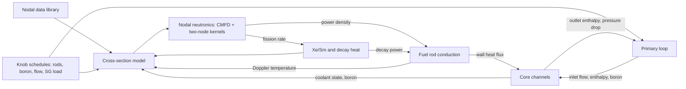
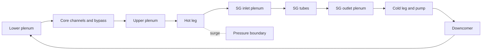

# Theory Manual

Coupled 3D nodal neutronics and thermal-hydraulics simulator with a primary loop.

This manual states every equation the engine solves, where it comes from, and how it is
discretized. It is the specification the milestones turn into code: a worker implementing a
section should need this manual, the cited reference pages and the coding standards, nothing
else. `Planning/VISION.md` wins where the two disagree.

## 0. How to read this manual

### 0.1 Scope fixed by the Captain

- **Two neutron energy groups** (g = 1 fast, g = 2 thermal) and **eight delayed-neutron
  precursor groups** (k = 1…8). All equations are written for exactly this structure.
  (Captain's directive of 2026-11-16. `VISION.md` §2.1 and §5 still say the group counts are
  not hard-coded; that sentence needs her edit or confirmation, see §21.)
- 3D Cartesian node mesh, PWR, BEAVRS as the development reactor, nothing about BEAVRS in
  the equations.
- Out of scope here, as in `VISION.md` §8: depletion, hexagonal geometry, SP3.

### 0.2 Provenance tags

Every method carries one tag:

| Tag | Meaning |
|---|---|
| **[PARCS]** | The method of the PARCS theory manual, restated in this manual's notation. |
| **[S5]** | The method named in the SIMULATE-5 paper. The paper names models but prints almost no equations, so the equations come from the cited textbook or are derived here. |
| **[OURS]** | Needed here and present in neither reference (primary loop, HDF5 contract, our data path). |
| **[DEPARTURE Dn]** | Differs from what PARCS or SIMULATE-5 does. Has a rationale in §20 and needs the Captain's approval before it is coded. |
| **[OPEN On]** | A decision the Captain has to make; listed in §21. |

### 0.3 Citations

| Short form | Document in `Resources/` |
|---|---|
| PARCS | `PARCS_theory_manual.pdf` (Downar, Xu, Seker; PARCS v3.0 theory manual, 2010) |
| S5 | `Studsvik_next-generation_nodal_code_SIMULATE-5.pdf` (Bahadir, Lindahl, ANFM 2009) |
| Dem | `Demaziere_modelling_of_nuclear_reactor_multiphysics.pdf` (Demazière, 2020) |
| Kolev | `Kolev_nuclear_thermal_hydraulics.pdf` (Kolev, Multiphase Flow Dynamics 5) |
| Grossman | `Grossman_nodal_diffusion-methods_for_space-time_neutron_kinetics.pdf` |
| Kobayashi | `Kobayashi_rigorous_derivation_of_nodal_equations.pdf` |
| Oka | `Oka_nuclear_reactor_kinetics_and_plant_control.pdf` |
| Marguet | `Marguet_physics_of_nuclear_reactors.pdf` |
| Spriggs | `Spriggs_Campbell_8-group_delayed_neutron_model.pdf` |
| BEAVRS | `BEAVRS_2.0.2_spec.pdf` |
| NUREG | `BEAVRS simulation with SCALE and PARCS.pdf` (NUREG/IA-0529) |

A citation gives document, section and equation, for example "PARCS §4.1.1, Eq. (4.45)".
Material quoted from memory of a document that is **not** in `Resources/` is marked
**(not in Resources; verify before coding)**. Nothing so marked may be coded from this manual
alone.

### 0.4 Equation labels and evidence

Equations are labelled (section.number) and the labels are stable: later edits add labels,
they never renumber. The central algorithms were checked numerically while this manual was
written; §19.1 records the cases, references, tolerances and convergence states. Appendix C
lists the places where the PARCS manual's printed equations disagree with their own
derivation; this manual follows the derivation.

### 0.5 Units

SI inside the thermal-hydraulics (m, kg, s, K, Pa, J, W). The neutronics keeps the reactor
physics convention: lengths in cm, macroscopic cross sections in cm⁻¹, flux in cm⁻² s⁻¹,
number densities in cm⁻³, power density in W cm⁻³. The nodal library stores energy per fission
in eV (OpenMC `kappa-fission`); it is converted once, on input, with
1 eV = 1.602176634×10⁻¹⁹ J. Boron concentration is in ppm by mass of natural boron in the
coolant. Temperatures are in kelvin everywhere, including inside correlations that were
published in other units (the conversion is part of the correlation's implementation).

## 1. System overview

| Block | Solves | Sections |
|---|---|---|
| Cross-section model | Node cross sections from the library and the local state | §7, §8 |
| Nodal neutronics | Two-group diffusion: eigenvalue and transient fixed-source problems | §3–§6, §11 |
| Xe/Sm and decay heat | Fission-product chains, decay-heat precursors | §10, §12 |
| Fuel rod conduction | Radial temperature field of the average rod of each node | §14 |
| Core channels | Coolant mass, energy, momentum and boron in each channel | §15, §16 |
| Primary loop | Plena, legs, steam generator primary side, pump | §17 |
| Coupling | The iteration that makes all of the above consistent | §18 |

The neutronics follows PARCS almost equation for equation, because PARCS documents its
equations and SIMULATE-5 does not. Where the two codes differ in kind, §20 says which one this
manual follows and why:

| Topic | PARCS | SIMULATE-5 | Here |
|---|---|---|---|
| Global solve | CMFD, nonlinear iteration | (not stated in S5) | CMFD, nonlinear iteration |
| Two-node kernel | ANM with NEM for near-critical nodes | ANM | ANM/NEM hybrid |
| Transverse leakage | Quadratic fit over three nodes | Shape from 2D submesh solution | Quadratic fit |
| Axial heterogeneity | Rod-cusping three-node problem | Axially homogeneous subnodes, 1D solve | Three-node problem |
| Cross sections | Macroscopic, branch derivatives | Hybrid micro/macro, ~50 nuclides | Macroscopic branch table, Xe/Sm microscopic |
| Kinetics | Theta method, exponential transform, analytic precursors | (not in S5) | As PARCS |
| Core thermal-hydraulics | Not in the theory manual | Four-equation drift-flux channels, COBRA-IIIC cross flow | As SIMULATE-5 |
| Water properties | — | NIST/ASME | IAPWS-IF97 (`VISION.md` §2.2) |
| Primary loop | Boundary condition | Boundary condition (PWR) | Modelled |

## 2. Notation

Indices: `m` node; `g` energy group (1 fast, 2 thermal); `k` delayed group (1…8);
`u ∈ {x, y, z}` direction; `u+`, `u−` the faces of a node at larger and smaller `u`;
`n` time level; `l`, `r` the left (smaller `u`) and right node of an interface.

| Symbol | Meaning | Unit |
|---|---|---|
| $h_u^m$ | Width of node m along u | cm |
| $V^m$ | Node volume $h_x h_y h_z$ | cm³ |
| $\bar\phi_g^m$ | Node-average scalar flux | cm⁻² s⁻¹ |
| $J_{g,u\pm}^m$ | Face-average net current along $+u$ at face $u\pm$ | cm⁻² s⁻¹ |
| $D_g$ | Diffusion coefficient | cm |
| $\Sigma_{ag}$, $\Sigma_{rg}$ | Absorption and removal cross sections | cm⁻¹ |
| $\Sigma_{12}$ | Fast-to-thermal scattering cross section | cm⁻¹ |
| $\nu\Sigma_{fg}$, $\Sigma_{fg}$, $\kappa\Sigma_{fg}$ | Production, fission and energy-release cross sections | cm⁻¹, cm⁻¹, J cm⁻¹ |
| $v_g$ | Group neutron speed | cm s⁻¹ |
| $\beta_k$, $\beta=\sum_k\beta_k$ | Delayed-neutron fractions | – |
| $\lambda_k$ | Precursor decay constant | s⁻¹ |
| $C_k^m$ | Node-average precursor concentration | cm⁻³ |
| $k_\text{eff}$ | Effective multiplication factor; $\lambda \equiv 1/k_\text{eff}$ | – |
| $\psi^m$ | Fission source $\lambda(\nu\Sigma_{f1}\bar\phi_1+\nu\Sigma_{f2}\bar\phi_2)$ | cm⁻³ s⁻¹ |
| $\tilde D$, $\hat D$ | Finite-difference and corrective nodal coupling coefficients | cm |
| $f_{g,u\pm}^m$ | Discontinuity factor of node m on face $u\pm$ | – |
| $L_{g,u}^m$ | Net leakage of node m along u per unit volume | cm⁻³ s⁻¹ |
| $\xi$ | Normalized coordinate $u/h_u\in[-\tfrac12,\tfrac12]$, origin at the node centre | – |
| $\theta$, $\Theta=1/\theta-1$ | Theta-method weight | – |
| $\alpha_g^m$ | Inverse period of the exponential transform | s⁻¹ |
| $T_D$ | Doppler (effective fuel) temperature | K |
| $\rho_m$, $T_m$ | Coolant (moderator) density and temperature | kg m⁻³, K |
| $C_B$ | Boron concentration | ppm |
| $\zeta$ | Rodded volume fraction of a node | – |
| $q'''$, $q''$, $q'$ | Volumetric, surface and linear heat rates | W m⁻³, W m⁻², W m⁻¹ |
| $G$, $W$ | Mass flux and mass flow rate | kg m⁻² s⁻¹, kg s⁻¹ |
| $p$, $h$ | Pressure and specific enthalpy | Pa, J kg⁻¹ |

Two-vectors over the groups are written without the index, $\boldsymbol\phi=(\phi_1,\phi_2)^T$,
and 2×2 matrices in bold capitals. The symbol $\rho$ means reactivity in §11, density in
§14–§17 and a transverse-leakage coefficient ($\rho_1,\rho_2$) in §5; the section makes the
meaning unambiguous. PARCS writes the rodded fraction as ξ; this manual uses ζ because ξ is
the nodal coordinate.

## 3. Neutronics: governing equations

### 3.1 Two-group diffusion with delayed neutrons [PARCS]

Inside a homogenized node the scalar fluxes obey (PARCS §2.1–2.2, Eqs. (2.1), (2.2), (2.15)–(2.18); Dem §4.4, Eqs. (4.233)–(4.234)):

$$
\frac{1}{v_1}\frac{\partial\phi_1}{\partial t}
 = \nabla\!\cdot\! D_1\nabla\phi_1-\Sigma_{r1}\phi_1+(1-\beta)\,\psi+\sum_{k=1}^{8}\lambda_k C_k ,
\tag{3.1}
$$

$$
\frac{1}{v_2}\frac{\partial\phi_2}{\partial t}
 = \nabla\!\cdot\! D_2\nabla\phi_2-\Sigma_{r2}\phi_2+\Sigma_{12}\phi_1 ,
\tag{3.2}
$$

$$
\frac{\partial C_k}{\partial t}=\beta_k\,\psi-\lambda_k C_k ,\qquad k=1,\dots,8,
\tag{3.3}
$$

$$
\psi \equiv \lambda\left(\nu\Sigma_{f1}\phi_1+\nu\Sigma_{f2}\phi_2\right),\qquad \lambda\equiv\frac{1}{k_\text{eff}} .
\tag{3.4}
$$

The assumptions are PARCS's four (PARCS §2.2):

1. All fission neutrons, prompt and delayed, are born in group 1.
2. $\beta_k$ does not depend on the energy of the neutron causing fission.
3. $\nu_{d,k}\Sigma_{fg}=\beta_k\,\nu\Sigma_{fg}$.
4. No up-scattering: $\Sigma_{21}=0$.

So $\Sigma_{r1}=\Sigma_{a1}+\Sigma_{12}$ and $\Sigma_{r2}=\Sigma_{a2}$.

$k_\text{eff}$ in (3.4) is the eigenvalue of the initial steady state. It is computed once, kept
for the whole transient, and makes the initial state exactly stationary when the initial core
is not exactly critical (PARCS §2.1).

**Up-scattering in the data.** A Monte Carlo tally with the 0.625 eV cut gives a small non-zero
$\Sigma_{21}$. Assumption 4 is kept and the data generator removes $\Sigma_{21}$ by the
effective down-scatter correction, which preserves the net group transfer rate at the
generating flux:

$$
\Sigma_{12}^\text{eff}=\Sigma_{12}-\Sigma_{21}\,\frac{\bar\phi_2}{\bar\phi_1},\qquad
\Sigma_{r1}=\Sigma_{a1}+\Sigma_{12}^\text{eff},\qquad \Sigma_{r2}=\Sigma_{a2}.
\tag{3.5}
$$

The current library stores the raw `Sigma_s12` and drops $\Sigma_{21}$ (§19.3, data item L2).

### 3.2 Nodal balance [PARCS]

Integrating (3.1)–(3.3) over node m gives the exact balance for node averages and face-average
net currents (PARCS Eqs. (2.15)–(2.18); Dem Eq. (4.145)):

$$
\frac{1}{v_1^m}\frac{d\bar\phi_1^m}{dt}=R_1^m\equiv(1-\beta^m)\psi^m+S_d^m-L_1^m-\Sigma_{r1}^m\bar\phi_1^m ,
\tag{3.6}
$$

$$
\frac{1}{v_2^m}\frac{d\bar\phi_2^m}{dt}=R_2^m\equiv\Sigma_{12}^m\bar\phi_1^m-L_2^m-\Sigma_{r2}^m\bar\phi_2^m ,
\tag{3.7}
$$

$$
\frac{dC_k^m}{dt}=\beta_k^m\psi^m-\lambda_k^m C_k^m,\qquad S_d^m\equiv\sum_k\lambda_k^m C_k^m ,
\tag{3.8}
$$

$$
L_g^m\equiv\sum_{u=x,y,z}L_{g,u}^m,\qquad L_{g,u}^m\equiv\frac{J_{g,u+}^m-J_{g,u-}^m}{h_u^m}.
\tag{3.9}
$$

Sign convention, used everywhere: a current is positive along $+u$. At face $u+$ a positive
current leaves the node; at face $u-$ a positive current enters it.

The balance is exact. All the approximation is in the relation between the face currents and
the node-average fluxes, which §4 and §5 supply.

### 3.3 Power and flux normalization [PARCS]

The fission power of a node is

$$
P_f^m=V^m\left(\kappa\Sigma_{f1}^m\bar\phi_1^m+\kappa\Sigma_{f2}^m\bar\phi_2^m\right).
\tag{3.10}
$$

An eigenvalue solution has an arbitrary amplitude. It is scaled so that the thermal power of
the core equals the input power $P_\text{th}$. At steady state decay heat is in equilibrium
(§12), so the thermal power equals the fission power and $\sum_m P_f^m=P_\text{th}$. In a
transient the amplitude follows from the initial condition and the power is a result.

The absolute flux matters in three places: the xenon and samarium absorption rates (§10), the
decay-heat source (§12) and the power sent to the thermal-hydraulics (§18.1).

### 3.4 What a node needs from the data library

Per node and per state point (§7): $D_1, D_2, \Sigma_{a1}, \Sigma_{a2}, \Sigma_{12},
\nu\Sigma_{f1}, \nu\Sigma_{f2}, \kappa\Sigma_{f1}, \kappa\Sigma_{f2}, \Sigma_{f1}, \Sigma_{f2},
1/v_1, 1/v_2, \beta_{1\dots8}, \lambda_{1\dots8}$, the discontinuity factors $f_{g,u\pm}$, and
the xenon, samarium, decay-heat and pin-power data of §10, §12, §13. §19.3 compares this list
with what `beavrs_kinetics_library.hdf5` holds today.

## 4. Steady state: the CMFD eigenvalue problem

### 4.1 Interface current relation [PARCS]

The nonlinear nodal method writes the net current at the interface between a left node `l`
and a right node `r` as (PARCS §3.1, Eq. (3.1); PARCS §4.2, Eq. (4.100)):

$$
J_g=-\tilde D_g\left(\bar\phi_g^{\,r}-\bar\phi_g^{\,l}\right)-\hat D_g\left(\bar\phi_g^{\,r}+\bar\phi_g^{\,l}\right).
\tag{4.1}
$$

$\tilde D_g$ is the finite-difference coupling coefficient (PARCS Eq. (3.2); Dem §4.2,
Eqs. (4.149)–(4.157)):

$$
\tilde D_g=\frac{2D_g^lD_g^r}{D_g^l h^r+D_g^r h^l},
\tag{4.2}
$$

with $h^l$, $h^r$ the widths of the two nodes normal to the interface. $\hat D_g$ is the
corrective coupling coefficient. It is whatever number makes (4.1) return the current
computed by the two-node kernel of §5 for the same node-average fluxes (PARCS Eq. (4.60)):

$$
\hat D_g=-\frac{J_g^\text{nodal}+\tilde D_g\left(\bar\phi_g^{\,r}-\bar\phi_g^{\,l}\right)}{\bar\phi_g^{\,r}+\bar\phi_g^{\,l}} .
\tag{4.3}
$$

$\hat D=0$ everywhere is plain coarse-mesh finite difference; the code offers that as an
option for testing (PARCS §4.2). The sum in the second term of (4.1), rather than a difference,
is what keeps the nonlinear iteration stable (PARCS §4.2, text after Eq. (4.101)).

(4.2) contains no discontinuity factors. They enter only through the two-node kernel, and
$\hat D$ carries their effect into the global system. This is PARCS's arrangement.

### 4.2 External boundaries [PARCS]

At an external face the node has no neighbour. The boundary condition is an albedo relation
between the outward current and the surface flux, $J_\text{out}=\alpha_b\,\phi_s$. Combined
with a finite-difference half node this gives (PARCS §10.1.2, Eqs. (10.1)–(10.2)):

$$
\tilde D_g^{\,b}=\frac{2\alpha_b D_g}{2D_g+\alpha_b h},
\tag{4.4}
$$

| Condition | $\alpha_b$ |
|---|---|
| Zero net current (reflective symmetry) | 0 |
| Zero incoming current (vacuum, Marshak) | 1/2 |
| Zero flux | $10^{30}$ |
| Reflector represented by an albedo | input, per group |

(4.1) is applied with the missing neighbour's flux set to zero:

$$
J_{g,u+}=(\tilde D_g^{\,b}-\hat D_g^{\,b})\,\bar\phi_g,\qquad
J_{g,u-}=-(\tilde D_g^{\,b}+\hat D_g^{\,b})\,\bar\phi_g .
\tag{4.5}
$$

$\hat D^b$ comes from the one-node problem of §5.7. A reflective face has $J=0$ exactly, so
$\tilde D^b=\hat D^b=0$ and no nodal calculation is done there.

The zero-incoming-current value follows from the P1 partial currents
$J^\pm=\tfrac14\phi\pm\tfrac12 J$ (PARCS Eq. (4.62)).

### 4.3 The CMFD system [PARCS]

Inserting (4.1) into (3.9), with superscripts `+`/`−` for the two faces of node m along u and
$m\pm$ for the neighbours:

$$
h_u^m L_{g,u}^m=-\left(\tilde D_g^{+}+\hat D_g^{+}\right)\bar\phi_g^{\,m+}
+\left(\tilde D_g^{+}-\hat D_g^{+}+\tilde D_g^{-}+\hat D_g^{-}\right)\bar\phi_g^{\,m}
-\left(\tilde D_g^{-}-\hat D_g^{-}\right)\bar\phi_g^{\,m-} .
\tag{4.6}
$$

This is the literal consequence of (4.1) and (3.9). PARCS's printed Eq. (3.4) carries different
signs on $\hat D^+$ (Appendix C, item 1).

The steady-state balance, (3.6)–(3.7) with zero time derivatives and (3.8) in equilibrium, is

$$
\begin{aligned}
L_1^m+\Sigma_{r1}^m\bar\phi_1^m &=\lambda\left(\nu\Sigma_{f1}^m\bar\phi_1^m+\nu\Sigma_{f2}^m\bar\phi_2^m\right),\\
L_2^m+\Sigma_{r2}^m\bar\phi_2^m-\Sigma_{12}^m\bar\phi_1^m&=0 ,
\end{aligned}
\tag{4.7}
$$

or $\mathbf M\boldsymbol\phi=\lambda\,\mathbf F\boldsymbol\phi$ (PARCS Eq. (2.3)). With the two
group fluxes of a node stored next to each other, $\mathbf M$ is a seven-stripe matrix of 2×2
blocks: diagonal off-diagonal blocks from (4.6) and a full diagonal block that holds the
removal terms and $-\Sigma_{12}$. $\mathbf F$ has one 2×2 block per node whose only non-zero
row is the first.

### 4.4 Outer iteration with Wielandt shift [PARCS]

PARCS §2.1, Eqs. (2.5)–(2.14). With outer index `i`, shifted eigenvalue
$k_s^{(i)}=k_\text{eff}^{(i)}+\delta k$ and fission-source vector
$\boldsymbol\psi^{(i)}=\mathbf F\boldsymbol\phi^{(i)}$:

$$
\left(\mathbf M-\frac{1}{k_s^{(i)}}\mathbf F\right)\boldsymbol\phi^{(i+1)}
=\left(\frac{1}{k_\text{eff}^{(i)}}-\frac{1}{k_s^{(i)}}\right)\boldsymbol\psi^{(i)} ,
\tag{4.8}
$$

$$
\gamma=\frac{\langle\boldsymbol\psi^{(i+1)},\boldsymbol\psi^{(i)}\rangle}{\langle\boldsymbol\psi^{(i+1)},\boldsymbol\psi^{(i+1)}\rangle},\qquad
\frac{1}{k_\text{eff}^{(i+1)}}=\frac{1}{k_s^{(i)}}+\gamma\left(\frac{1}{k_\text{eff}^{(i)}}-\frac{1}{k_s^{(i)}}\right).
\tag{4.9}
$$

PARCS recommends $\delta k=0.04$ for LWR problems: a smaller shift converges the outer
iteration faster but makes the linear system (4.8) less diagonally dominant (PARCS §2.1). The
shift is an input. $\delta k\to\infty$ recovers the unshifted power iteration.

### 4.5 Linear solver [PARCS]

(4.8) is non-symmetric. PARCS solves it with preconditioned BiCGSTAB, or GMRES as a more
robust alternative (PARCS §3.2.1–3.2.2). The preconditioner is BILU3D (PARCS §3.2.3–3.2.6):
block Gauss–Seidel between axial planes, justified by the weak axial coupling of
a mesh that is coarser axially than radially, with a blockwise incomplete LU factorization in
each plane whose 2×2 blocks couple the two groups exactly. One BiCGSTAB iteration per outer
iteration is usually enough (PARCS §10.1.7). The inner iteration stops when the residual has
dropped by the factor $\varepsilon_\text{erf}$ (PARCS Eq. (10.4), typical value 0.01) or after
$N_\text{in}$ iterations.

The converged solution does not depend on the linear solver or the preconditioner. The first
milestone may therefore start with a simpler preconditioner, provided the residual-based
stopping rule is kept; BILU3D is a performance item, not a physics item.

### 4.6 Convergence of the steady state [PARCS]

All four must hold, checked on the first CMFD solution after a nodal update (PARCS §10.1.16,
Eq. (10.8)):

$$
\begin{aligned}
\delta_k&=\left|k_\text{eff}^{(i+1)}-k_\text{eff}^{(i)}\right|<\varepsilon_k, &
\delta_{L2}&=\frac{\lVert\boldsymbol\psi^{(i+1)}-\boldsymbol\psi^{(i)}\rVert_2}{\langle\boldsymbol\psi^{(i+1)},\boldsymbol\psi^{(i)}\rangle^{1/2}}<\varepsilon_{L2},\\
\delta_{L\infty}&=\max_m\left|\frac{\psi^{m,(i+1)}-\psi^{m,(i)}}{\psi^{m,(i+1)}}\right|<\varepsilon_{L\infty}, &
\delta_\text{Dop}&=\max_m\left|\frac{T_D^{m,(t+1)}-T_D^{m,(t)}}{T_D^{m,(t+1)}}\right|<\varepsilon_\text{Dop}.
\end{aligned}
\tag{4.10}
$$

PARCS's recommended values are $\varepsilon_k=5\times10^{-6}$,
$\varepsilon_{L2}=5\times10^{-5}$, $\varepsilon_{L\infty}=5\times10^{-4}$,
$\varepsilon_\text{Dop}=10^{-3}$. The $L_\infty$ test runs over fuel nodes only, since $\psi=0$
in reflector nodes. The fourth test is on the thermal-hydraulic update index `t`; §18.2 adds
tests on the coolant state and on the loop.

These are differences between successive iterates, not errors. Every reported result also
states the final residual $\lVert\mathbf M\boldsymbol\phi-\lambda\mathbf F\boldsymbol\phi\rVert_2/\lVert\lambda\mathbf F\boldsymbol\phi\rVert_2$ and the largest change of
$\hat D$ in the last nodal update.

## 5. Two-node kernels

The two-node problem takes the node-average fluxes, the eigenvalue and the leakages of the
last CMFD solution as given and returns a higher-order estimate of the current at one
interface. It is solved for every interface, direction by direction (PARCS §4, introduction).

### 5.1 Transverse-integrated equation [PARCS]

Integrate the steady diffusion equation over the two directions transverse to u. Inside node
m, with $\xi=u/h$, $h=h_u^m$, the transverse-averaged flux
$\boldsymbol\phi(\xi)=(\phi_1,\phi_2)^T$ obeys (PARCS Eqs. (4.1)–(4.3), (4.82); Dem
Eq. (4.169)):

$$
-\frac{1}{h^2}\,\mathbf D\,\frac{d^2\boldsymbol\phi}{d\xi^2}+\mathbf A\,\boldsymbol\phi(\xi)=-\boldsymbol\ell(\xi),
\tag{5.1}
$$

$$
\mathbf D=\begin{pmatrix}D_1&0\\0&D_2\end{pmatrix},\qquad
\mathbf A=\begin{pmatrix}\Sigma_{r1}-\lambda\nu\Sigma_{f1}&-\lambda\nu\Sigma_{f2}\\-\Sigma_{12}&\Sigma_{r2}\end{pmatrix},
\tag{5.2}
$$

where $\boldsymbol\ell(\xi)$ is the transverse leakage: the leakage per unit volume through the
faces normal to the other two directions, as a function of position along u. The net current
along u is $\mathbf J(\xi)=-(1/h)\,\mathbf D\,d\boldsymbol\phi/d\xi$. (5.1) is exact within
diffusion theory (Grossman §4.1.3 reviews transverse integration and the analytic nodal
methods built on it). $\mathbf A$ is PARCS's $\mathbf A_\infty$ (Eq. (4.10) at zero buckling) and
its determinant vanishes when the node's

$$
k_\infty=\frac{\nu\Sigma_{f1}}{\Sigma_{r1}}+\frac{\Sigma_{12}}{\Sigma_{r1}}\frac{\nu\Sigma_{f2}}{\Sigma_{r2}}
\tag{5.3}
$$

equals $k_\text{eff}$ (PARCS Eqs. (4.13), (4.15)).

### 5.2 Transverse-leakage approximation [PARCS]

The only approximation of the transverse-integrated nodal methods is the shape of
$\boldsymbol\ell(\xi)$. It is taken quadratic (PARCS Eqs. (4.4)–(4.6), (4.90)):

$$
\boldsymbol\ell(\xi)=\bar{\boldsymbol\ell}+\boldsymbol\rho_1 f_1(\xi)+\boldsymbol\rho_2 f_2(\xi),\qquad
f_1=\xi,\quad f_2=3\xi^2-\tfrac14 .
\tag{5.4}
$$

$\bar{\boldsymbol\ell}^m=\sum_{u'\ne u}\mathbf L_{u'}^m$ is the node-average transverse leakage,
from (3.9) with the CMFD currents (4.1), (4.5). The coefficients make the quadratic reproduce
the average transverse leakages of the two neighbours along u, $\bar{\boldsymbol\ell}^-$ and
$\bar{\boldsymbol\ell}^+$, over their own widths $h^-$ and $h^+$. With $r_\pm=h^\pm/h$ and

$$
\mathbf d_\pm=\frac{2\left(\bar{\boldsymbol\ell}^\pm-\bar{\boldsymbol\ell}\right)}{1+r_\pm},
\tag{5.5}
$$

$$
\boldsymbol\rho_2=\frac{\mathbf d_++\mathbf d_-}{2\,(1+r_++r_-)},\qquad
\boldsymbol\rho_1=\frac{(1+2r_-)\,\mathbf d_+-(1+2r_+)\,\mathbf d_-}{2\,(1+r_++r_-)} .
\tag{5.6}
$$

(5.6) is algebraically PARCS Eqs. (4.91)–(4.93). On a uniform mesh it reduces to
$\boldsymbol\rho_1=\tfrac12(\bar{\boldsymbol\ell}^+-\bar{\boldsymbol\ell}^-)$,
$\boldsymbol\rho_2=\tfrac16(\bar{\boldsymbol\ell}^++\bar{\boldsymbol\ell}^--2\bar{\boldsymbol\ell})$.

**Missing neighbour.** The PARCS manual does not say what replaces a neighbour that does not
exist. This manual uses [OURS, O7]:

- reflective face: a mirror image, $\bar{\boldsymbol\ell}^\pm=\bar{\boldsymbol\ell}$, $r_\pm=1$;
- any other external face: a ghost node of the same width with zero leakage,
  $\bar{\boldsymbol\ell}^\pm=\mathbf 0$, $r_\pm=1$.

A flat-leakage option ($\boldsymbol\rho_1=\boldsymbol\rho_2=\mathbf 0$) is kept for testing: with
it the kernels are exact in 1D and the size of the quadratic correction can be measured.

SIMULATE-5 takes the leakage shape from its 2D submesh solution instead (S5 §2.3, item 3).
That needs the submesh machinery and its data; it is not adopted (§20.1).

### 5.3 Node response: the common form of both kernels

For a given node, direction, $\bar{\boldsymbol\phi}$, $\lambda$ and leakage coefficients, both
kernels reduce the 1D solution to two free numbers per node, the odd coefficients
$\mathbf x\in\mathbb R^2$. The even part is fixed by the node itself. Flux and current at the
two faces are then affine in $\mathbf x$:

$$
\boldsymbol\phi(\pm\tfrac12)=\mathbf p^\pm+\mathbf P^\pm\mathbf x,\qquad
\mathbf J(\pm\tfrac12)=\mathbf j^\pm+\mathbf Q^\pm\mathbf x .
\tag{5.7}
$$

A kernel is a rule that produces the eight objects
$(\mathbf p^\pm,\mathbf P^\pm,\mathbf j^\pm,\mathbf Q^\pm)$ for one node. The two-node and
one-node solves of §5.6 and §5.7 use only (5.7), so the two nodes of an interface may use
different kernels. PARCS chooses the kernel node by node in the same way (PARCS §10.1.10).

### 5.4 Nodal expansion method (NEM) [PARCS]

PARCS §4.2. The flux is a quartic polynomial around the node average:

$$
\boldsymbol\phi(\xi)=\bar{\boldsymbol\phi}+\sum_{n=1}^{4}\mathbf a_n f_n(\xi),\qquad
f_3=\xi^3-\tfrac14\xi,\quad f_4=\xi^4-\tfrac{3}{10}\xi^2+\tfrac{1}{80},
\tag{5.8}
$$

with $f_1$, $f_2$ of (5.4). Each $f_n$ has zero node average; $f_3$ and $f_4$ vanish at
both faces (PARCS Eqs. (4.85)–(4.87)). The face values and derivatives that are needed are

| | $f_1$ | $f_2$ | $f_3$ | $f_4$ |
|---|---|---|---|---|
| $f_n(\pm\tfrac12)$ | $\pm\tfrac12$ | $\tfrac12$ | 0 | 0 |
| $f_n'(\pm\tfrac12)$ | 1 | $\pm3$ | $\tfrac12$ | $\pm\tfrac15$ |

so that (PARCS Eq. (4.94))

$$
\boldsymbol\phi(\pm\tfrac12)=\bar{\boldsymbol\phi}\pm\tfrac12\mathbf a_1+\tfrac12\mathbf a_2,\qquad
\mathbf J(\pm\tfrac12)=-\frac{1}{h}\mathbf D\left(\mathbf a_1\pm3\mathbf a_2+\tfrac12\mathbf a_3\pm\tfrac15\mathbf a_4\right).
\tag{5.9}
$$

Weighting (5.1) with 1, $f_1$ and $f_2$ (moment weighting; Appendix A gives the integrals)
yields the nodal balance and the two moment equations (PARCS Eqs. (4.95)–(4.97)):

$$
\frac{1}{h^2}\mathbf D\left(6\mathbf a_2+\tfrac25\mathbf a_4\right)=\mathbf A\bar{\boldsymbol\phi}+\bar{\boldsymbol\ell},
\tag{5.10}
$$

$$
\left(\frac{60}{h^2}\mathbf D+\mathbf A\right)\mathbf a_3-10\,\mathbf A\,\mathbf a_1=10\,\boldsymbol\rho_1,
\tag{5.11}
$$

$$
\left(\frac{140}{h^2}\mathbf D+\mathbf A\right)\mathbf a_4-35\,\mathbf A\,\mathbf a_2=35\,\boldsymbol\rho_2 .
\tag{5.12}
$$

**Even coefficients.** (5.10) and (5.12) involve only this node. Eliminating $\mathbf a_2$:

$$
\left(\frac{140}{h^2}\mathbf D+\frac{10}{3}\mathbf A\right)\mathbf a_4
=35\,\boldsymbol\rho_2+\frac{35}{6}h^2\,\mathbf A\mathbf D^{-1}\left(\mathbf A\bar{\boldsymbol\phi}+\bar{\boldsymbol\ell}\right),\qquad
\mathbf a_2=\frac{h^2}{6}\mathbf D^{-1}\left(\mathbf A\bar{\boldsymbol\phi}+\bar{\boldsymbol\ell}\right)-\frac{1}{15}\mathbf a_4 .
\tag{5.13}
$$

**Odd coefficients.** (5.11) gives $\mathbf a_3$ in terms of $\mathbf a_1$:

$$
\mathbf a_3=\mathbf T\mathbf a_1+\mathbf t,\qquad
\mathbf T=10\left(\frac{60}{h^2}\mathbf D+\mathbf A\right)^{-1}\mathbf A,\quad
\mathbf t=10\left(\frac{60}{h^2}\mathbf D+\mathbf A\right)^{-1}\boldsymbol\rho_1 .
\tag{5.14}
$$

**Node response.** With $\mathbf x=\mathbf a_1$, (5.9) and (5.14) give

$$
\begin{aligned}
\mathbf p^\pm&=\bar{\boldsymbol\phi}+\tfrac12\mathbf a_2, &\mathbf P^\pm&=\pm\tfrac12\mathbf I,\\
\mathbf j^\pm&=-\frac1h\mathbf D\left(\pm3\mathbf a_2+\tfrac12\mathbf t\pm\tfrac15\mathbf a_4\right), &
\mathbf Q^\pm&=-\frac1h\mathbf D\left(\mathbf I+\tfrac12\mathbf T\right).
\end{aligned}
\tag{5.15}
$$

NEM has no singularity at $k_\infty=k_\text{eff}$: the matrices inverted in (5.13) and (5.14)
are dominated by the $\mathbf D/h^2$ terms.

### 5.5 Analytic nodal method (ANM) [PARCS]

PARCS §4.1.1. (5.1) is solved exactly for the quadratic right-hand side (5.4).

**Particular solution** (PARCS Eqs. (4.31)–(4.39)), valid when $\det\mathbf A\ne0$:

$$
\boldsymbol\phi^P(\xi)=\mathbf c_0+\mathbf c_1 f_1(\xi)+\mathbf c_2 f_2(\xi),\qquad
\mathbf c_1=-\mathbf A^{-1}\boldsymbol\rho_1,\quad
\mathbf c_2=-\mathbf A^{-1}\boldsymbol\rho_2,\quad
\mathbf c_0=-\mathbf A^{-1}\left(\bar{\boldsymbol\ell}-\frac{6}{h^2}\mathbf D\mathbf c_2\right).
\tag{5.16}
$$

**Homogeneous solution** (PARCS Eqs. (4.7)–(4.30)). Solutions of
$\mathbf D\boldsymbol\phi''=h^2\mathbf A\boldsymbol\phi$ are built from the eigenpairs of
$\mathbf D^{-1}\mathbf A$:

$$
\mathbf D^{-1}\mathbf A\,\mathbf s_i=-B_i^2\,\mathbf s_i,\qquad i=0,1 .
\tag{5.17}
$$

The two bucklings are the roots of $\det(\mathbf A+B^2\mathbf D)=0$ (PARCS Eqs. (4.11)–(4.21)):

$$
B^2_{0,1}=-b\pm\sqrt{b^2-c},\qquad
b=\frac12\left(\frac{\Sigma_{r1}-\lambda\nu\Sigma_{f1}}{D_1}+\frac{\Sigma_{r2}}{D_2}\right),\quad
c=\left(1-\lambda k_\infty\right)\frac{\Sigma_{r1}\Sigma_{r2}}{D_1D_2}.
\tag{5.18}
$$

Both roots are real (PARCS Eq. (4.18)). The harmonic root $B_1^2$ (minus sign) is always
negative. The fundamental root $B_0^2$ (plus sign) has the sign of $k_\infty-k_\text{eff}$
(PARCS Eq. (4.22)). The eigenvectors are the fast-to-thermal ratios of the two modes (PARCS
Eqs. (4.28)–(4.29)):

$$
\mathbf s_i=\begin{pmatrix}r_i\\1\end{pmatrix},\qquad r_i=\frac{D_2B_i^2+\Sigma_{r2}}{\Sigma_{12}} .
\tag{5.19}
$$

In a node with $\Sigma_{12}=0$ the groups decouple; (5.17) is then solved directly and the
ratio form (5.19) is not used. With $\kappa_i=\sqrt{|B_i^2|}$ and $w_i=\kappa_ih/2$, the even
and odd basis functions of mode i, as functions of $u=h\xi$, and their values at the face
$u=h/2$ are

| | $B_i^2>0$ | $B_i^2<0$ |
|---|---|---|
| even $c_i(u)$ | $\cos\kappa_iu$ | $\cosh\kappa_iu$ |
| odd $s_i(u)$ | $\sin\kappa_iu$ | $\sinh\kappa_iu$ |
| $c_i'(h/2)$ | $-\kappa_i\sin w_i$ | $\kappa_i\sinh w_i$ |
| $s_i'(h/2)$ | $\kappa_i\cos w_i$ | $\kappa_i\cosh w_i$ |
| node average of $c_i$ | $\sin w_i/w_i$ | $\sinh w_i/w_i$ |

(PARCS Eqs. (4.24)–(4.25), (4.42), (4.51)–(4.52)). The general solution is (PARCS Eq. (4.40))

$$
\boldsymbol\phi(u)=\sum_{i=0}^{1}\mathbf s_i\left[e_i\,c_i(u)+x_i\,s_i(u)\right]+\boldsymbol\phi^P(u/h).
\tag{5.20}
$$

**Even coefficients** from the node-average constraint (PARCS Eqs. (4.41)–(4.45)). The odd
functions and $f_1$, $f_2$ average to zero, so

$$
\sum_{i}\mathbf s_i\,\bar c_i\,e_i=\bar{\boldsymbol\phi}-\mathbf c_0,
\tag{5.21}
$$

a 2×2 system for $(e_0,e_1)$ in each node, with $\bar c_i$ the node average of $c_i$.

**Node response.** With $\mathbf x=(x_0,x_1)^T$, $\mathbf S=(\mathbf s_0\ \mathbf s_1)$ and
diagonal matrices of the face values:

$$
\begin{aligned}
\mathbf p^\pm&=\mathbf S\,\mathrm{diag}\!\left(c_i(\tfrac h2)\right)\mathbf e+\mathbf c_0\pm\tfrac12\mathbf c_1+\tfrac12\mathbf c_2, &
\mathbf P^\pm&=\pm\,\mathbf S\,\mathrm{diag}\!\left(s_i(\tfrac h2)\right),\\
\mathbf j^\pm&=-\mathbf D\left[\pm\,\mathbf S\,\mathrm{diag}\!\left(c_i'(\tfrac h2)\right)\mathbf e+\frac1h\left(\mathbf c_1\pm3\mathbf c_2\right)\right], &
\mathbf Q^\pm&=-\mathbf D\,\mathbf S\,\mathrm{diag}\!\left(s_i'(\tfrac h2)\right).
\end{aligned}
\tag{5.22}
$$

The signs use the parity of the basis: $c_i$ and $s_i'$ are even, $s_i$ and $c_i'$ odd (PARCS
Eqs. (4.48)–(4.56)).

**Implementation notes.**

- $\sin w/w$ and $\sinh w/w$ need their series near $w=0$.
- The hyperbolic functions of the harmonic mode grow like $e^{w_1}$ with $w_1$ of order 4 to
  6 for assembly-size nodes. Divide $c_1$ and $s_1$ by $\cosh w_1$ and absorb the factor
  in $e_1$, $x_1$; the response (5.22) is unchanged and its entries stay of order one.
- Without transverse leakage ANM is exact in 1D. §19.1 uses this as a test of (5.16)–(5.22).

### 5.6 Two-node solve with discontinuity factors [PARCS]

At the interface the net current is continuous and the heterogeneous surface flux is
continuous. The homogeneous flux of each node is multiplied by that node's discontinuity
factor on that face (PARCS Eqs. (4.46)–(4.47), (4.98)–(4.99); Dem Eq. (3.584)). With
$\mathbf f=\mathrm{diag}(f_1,f_2)$, the `+` face of the left node meeting the `−` face of
the right node:

$$
\begin{pmatrix}\mathbf Q^{+}_l&-\mathbf Q^{-}_r\\[2pt]\mathbf f_l^{+}\mathbf P^{+}_l&-\mathbf f_r^{-}\mathbf P^{-}_r\end{pmatrix}
\begin{pmatrix}\mathbf x_l\\\mathbf x_r\end{pmatrix}
=\begin{pmatrix}\mathbf j^{-}_r-\mathbf j^{+}_l\\[2pt]\mathbf f_r^{-}\mathbf p^{-}_r-\mathbf f_l^{+}\mathbf p^{+}_l\end{pmatrix},
\tag{5.23}
$$

a 4×4 system solved directly. Then

$$
\mathbf J^\text{nodal}=\mathbf j^{+}_l+\mathbf Q^{+}_l\mathbf x_l ,
\tag{5.24}
$$

and (4.3) gives $\hat D_1$, $\hat D_2$ for that interface. No continuity condition is imposed
on the outer faces of the two nodes; the two-node problem is deliberately decoupled from the
rest of the core and the CMFD system provides the global coupling (PARCS §4.2).

### 5.7 One-node problem at an external boundary [PARCS]

PARCS §4.1.1, "Incorporation of Boundary Conditions", Eqs. (4.61)–(4.65). At an external
face with albedo $\alpha_b$ (§4.2) and outward-normal sign $s=+1$ for a `+` face, $s=-1$ for
a `−` face, the condition $s\,\mathbf J=\boldsymbol\alpha_b\,\mathbf f\boldsymbol\phi$ at the
face gives the 2×2 system

$$
\left(s\,\mathbf Q^{\pm}-\boldsymbol\alpha_b\mathbf f^\pm\mathbf P^{\pm}\right)\mathbf x
=\boldsymbol\alpha_b\mathbf f^\pm\mathbf p^{\pm}-s\,\mathbf j^{\pm},
\tag{5.25}
$$

with $\boldsymbol\alpha_b$ diagonal (or a full 2×2 albedo matrix when a reflector is
represented by albedos). The boundary current is $\mathbf J=\mathbf j^\pm+\mathbf Q^\pm\mathbf x$
and, from (4.5),

$$
\hat D_g^{\,b}=\tilde D_g^{\,b}-\frac{J_g}{\bar\phi_g}\ \ (\text{face }u+),\qquad
\hat D_g^{\,b}=-\frac{J_g}{\bar\phi_g}-\tilde D_g^{\,b}\ \ (\text{face }u-).
\tag{5.26}
$$

### 5.8 Kernel selection: the ANM/NEM hybrid [PARCS]

ANM's particular solution (5.16) does not exist when $\det\mathbf A=0$ and is ill-conditioned
nearby. PARCS switches such nodes to NEM (PARCS §4.1.2 and §10.1.10, Eq. (10.6)):

$$
\text{use NEM in node } m\ \text{ if }\ \left|1-\frac{k_\infty^m}{k_\text{eff}}\right|<\varepsilon_k,\ \text{ otherwise ANM}.
\tag{5.27}
$$

$\varepsilon_k>1$ makes every node NEM; $\varepsilon_k=0$ makes every node ANM.
$\varepsilon_k$ is an input. The PARCS manual leaves its value to its Reference [16], which is
not in `Resources/`; §19.1 used 0.01 [O8]. $k_\infty$ and $k_\text{eff}$ both change during the
iteration, so a node may change kernel between nodal updates. That is harmless: both kernels
approximate the same 1D problem.

### 5.9 What the discontinuity factors are [PARCS, S5]

A node is homogenized; the real assembly is not. Flux-volume weighted cross sections preserve
reaction rates for the flux they were weighted with, but the homogeneous diffusion solution
with those cross sections does not reproduce the heterogeneous surface fluxes and so cannot
reproduce the leakage. Generalized equivalence theory restores the degree of freedom by
letting the homogeneous flux be discontinuous at node faces (Dem §3.9, Eqs. (3.574)–(3.584);
Marguet §14.5.5):

$$
f_{g,u\pm}=\frac{\phi^\text{het}_{g}\ \text{averaged over the face}}{\phi^\text{hom}_{g}\ \text{at the face}} .
\tag{5.28}
$$

Both reference codes take assembly discontinuity factors from single-assembly lattice
calculations with zero net current on the boundary, where the homogeneous flux is flat and
$f=\phi^\text{het}_\text{face}/\bar\phi^\text{het}$ (PARCS §9.2; S5 §2.3). The same
calculation gives the cross sections and the form functions of §13. Reflector nodes get their
cross sections and discontinuity factors from a fuel-plus-reflector calculation (NUREG §2.2.4).

The present library comes from full-core Monte Carlo tallies and holds no discontinuity
factors. §19.3 and decision O1 deal with this. Until they exist the code runs with $f=1$,
which is a homogenization error, not a solver error, and has to be reported as such.

## 6. Nonlinear iteration and steady-state searches

### 6.1 Algorithm [PARCS]

PARCS §10.1, Figure 10.1. Without feedback:

1. Initialize: $k_\text{eff}=1$, $\hat D=0$, a flat or cosine flux (PARCS §10.1.1).
2. Compute $\tilde D$ from (4.2), (4.4). Assemble $\mathbf M$, $\mathbf F$ (§4.3).
3. Outer iteration (4.8)–(4.9), each with a few inner iterations (§4.5).
4. Every $N_\text{upd}$ outer iterations, and once more when the tests (4.10) are met, do a
   **nodal update**:
   1. compute all face currents from (4.1), (4.5) and the directional leakages (3.9);
   2. for each direction u: transverse-leakage coefficients (5.4)–(5.6) for every node; node
      responses by the kernel chosen with (5.27); the two-node solve (5.23) on every interior
      interface and the one-node solve (5.25) on every non-reflective boundary face; new
      $\hat D$ from (4.3), (5.26);
   3. reassemble $\mathbf M$ and rebuild the preconditioner.
5. Stop when (4.10) holds on the first CMFD solution after a nodal update.

All three directions of step 4.2 use the currents of step 4.1, so the result does not depend
on the order of the directions or of the interfaces. Step 4.2 is the natural unit of
parallelism.

With feedback, the thermal-hydraulic update, the equilibrium xenon update and the critical
boron update happen at the same points as the nodal update (PARCS §10.1.9–10.1.15). §18.2
gives the full coupled loop.

### 6.2 Safeguards [OURS]

The PARCS manual lists none. These do not change a converged solution:

- (4.3) divides by $\bar\phi^r+\bar\phi^l$. If the sum is not positive the update of that
  face is skipped and the event is counted and reported.
- An optional under-relaxation $\hat D\leftarrow\omega_D\hat D^\text{new}+(1-\omega_D)\hat D^\text{old}$,
  off by default ($\omega_D=1$).
- The number of faces with $|\hat D_g|>\tilde D_g$ is reported after each nodal update. Such
  faces remove the diagonal dominance of $\mathbf M$ and are the usual precursor of a
  diverging iteration. $\hat D$ is **not** clipped: clipping changes the converged answer.

### 6.3 Critical boron search [PARCS]

PARCS §9.1, Eq. (9.1) and §10.1.11. The boron concentration that makes
$k_\text{eff}=k_\text{target}$ (default 1) is found by a secant step on the two most recent
pairs of boron concentration and eigenvalue:

$$
C_B^\text{new}=C_B^{(2)}+\frac{k_\text{target}-k_\text{eff}^{(2)}}{k_\text{eff}^{(1)}-k_\text{eff}^{(2)}}\left(C_B^{(1)}-C_B^{(2)}\right).
\tag{6.1}
$$

The eigenvalues are the partially converged ones available at each nodal or thermal-hydraulic
update; the search is synchronized with those updates and adds no outer iterations of its own.
The boron concentration is uniform in the core at steady state.

Details the PARCS manual leaves open [OURS]: the second starting point is the first one moved
by an input estimate of the boron worth; the step is limited to an input maximum; the result
is clamped to the boron range of the library and a clamped result is an error, not a
solution. With the search active the test $|k_\text{eff}-k_\text{target}|<\varepsilon_k$ and a
test on the last boron change are added to (4.10).

### 6.4 Other steady-state searches [OURS]

The same secant logic serves a critical rod-bank position (the unknown is the bank
position, §8). Only one search variable is active at a time.

## 7. Cross-section model

### 7.1 State variables [PARCS]

The few-group data of a node depend on its composition and on the local state. PARCS uses
five instantaneous variables: control-rod insertion, fuel temperature, moderator temperature,
moderator density and boron concentration (PARCS §9.2; Dem §3.9, Eq. (3.585) and §6.2). The
history variables of PARCS and SIMULATE-5 (burnup, spectral history) are out of scope with
depletion.

| Variable | Symbol | Comes from |
|---|---|---|
| Doppler temperature | $T_D$ | Fuel rod model, §14.6 |
| Moderator density | $\rho_m$ | Channel model, §15.6 |
| Moderator temperature | $T_m$ | Channel model, §15.6 |
| Boron concentration | $C_B$ | Boron transport, §15.7, or the critical search §6.3 |
| Rodded fraction | $\zeta$ | Rod positions, §8 |
| Xenon and samarium densities | $N_\text{Xe}$, $N_\text{Sm}$ | §10 |

Every node refers to one **composition**: the unit for which the library holds a table. In a
library made the way PARCS and SIMULATE-5 make theirs, a composition is an assembly type in an
axial zone, in its unrodded and rodded variants, plus the reflector types. In the present
library every node is its own composition (§19.3).

### 7.2 Table interpolation [PARCS, DEPARTURE D2]

PARCS's original model is a first-order expansion around a reference state, linear in
$\sqrt{T_f}$, $T_m$ and $C_B$ and quadratic in $\rho_m$ (PARCS Eq. (9.2)). Its current model
takes the derivatives by finite differences between the branch states of the PMAXS file
(PARCS §9.2), which is a piecewise-linear table. This manual uses the table form directly.

The library gives each quantity $X$ of a composition on a tensor-product grid of the
interpolation coordinates

$$
\mathbf s=\left(\sqrt{T_D},\ \rho_m,\ C_B\right).
\tag{7.1}
$$

Between grid points $X$ is multilinear:

$$
X(\mathbf s)=\sum_{c\in\text{corners}}\Big[\prod_{a=1}^{3}w_a^{c}\Big]X_c,\qquad
w_a^{c}=\begin{cases}1-t_a&\text{lower corner}\\t_a&\text{upper corner}\end{cases},\quad
t_a=\frac{s_a-s_a^\text{lo}}{s_a^\text{hi}-s_a^\text{lo}} .
\tag{7.2}
$$

$\sqrt{T_D}$ is the coordinate because resonance absorption is close to linear in it (PARCS
Eq. (9.2); Marguet ch. 6). Interpolated: $1/(3D_g)$, $\Sigma_{ag}$, $\Sigma_{12}$,
$\nu\Sigma_{fg}$, $\Sigma_{fg}$, $\kappa\Sigma_{fg}$, $1/v_g$, $\beta_k$, the discontinuity
factors, the microscopic xenon and samarium data and the form functions. $D_g$ is recovered
from the interpolated $1/(3D_g)$, the transport cross section, because that is the quantity
additive in the material.

A state outside the grid is clamped to the nearest edge and counted. The counts per axis are
part of every result; a run whose converged state is clamped is not a valid result. The code
never extrapolates silently.

The difference from PARCS's Eq. (9.2) is the quadratic density term, replaced by more density
points. D2 in §20 records this.

### 7.3 The moderator axis of the present library [OURS]

`generate_models.py` builds the moderator states on the 15.5 MPa isobar: each state is a
temperature with the IAPWS density at that temperature. $T_m$ and $\rho_m$ are therefore one
axis, not two. The table is entered with $\rho_m$, the variable with the larger reactivity
effect, and the spectral effect of $T_m$ rides along with it. This is exact on the isobar and
approximate whenever the pressure or the boron content moves the density at a given
temperature. Separating the two effects needs branch states off the isobar (data item L5).

The last grid point (645 K, 77 kg m⁻³) is superheated steam; the point before it (617.9 K,
595 kg m⁻³) is close to saturated liquid. Linear interpolation across that interval stands in
for all two-phase mixture densities. It is a guard against leaving the table, not a voided-core
model.

### 7.4 Assembling the cross sections of a node [PARCS]

In this order (PARCS §9.2, Eqs. (9.2)–(9.4); §9.6, Eq. (9.31); §10.1.2):

1. Interpolate the unrodded composition at the node's $(T_D,\rho_m,C_B)$ with (7.2).
2. If $\zeta>0$, interpolate the rodded composition the same way and mix with (8.2).
3. Add xenon and samarium absorption with (10.9).
4. Form $\Sigma_{r1}=\Sigma_{a1}+\Sigma_{12}$, $\Sigma_{r2}=\Sigma_{a2}$, $D_g$, and recompute
   $\tilde D$ of every face of the node from (4.2), (4.4).

### 7.5 Kinetics data [PARCS]

$\beta_k$, $\lambda_k$ and $1/v_g$ come from the library per composition (PARCS §9.2 lists
them among the PMAXS data). The eight decay constants are the fixed half-life set of the
eight-group model, the same for every fissioning nuclide (Spriggs): half-lives 55.6, 24.5,
16.3, 5.21, 2.37, 1.04, 0.424 and 0.195 s. The library reproduces these in every fuel node.
Only the abundances $\beta_k$ depend on composition and state. Its fuel-node average at 900 K
fuel, 585 K moderator, rods out is $\beta=0.00740$. (Both statements are data-derived from
`beavrs_kinetics_library.hdf5`, restricted to nodes with $\nu\Sigma_f>0$.)

The library's $\beta_k$ are physical fractions: delayed production over total production,
weighted with the forward flux (`run_model.py`). §9.3 explains why that matters.

## 8. Control rods

### 8.1 Geometry [PARCS]

Rods move in banks. A bank is a set of assemblies and a position in steps. Input gives the
elevation of the absorber tip at step 0, the step length, and the axial zoning of the
absorber. BEAVRS rods have a B₄C section above an Ag-In-Cd section (BEAVRS §2.3.5), so a rod
is a stack of absorber zones, each with its own rodded composition.

For a node between elevations $z_b$ and $z_t$ in a rodded assembly, with the tip of absorber
zone `a` at $z_a^\text{lo}$ and its top at $z_a^\text{hi}$, the rodded fraction of that zone is

$$
\zeta_a=\frac{\max\!\big(0,\ \min(z_t,z_a^\text{hi})-\max(z_b,z_a^\text{lo})\big)}{z_t-z_b} .
\tag{8.1}
$$

### 8.2 Homogenization of a partially rodded node [PARCS]

PARCS Eq. (9.4), written per absorber zone:

$$
\Sigma_g=\Sigma_g^{U}+\sum_a w_{a,g}\left(\Sigma_g^{R_a}-\Sigma_g^{U}\right),
\tag{8.2}
$$

with $\Sigma^U$ the unrodded and $\Sigma^{R_a}$ the rodded composition at the node's state.
$w_{a,g}$ is the share of the node's flux integral that lies in the part rodded by zone `a`:

$$
w_{a,g}=\frac{\int_{\text{rodded by }a}\phi_g(z)\,dz}{\int_{z_b}^{z_t}\phi_g(z)\,dz} .
\tag{8.3}
$$

Volume weighting sets $w_{a,g}=\zeta_a$. PARCS's flux-weighting factor is
$\alpha_g=w_{a,g}/\zeta_a$. (8.2) applies to every reaction cross section and to $1/(3D_g)$.

Volume weighting ignores that the flux is depressed in the rodded part, so it overstates the
absorption of a partially rodded node. The error grows and shrinks again each time
the tip crosses a node, which makes $k_\text{eff}$ against rod position a row of cusps and
puts ripples on the power during slow rod motion: the **rod cusping effect** (PARCS §9.3).

### 8.3 Cusping correction: the three-node problem [PARCS]

PARCS §9.3.1–9.3.2. For each partially rodded node P, take the node below (U) and the node
above (R). Solve the axial transverse-integrated equation (5.1) on a fine mesh across the
three nodes, with the transverse leakage of each coarse node given by its quadratic (5.4) and
$\lambda$ fixed at the CMFD value.

- **Mesh.** $N_\text{fine}$ meshes in each of U and R, uniform. In P, a mesh boundary is
  placed at every material boundary (rod tip, absorber-zone change) and each material
  segment is divided uniformly, $N_\text{fine}$ meshes in all (PARCS §9.3.1; Figure 9.1).
- **Equations.** For fine mesh `i` of width $\delta_i$, with mesh-average flux
  $\boldsymbol\phi_i$ and mesh-average transverse leakage $\boldsymbol\ell_i$ (the integral of
  (5.4) over the mesh):

$$
\frac{\mathbf J_{i+1/2}-\mathbf J_{i-1/2}}{\delta_i}+\mathbf A_i\boldsymbol\phi_i=-\boldsymbol\ell_i,\qquad
J_{g,i+1/2}=-\frac{2D_{g,i}D_{g,i+1}}{D_{g,i}\delta_{i+1}+D_{g,i+1}\delta_i}\left(\phi_{g,i+1}-\phi_{g,i}\right).
\tag{8.4}
$$

- **Closure.** (8.4) is written for every mesh except the first and the last. The two
  missing equations are the constraints that the mesh fluxes of U and of R average to the
  CMFD node-average fluxes of U and R (PARCS §9.3.1). PARCS prefers these to current
  boundary conditions because they keep the fine solution consistent with the coarse one.
- **Solution.** Block-tridiagonal with 2×2 blocks plus two full rows; PARCS reorders the
  first mesh to the end to limit fill-in (PARCS §9.3.2, Figure 9.2).
- **Results.** The weights (8.3) for P from the mesh fluxes (PARCS Eq. (9.5)), and the
  currents at the two faces of P, which give $\hat D$ on those faces through (4.3) in place
  of the two-node result.

The three-node problem is solved at every nodal update. The new weights change the cross
sections of P, so $\tilde D$ of its faces is recomputed before (4.3) is applied.

Cases the PARCS text does not spell out, treated by the same construction [OURS]: P at the
top or bottom of the core (the neighbour is a reflector node, or absent, in which case the
boundary condition (4.4) closes that end); tips in two adjacent nodes (each is the P of its
own problem, with the other treated as heterogeneous too, on a five-node problem); the
node-average flux of P that the fine solution implies is compared with the CMFD value and
the difference is reported.

SIMULATE-5 removes the problem at its root: its axial subnodes are materially homogeneous by
construction and a 1D axial solve per assembly supplies the flux weights (S5 §2.1, §2.3
step 1). The three-node problem is the same idea applied only where a rod tip is.

## 9. Adjoint flux, reactivity and point-kinetics edits

### 9.1 Adjoint problem [PARCS]

PARCS §9.4. After the forward steady state has converged, the adjoint flux
$\boldsymbol\phi_0^*$ solves the transposed CMFD problem with the converged $\hat D$ frozen:

$$
\mathbf M^T\boldsymbol\phi_0^*=\lambda_0\,\mathbf F^T\boldsymbol\phi_0^* .
\tag{9.1}
$$

No nodal or thermal-hydraulic update is involved, and the same Wielandt and Krylov machinery
is used. The eigenvalue must equal the forward one; the difference is a reported check.

### 9.2 Dynamic reactivity and its components [PARCS]

With $\mathbf A_\text{net}(t)=\lambda_0\mathbf F(t)-\mathbf M(t)$ the net production
operator at time t and $\langle\cdot,\cdot\rangle$ the volume-weighted inner product over
nodes and groups (PARCS Eq. (9.6)):

$$
\rho(t)=\frac{\langle\boldsymbol\phi_0^*,\mathbf A_\text{net}(t)\,\boldsymbol\phi(t)\rangle}{\langle\boldsymbol\phi_0^*,\lambda_0\mathbf F(t)\,\boldsymbol\phi(t)\rangle} .
\tag{9.2}
$$

The reactivity is split by cause. For each cause X, $\mathbf A_X$ is the operator with only
that cause changed from the initial state (PARCS Eqs. (9.7)–(9.11)):

$$
\rho_X=\frac{\langle\boldsymbol\phi_0^*,(\mathbf A_X-\mathbf A_0)\boldsymbol\phi\rangle}{\langle\boldsymbol\phi_0^*,\lambda_0\mathbf F\boldsymbol\phi\rangle},\qquad
\rho=\sum_X\rho_X+\rho_\text{NULL},\qquad
\rho_\text{NULL}=\frac{\langle\boldsymbol\phi_0^*,\mathbf A_0\boldsymbol\phi\rangle}{\langle\boldsymbol\phi_0^*,\lambda_0\mathbf F\boldsymbol\phi\rangle} .
\tag{9.3}
$$

The causes are control rods, boron, Doppler temperature, moderator density (with the
moderator temperature, §7.3), xenon and samarium, and the change of $\hat D$ (PARCS's "nodal
leakage" component). $\rho_\text{NULL}$ is zero when $\boldsymbol\phi_0^*$ is the exact adjoint
and is kept as a diagnostic. The split is exact only to first order in the changes, because
the causes are changed one at a time.

### 9.3 Point-kinetics parameters [PARCS]

PARCS §9.8.1, Eqs. (9.63)–(9.79), specialized to the assumptions of §3.1. Because every
fission neutron is born in group 1, the adjoint weight of the fission source is
$\phi_{0,1}^*$ alone:

$$
F(t)=\sum_m V^m\phi_{0,1}^{*m}\,\psi^m(t),\qquad
\Lambda(t)=\frac{\sum_m V^m\sum_g\phi_{0,g}^{*m}\,\bar\phi_g^m/v_g^m}{F(t)},\qquad
\beta_k^\text{eff}(t)=\frac{\sum_m V^m\phi_{0,1}^{*m}\,\beta_k^m\psi^m}{F(t)} .
\tag{9.4}
$$

These are edits. They also drive a point-kinetics solver used for verification: a problem
whose flux shape does not change must give the same power history from the spatial solver
and from point kinetics with (9.2) and (9.4) (PARCS §9.8.1, last paragraph before §9.8.2).
Kobayashi derives nodal kinetics equations and their point-reactor limit from the transport
equation; it is background for these definitions and is not used by the method.

**A limit of the model.** With a single emission group, a delayed neutron and a prompt
neutron born at the same place have the same importance. (9.4) then gives
$\beta^\text{eff}=\beta$ wherever $\beta$ is uniform: the higher worth of delayed neutrons,
which comes from their lower emission energy, is absent. This is PARCS's assumption 1, not
an error of this manual. If the effect is wanted, it has to be put into the library by
tallying adjoint-weighted (effective) delayed fractions (data item L9, decision O5).

## 10. Xenon and samarium

### 10.1 Chains [PARCS]

PARCS §9.6, Eqs. (9.18)–(9.22); Dem §3.9, Figure 3.28. Per node, with the fission rate
density $\mathcal F=\Sigma_{f1}\bar\phi_1+\Sigma_{f2}\bar\phi_2$ (fissions cm⁻³ s⁻¹, absolute
flux from §3.3) and the microscopic absorption rates
$a_X=\sigma_{a1}^{X}\bar\phi_1+\sigma_{a2}^{X}\bar\phi_2$ (s⁻¹):

$$
\frac{dN_I}{dt}=\gamma_I\mathcal F-\lambda_IN_I,\qquad
\frac{dN_\text{Xe}}{dt}=\gamma_\text{Xe}\mathcal F+\lambda_IN_I-\left(\lambda_\text{Xe}+a_\text{Xe}\right)N_\text{Xe},
\tag{10.1}
$$

$$
\frac{dN_\text{Pm}}{dt}=\gamma_\text{Pm}\mathcal F-\lambda_\text{Pm}N_\text{Pm},\qquad
\frac{dN_\text{Sm}}{dt}=\lambda_\text{Pm}N_\text{Pm}-a_\text{Sm}N_\text{Sm} .
\tag{10.2}
$$

The short-lived parents (Te-135, Nd-149) are folded into the yields of I-135 and Pm-149.
Yields, decay constants and microscopic cross sections come from the library (data item L7);
$\mathcal F$ needs $\Sigma_{fg}$, which is not $\nu\Sigma_{fg}$ (data item L3).

### 10.2 Equilibrium [PARCS]

PARCS Eqs. (9.23)–(9.26):

$$
N_I^\infty=\frac{\gamma_I\mathcal F}{\lambda_I},\qquad
N_\text{Xe}^\infty=\frac{(\gamma_I+\gamma_\text{Xe})\mathcal F}{\lambda_\text{Xe}+a_\text{Xe}},\qquad
N_\text{Pm}^\infty=\frac{\gamma_\text{Pm}\mathcal F}{\lambda_\text{Pm}},\qquad
N_\text{Sm}^\infty=\frac{\gamma_\text{Pm}\mathcal F}{a_\text{Sm}} .
\tag{10.3}
$$

In the steady-state iteration these are re-evaluated at every nodal or thermal-hydraulic
update (PARCS §10.1.14). Equilibrium samarium does not depend on the flux level; at zero
flux it is undefined and the input value is kept.

### 10.3 Time integration [PARCS, DEPARTURE D3]

PARCS advances (10.1)–(10.2) with one explicit Euler step per neutronic time step, using the
fluxes at the start of the step (PARCS Eqs. (9.27)–(9.30)), and updates the densities at the
beginning of each step (PARCS §9.6, last paragraph):

$$
N_X(t+\Delta t)=N_X(t)+\Delta t\left.\frac{dN_X}{dt}\right|_{t} .
\tag{10.4}
$$

That is accurate for the millisecond-to-second steps of a reactivity transient. It is first
order, and it is unstable for $\Delta t>2/(\lambda_\text{Xe}+a_\text{Xe})$, a few hours at
full power. A xenon transient lasts days and is the natural use of long steps in a teaching
tool. D3 therefore proposes the exact solution of (10.1)–(10.2) for $\mathcal F$, $a_\text{Xe}$,
$a_\text{Sm}$ constant over the step at their time-centred values (mean of the values at
both ends once the coupled iteration of §18.3 has them). With
$\lambda^*=\lambda_\text{Xe}+a_\text{Xe}$:

$$
N_I(t+\Delta t)=N_I\,e^{-\lambda_I\Delta t}+\frac{\gamma_I\mathcal F}{\lambda_I}\left(1-e^{-\lambda_I\Delta t}\right),
\tag{10.5}
$$

$$
N_\text{Xe}(t+\Delta t)=N_\text{Xe}\,e^{-\lambda^*\Delta t}
+\frac{(\gamma_I+\gamma_\text{Xe})\mathcal F}{\lambda^*}\left(1-e^{-\lambda^*\Delta t}\right)
+\frac{\lambda_IN_I-\gamma_I\mathcal F}{\lambda^*-\lambda_I}\left(e^{-\lambda_I\Delta t}-e^{-\lambda^*\Delta t}\right),
\tag{10.6}
$$

$$
N_\text{Pm}(t+\Delta t)=N_\text{Pm}\,e^{-\lambda_\text{Pm}\Delta t}+\frac{\gamma_\text{Pm}\mathcal F}{\lambda_\text{Pm}}\left(1-e^{-\lambda_\text{Pm}\Delta t}\right),
\tag{10.7}
$$

$$
N_\text{Sm}(t+\Delta t)=N_\text{Sm}\,e^{-a_\text{Sm}\Delta t}
+\frac{\gamma_\text{Pm}\mathcal F}{a_\text{Sm}}\left(1-e^{-a_\text{Sm}\Delta t}\right)
+\frac{\lambda_\text{Pm}N_\text{Pm}-\gamma_\text{Pm}\mathcal F}{a_\text{Sm}-\lambda_\text{Pm}}\left(e^{-\lambda_\text{Pm}\Delta t}-e^{-a_\text{Sm}\Delta t}\right).
\tag{10.8}
$$

$N_I$, $N_\text{Pm}$ on the right are the values at t. The quotients are evaluated with
`expm1`-type functions so that the limits $a_\text{Sm}\to0$ (shutdown: samarium only grows
from promethium decay), $a_\text{Sm}\to\lambda_\text{Pm}$ and $\lambda^*\to\lambda_I$ are
finite. (10.5)–(10.8) reproduce (10.3) as $\Delta t\to\infty$ and (10.4) as
$\Delta t\to0$. Until D3 is approved the code implements (10.4).

### 10.4 Effect on the cross sections [PARCS]

PARCS Eqs. (9.31)–(9.32):

$$
\Sigma_{ag}\leftarrow\Sigma_{ag}+\sigma_{ag}^\text{Xe}N_\text{Xe}+\sigma_{ag}^\text{Sm}N_\text{Sm} .
\tag{10.9}
$$

The library cross sections must then be free of xenon and samarium, which holds for a fresh
core. The microscopic cross sections are interpolated in the state like everything else
(§7.2).

### 10.5 Options [PARCS]

None; equilibrium (10.3) at the steady state and frozen in the transient; equilibrium at the
steady state and transient afterwards (PARCS §10.1.14). A fourth, input densities, serves
restarts and xenon-free physics tests such as BEAVRS hot zero power.

## 11. Kinetics: the transient fixed-source problem

The node balance (3.6)–(3.8) is advanced from time level n−1 to n over
$\Delta t_n=t_n-t_{n-1}$. Three devices are combined (PARCS §1, §2.2): the theta method for
the flux, an exponential transform that carries the fast part of the flux variation, and
analytic integration of the precursors. The result at each step is a fixed-source problem
with the same structure as the eigenvalue problem's linear system.

### 11.1 Theta method [PARCS]

PARCS Eq. (2.19). With $\Theta\equiv1/\theta-1$, $0<\theta\le1$:

$$
\frac{\bar\phi_g^{\,n}-\bar\phi_g^{\,n-1}}{v_g\Delta t_n}=\theta R_g^{\,n}+(1-\theta)R_g^{\,n-1}
\quad\Longleftrightarrow\quad
\frac{\bar\phi_g^{\,n}}{\theta v_g\Delta t_n}-R_g^{\,n}=\frac{\bar\phi_g^{\,n-1}}{\theta v_g\Delta t_n}+\Theta R_g^{\,n-1}.
\tag{11.1}
$$

$\theta=1$ is fully implicit and first order; $\theta=\tfrac12$ is Crank–Nicolson and second
order (Grossman §5.2 reviews the family and the stiffness of the kinetics equations). The
node index m is omitted in this section.

### 11.2 Exponential transform [PARCS]

PARCS Eqs. (2.20)–(2.22); Dem §4.4, Eqs. (4.238)–(4.242). On the step, write
$\bar\phi_g(t)=e^{\alpha_g(t-t_{n-1})}\tilde\phi_g(t)$ and apply (11.1) to the slowly varying
$\tilde\phi_g$:

$$
\left(\frac{1}{\theta v_g\Delta t_n}+\frac{\alpha_g}{v_g}\right)\bar\phi_g^{\,n}-R_g^{\,n}
=e^{\alpha_g\Delta t_n}\left[\left(\frac{1}{\theta v_g\Delta t_n}-\frac{\Theta\alpha_g}{v_g}\right)\bar\phi_g^{\,n-1}+\Theta R_g^{\,n-1}\right]\equiv S_g^{\,n}.
\tag{11.2}
$$

$\alpha_g=0$ recovers (11.1). The inverse period is estimated per node and group from the
two previous solutions (PARCS §10.2.4):

$$
\alpha_g^{\,n}=\frac{1}{\Delta t_{n-1}}\ln\frac{\bar\phi_g^{\,n-1}}{\bar\phi_g^{\,n-2}} .
\tag{11.3}
$$

Rules the PARCS manual does not state [OURS]: $\alpha=0$ on the first step, in any node where
either flux in (11.3) is not positive, and on the step after a time-step-size change by more
than an input ratio; $|\alpha\Delta t_n|$ is limited to an input maximum. The transform is
optional; when it is off, $\alpha$ from (11.3) is still used for the initial guess
$\bar\phi^{\,n}\approx\bar\phi^{\,n-1}e^{\alpha\Delta t_n}$ of the linear solve (PARCS §10.2.4).

### 11.3 Precursors: second-order analytic integration [PARCS]

PARCS Eqs. (2.23)–(2.27); Dem §4.4.c, Eqs. (4.285)–(4.290). (3.8) is integrated exactly for a
fission source that is the parabola through $\psi^{n-2}$, $\psi^{n-1}$, $\psi^{n}$:

$$
C_k^{\,n}=\kappa_kC_k^{\,n-1}+\frac{\beta_k}{\lambda_k}\left(\Omega_k^{\,n-2}\psi^{n-2}+\Omega_k^{\,n-1}\psi^{n-1}+\Omega_k^{\,n}\psi^{n}\right),\qquad
\kappa_k=e^{-\lambda_k\Delta t_n}.
\tag{11.4}
$$

With $x_k=\lambda_k\Delta t_n$, $\gamma=\Delta t_n/\Delta t_{n-1}$ and the functions $E_0$,
$E_1$, $E_2$ of Appendix B:

$$
\Omega_k^{\,n-2}=\frac{x_k\gamma^2\left[E_2(x_k)-E_1(x_k)\right]}{1+\gamma},\qquad
\Omega_k^{\,n}=\frac{x_k\left[\gamma E_2(x_k)+E_1(x_k)\right]}{1+\gamma},\qquad
\Omega_k^{\,n-1}=x_kE_0(x_k)-\Omega_k^{\,n-2}-\Omega_k^{\,n}.
\tag{11.5}
$$

The three weights sum to $1-\kappa_k$, so a constant source keeps $C_k=\beta_k\psi/\lambda_k$
exactly. On the first step there is no $\psi^{n-2}$ and the source is taken linear:
$\Omega_k^{\,n-2}=0$, $\Omega_k^{\,n}=x_kE_1(x_k)$, $\Omega_k^{\,n-1}=x_k[E_0(x_k)-E_1(x_k)]$,
which is the $\gamma\to0$ limit of (11.5). (11.5) is the same quadrature as PARCS's
Eq. (2.24), written with functions that stay accurate for small $x_k$ (§19.1 item 3 checks it
against numerical integration).

The delayed source at level n splits into a known part and a part proportional to the
unknown $\psi^n$ (PARCS Eqs. (2.25)–(2.27)):

$$
S_d^{\,n}=\tilde S_d+\omega\,\psi^{n},\qquad
\tilde S_d=\sum_k\left[\kappa_k\lambda_kC_k^{\,n-1}+\beta_k\left(\Omega_k^{\,n-2}\psi^{n-2}+\Omega_k^{\,n-1}\psi^{n-1}\right)\right],\qquad
\omega=\sum_k\beta_k\Omega_k^{\,n}.
\tag{11.6}
$$

$\omega$ rises from 0 to $\beta$ as $\Delta t_n$ goes from 0 to infinity. $\beta_k$ in (11.4)
and (11.6) is the value at level n.

### 11.4 The fixed-source problem [PARCS]

Insert (11.6) into (3.6) and the result into (11.2). With the effective prompt fraction
$\beta_p\equiv1-\beta+\omega$ and
$\tilde\Sigma_{rg}\equiv\Sigma_{rg}+\dfrac{1}{\theta v_g\Delta t_n}+\dfrac{\alpha_g}{v_g}$
(PARCS Eqs. (2.28)–(2.32)):

$$
\begin{aligned}
\left(\tilde\Sigma_{r1}-\beta_p\lambda_0\nu\Sigma_{f1}\right)\bar\phi_1^{\,n}-\beta_p\lambda_0\nu\Sigma_{f2}\,\bar\phi_2^{\,n}+L_1^{\,n}&=S_1^{\,n}+\tilde S_d,\\
-\Sigma_{12}\bar\phi_1^{\,n}+\tilde\Sigma_{r2}\bar\phi_2^{\,n}+L_2^{\,n}&=S_2^{\,n}.
\end{aligned}
\tag{11.7}
$$

All cross sections are those of level n, so they need the thermal-hydraulic state of level n
(§18.3). With the leakage from (4.6) this is a linear system
$\mathbf A^n\boldsymbol\phi^n=\mathbf s^n$ with the sparsity of §4.3 (PARCS Eqs. (3.5)–(3.10)).
It is solved with the same Krylov solver and preconditioner.

After the step the residual needed by the next step is recovered from (11.2) without
recomputing leakages, and the precursors are updated with (11.4):

$$
R_g^{\,n}=\left(\frac{1}{\theta v_g\Delta t_n}+\frac{\alpha_g}{v_g}\right)\bar\phi_g^{\,n}-S_g^{\,n}.
\tag{11.8}
$$

**Initial conditions.** From the converged steady state: $R_g^{\,0}=0$,
$C_k^{\,0}=\beta_k\psi^0/\lambda_k$, $\lambda_0=1/k_\text{eff}$.

**Limits.** $\Delta t\to\infty$ (or $v\to\infty$) with $\theta=1$ turns (11.7) into the
steady-state equations (4.7): $\beta_p\to1$, $\tilde S_d\to0$, $S_g\to0$ (PARCS §2.1). A
transient with nothing changed must stay at the initial state to solver tolerance. Both are
tests.

**Discontinuous changes** [OURS]. $R^{n-1}$ in (11.2) is the balance at the end of the
previous step, with the previous cross sections. If a cross section jumps at $t_{n-1}$, the
Crank–Nicolson step that follows uses a stale $R^{n-1}$ and is only first order (seen in
§19.1 item 4). Knob schedules are therefore piecewise linear in time, and a step containing
a genuine jump is taken with $\theta=1$.

### 11.5 Convergence of a time step [PARCS]

The right-hand side of (11.7) is fixed during the linear solve, so the residual is a true
error measure (PARCS §10.2.3, Eqs. (10.11)–(10.13)):

$$
\delta_2=\frac{\lVert\mathbf s-\mathbf A\boldsymbol\phi\rVert_2}{\lVert\mathbf s\rVert_2}<\varepsilon_{r2},\qquad
\delta_\infty=\max_{m,g}\left|\frac{(\mathbf s-\mathbf A\boldsymbol\phi)_g^m}{s_g^m}\right| .
\tag{11.9}
$$

PARCS's default is $\varepsilon_{r2}=10^{-3}$ on the global measure. When cross sections or
$\hat D$ change inside the step (§18.3), the residual is re-evaluated with the updated
matrix before the step is accepted.

### 11.6 Two-node problems in a transient [PARCS]

PARCS §4.1.1, "Transient Two-Node Problem", Eqs. (4.66)–(4.70). Rather than carry the
intranodal shapes of the sources through time, every term of (11.7) that is absent from the
steady equation is moved to the right-hand side and the whole right-hand side is fitted by
one quadratic. The kernels of §5 are then used unchanged, with $\mathbf A$ of (5.2) built
from the level-n cross sections and $\lambda_0$, and with the transverse leakage replaced by
an effective one whose node average is

$$
\begin{aligned}
\bar\ell_1^\text{eff}&=\bar\ell_1+\left(\frac{1}{\theta v_1\Delta t_n}+\frac{\alpha_1}{v_1}\right)\bar\phi_1+(\beta-\omega)\,\psi-S_1-\tilde S_d,\\
\bar\ell_2^\text{eff}&=\bar\ell_2+\left(\frac{1}{\theta v_2\Delta t_n}+\frac{\alpha_2}{v_2}\right)\bar\phi_2-S_2 ,
\end{aligned}
\tag{11.10}
$$

evaluated with the latest iterates of level n. $\boldsymbol\rho_1$, $\boldsymbol\rho_2$ follow
from (5.5)–(5.6) applied to $\bar{\boldsymbol\ell}^\text{eff}$ of the three nodes. The sign of
the $(\beta-\omega)\psi$ term follows from $\beta_p-1=-(\beta-\omega)$; PARCS's printed
Eq. (4.70) has it reversed (Appendix C, item 2).

### 11.7 Conditional nodal update [PARCS]

$\hat D$ changes little during most of a transient, so the two-node problems are not solved
at every step (PARCS §10.2.1):

1. After the cross sections of level n are estimated, compute the largest relative change
   of a removal cross section since the last nodal update,
   $\Delta\Sigma_\text{max}=\max_{m,g}\left|\Sigma_{rg}^m-\hat\Sigma_{rg}^m\right|/\hat\Sigma_{rg}^m$
   (PARCS Eq. (10.9)).
2. If $\Delta\Sigma_\text{max}>\varepsilon_\text{Xsec}$, set the nodal flag.
3. With the flag set, do at least one nodal update in this step. Without it, do one only if
   the CMFD solution has not converged within an input number of iterations.
4. At every nodal update store the current $\Sigma_{rg}^m$ as $\hat\Sigma_{rg}^m$.

The three-node rod problems (§8.3) are part of a nodal update. A moving rod tip changes the
removal cross section of its node at every step and so keeps the flag set while it moves.

### 11.8 Choice of θ and of the step [PARCS, OURS]

θ, the transform switch and the step sequence are inputs. The numerical check of §19.1
item 4 supports $\theta=\tfrac12$ with the transform as the default: second order, and for a
super-prompt-critical ramp about fifteen times more accurate than Crank–Nicolson alone at
the same step. The PARCS manual describes no automatic step-size control; §18.5 defines
ours.

## 12. Decay heat

### 12.1 Model [PARCS]

PARCS §9.5, Eqs. (9.12)–(9.13). A fraction of the fission energy is released later by
fission-product decay. It is lumped into I decay-heat groups with energy fractions
$\alpha_i$ and decay constants $\zeta_i$, $\alpha_T=\sum_i\alpha_i$. With the fission power
density $q_f=\kappa\Sigma_{f1}\bar\phi_1+\kappa\Sigma_{f2}\bar\phi_2$ and $D_i$ the stored
decay energy density of group i (J cm⁻³):

$$
q_T=(1-\alpha_T)\,q_f+\sum_{i=1}^{I}\zeta_iD_i,\qquad
\frac{dD_i}{dt}=\alpha_i\,q_f-\zeta_iD_i .
\tag{12.1}
$$

$q_T$ is the heat source of the thermal-hydraulics. At the initial steady state every group
is in equilibrium (PARCS Eq. (9.17)), $D_i^\infty=\alpha_iq_f/\zeta_i$, and $q_T=q_f$. A start
from a shut-down state needs $D_i$ as input.

For (12.1) to conserve energy, $\kappa$ must be the total recoverable energy per fission,
delayed part included. Whether OpenMC's `kappa-fission` with the JEFF-4.0 data satisfies that
is a check of the data generation, not an assumption of the engine (data item L8).

### 12.2 Time integration [PARCS, DEPARTURE D4]

PARCS holds the fission power at its start-of-step value (PARCS Eqs. (9.14)–(9.16)):

$$
D_i^{\,n}=D_i^{\,n-1}e^{-\zeta_i\Delta t_n}+\frac{\alpha_i}{\zeta_i}\left(1-e^{-\zeta_i\Delta t_n}\right)q_f^{\,n-1}.
\tag{12.2}
$$

This is first order and lags the power by one step. D4 proposes the fission power linear
over the step, the direct analogue of §11.3 and second order. With $x_i=\zeta_i\Delta t_n$:

$$
D_i^{\,n}=D_i^{\,n-1}e^{-x_i}+\alpha_i\Delta t_n\left\{\left[E_0(x_i)-E_1(x_i)\right]q_f^{\,n-1}+E_1(x_i)\,q_f^{\,n}\right\}.
\tag{12.3}
$$

Both keep the equilibrium exactly. Until D4 is approved the code implements (12.2). The decay
heat precursors are updated together with the delayed-neutron precursors, after the step has
converged (PARCS §10.2.4).

### 12.3 Data

The group constants $(\alpha_i,\zeta_i)$ are fits to a decay-heat curve (PARCS §9.5 and its
Reference [24], not in `Resources/`). They are input data, not constants of the code (data
item L8). Marguet §15.6.4 describes the underlying decay-heat physics.

## 13. Pin power reconstruction and detector response

### 13.1 Principle [PARCS]

PARCS §5.1; Dem §4.2 (list of reconstruction approaches). The nodal solution describes
homogenized nodes. The power of a fuel pin is recovered by modulation: a smooth intranodal
flux of the homogenized node times a form function that carries the heterogeneity of the
assembly (PARCS Eqs. (5.35)–(5.36)):

$$
p(x,y)=\sum_{g=1}^{2}\kappa\Sigma_{fg}\,\phi_g^\text{hom}(x,y)\,f_g(x,y),\qquad
f_g(x,y)=\frac{\kappa\Sigma_{fg}(x,y)\,\phi_g^\text{het}(x,y)}{\overline{\kappa\Sigma_{fg}}\ \overline{\phi_g}}\bigg|_\text{single assembly} .
\tag{13.1}
$$

The form functions are per pin and per group, from a single-assembly calculation with
reflective boundaries, where the homogeneous flux is flat. The assumption is that they hold
in the core (PARCS §5.1.5). SIMULATE-5 synthesizes its 1D, 2D submesh and 3D solutions with
CASMO form functions (S5 §2.4); this manual follows PARCS.

Reconstruction is a post-processing edit. It does not feed back on the nodal solution.

### 13.2 Intranodal flux equation [PARCS]

PARCS §5.1.2, Eqs. (5.1)–(5.6). Integrate the diffusion equation over the height of the
node. The axial leakage and, in a transient, the fixed source are assumed to have the radial
shape of the flux itself and become a pseudo-absorption:

$$
-\mathbf D\left(\frac{\partial^2}{\partial x^2}+\frac{\partial^2}{\partial y^2}\right)\boldsymbol\Phi(x,y)+\mathbf A'\boldsymbol\Phi(x,y)=\mathbf 0,\qquad
\mathbf A'=\mathbf A+\mathrm{diag}\!\left(\Sigma_{ps,g}\right),\quad
\Sigma_{ps,g}=\frac{\bar L_{g,z}-\bar S_g}{\bar\phi_g} .
\tag{13.2}
$$

By construction the node balance with $\mathbf A'$ holds for the node-average flux and the
four radial face currents of the nodal solution.

### 13.3 Analytic expansion [PARCS]

PARCS §5.1.2.1, Eqs. (5.7)–(5.12). Diagonalize as in (5.17), now with $\mathbf A'$:
$\boldsymbol\Phi=\mathbf S\boldsymbol\Psi$ with modal fluxes $\Psi_0$, $\Psi_1$, each obeying
$\nabla^2\Psi_i=-B_i^2\Psi_i$. With $c$, $s$ the even and odd functions of §5.5 for the sign
of $B_i^2$, $\kappa=\sqrt{|B_i^2|}$ and $\tilde\kappa=\kappa/\sqrt2$, each mode is expanded
in eight functions that all satisfy its equation exactly:

$$
\begin{aligned}
\Psi(x,y)={}&a_1\,s(\kappa x)+a_2\,c(\kappa x)+a_3\,s(\kappa y)+a_4\,c(\kappa y)\\
&+a_5\,s(\tilde\kappa x)c(\tilde\kappa y)+a_6\,s(\tilde\kappa x)s(\tilde\kappa y)+a_7\,c(\tilde\kappa x)s(\tilde\kappa y)+a_8\,c(\tilde\kappa x)c(\tilde\kappa y).
\end{aligned}
\tag{13.3}
$$

The origin is the node centre. PARCS applies a lower bound to $\kappa$ in the even functions
to avoid the degenerate basis at $B^2\to0$ (PARCS text after Eq. (5.12)).

### 13.4 Constraints [PARCS]

Eight per mode, sixteen per node (PARCS §5.1.2.2, Eqs. (5.13)–(5.21)):

- the modal flux at the four corners, from the corner fluxes of §13.5 with the corner
  discontinuity factors $\boldsymbol\Gamma$ of the node (PARCS Eqs. (5.13), (5.22)):
  $\boldsymbol\Psi_c=\mathbf S^{-1}\boldsymbol\Gamma^{-1}\boldsymbol\Phi_c^\text{het}$;
- the face-average normal derivative of the modal flux on the four faces, from the nodal
  face currents (PARCS Eq. (5.14)):
  $\overline{\partial\boldsymbol\Psi/\partial u}=-\mathbf S^{-1}\mathbf D^{-1}\mathbf J_u$.

Currents, not surface fluxes, are imposed because they are what the node balance contains:
with them the reconstructed flux has the node-average flux of the nodal solution without a
further constraint (PARCS §5.1.1, §5.1.2.1). The 8×8 system separates by parity in x and y
into blocks of size 3 (even-even: $a_2,a_4,a_8$), 2 (odd in x: $a_1,a_5$), 2 (odd in y:
$a_3,a_7$) and 1 (odd-odd: $a_6$). PARCS gives the closed-form solution (PARCS Eq. (5.19)).
This manual specifies the system; the first implementation solves the small blocks
numerically, which is the same mathematics.

### 13.5 Corner fluxes: corner-point balance [PARCS]

PARCS §5.1.3, Eqs. (5.23)–(5.34). The corner fluxes are not nodal unknowns. They are
determined by requiring no net neutron source at each corner point: shrink a box around the
corner; the volume terms vanish with the box and the currents of the four surrounding nodes
must cancel. With $(\sigma_x,\sigma_y)$ the signs of the direction from the centre of node q
to the corner, the condition is (PARCS Eq. (5.24))

$$
\sum_{q=1}^{4}\left(\sigma_x^{q}\,\mathbf J_x^{q}+\sigma_y^{q}\,\mathbf J_y^{q}\right)\Big|_\text{corner}=\mathbf 0 .
\tag{13.4}
$$

Each term is the gradient of (13.3) at that corner, which through §13.4 is linear in the four
corner fluxes of node q and in its four face currents (PARCS Eqs. (5.25)–(5.33)). (13.4)
written for every corner of a radial plane is a sparse linear system for the heterogeneous
corner fluxes, each coupled to its eight neighbours, strongly diagonally dominant, solved by
Gauss–Seidel (PARCS Eq. (5.34), §5.1.3.2). Corners on the core boundary use the nodes that
exist, with the boundary condition of §4.2 supplying the missing relation [OURS; the PARCS
text treats interior corners only].

### 13.6 Sequence [PARCS]

PARCS §5.1.4. Per radial plane: (a) the modal parameters of every node; (b) the corner
balance system; (c) Gauss–Seidel for the corner fluxes; (d) the expansion coefficients of
every node; (e) the homogeneous flux averaged over each pin cell, then (13.1). Pin powers are
normalized so that their sum in a node equals the node power.

### 13.7 Detector response [PARCS]

PARCS §5.2, Eqs. (5.37)–(5.40). A detector in the instrument tube of assembly `l` responds as

$$
R=\sum_{g=1}^{2}\Sigma_{g}^{d}\,\phi_g^\text{hom}(x_d,y_d)\,f_g^{d},
\tag{13.5}
$$

with the reconstructed homogeneous flux at the detector position, a detector form function
(heterogeneous over homogeneous flux at that position) and a detector cross section, both
from the single-assembly calculation. The BEAVRS flux maps are U-235 fission-chamber signals
(BEAVRS §3.1), so $\Sigma^d$ is the U-235 fission cross section in the instrument thimble.
This edit is what the measured maps are compared with (§19.2).

### 13.8 Data

Form functions, corner discontinuity factors and detector data (data item L10). All of them
presuppose single-assembly calculations (decision O1).

## 14. Fuel rod heat conduction

### 14.1 Model [S5, PARCS]

Both codes solve the radial heat conduction equation for the average fuel rod of each node
(S5 §2.5; PARCS §10.1.13, §10.2.2). Axial conduction is neglected against radial conduction
(Dem §5.5; Kolev §2.2). With temperature-dependent properties (Dem Eq. (5.253); Kolev
Eq. (2.38)):

$$
\rho c_p(T)\,\frac{\partial T}{\partial t}=\frac1r\frac{\partial}{\partial r}\left(r\,k(T)\,\frac{\partial T}{\partial r}\right)+q'''(r,t).
\tag{14.1}
$$

One rod is solved per fuel node. Its regions are the pellet (radius $R_f$), the gap, and the
cladding ($R_{ci}$ to $R_{co}$).

### 14.2 Heat source [OURS]

The thermal power of node m is $P_T^m=V^mq_T^m$ with $q_T$ from (12.1). A fraction $\eta_c$
is deposited directly in the coolant by gamma rays and neutron slowing down; the rest is
released in the pellets of the $N_{fr}$ fuel rods of the node, uniformly over the pellet
cross section:

$$
q'^{\,m}=\frac{(1-\eta_c)\,P_T^m}{N_{fr}\,h_z^m},\qquad q'''^{\,m}=\frac{q'^{\,m}}{\pi R_f^2},\qquad
Q_\gamma^m=\eta_c\,P_T^m .
\tag{14.2}
$$

$\eta_c$ is an input of the order of 0.02 to 0.03. Neither reference document states its
value [O10]. A radially uniform source is adequate for fresh fuel; the rim peaking of burnt
fuel belongs with depletion.

### 14.3 Radial mesh [OURS]

Kolev §2.2, Eqs. (2.39)–(2.41) and Dem §5.5, Figure 5.6 both use rings of equal volume with
the temperature located at the radius that splits a ring into equal areas. This manual keeps
that mesh and writes it in the variable $s=r^2$, in which it is uniform:

$$
s_{i+1/2}=\frac{i}{N_f}R_f^2\ \ (i=0,\dots,N_f),\qquad s_i=\tfrac12\left(s_{i-1/2}+s_{i+1/2}\right),\qquad A_i=\pi\left(s_{i+1/2}-s_{i-1/2}\right).
\tag{14.3}
$$

The cladding has $N_c$ rings of equal area between $R_{ci}^2$ and $R_{co}^2$ with nodes
defined the same way. The gap stores no heat (Kolev §2.2, list of assumptions).

### 14.4 Discrete equations [OURS]

In the variable s, (14.1) is
$\rho c_p\,\partial_tT=4\,\partial_s\!\left(s\,k\,\partial_sT\right)+q'''$ and the heat flow
per unit length through radius r is $-4\pi ks\,\partial_sT$. Integrating over ring i:

$$
(\rho c_p)_iA_i\frac{dT_i}{dt}=q'''_iA_i+K_{i-1/2}\left(T_{i-1}-T_i\right)-K_{i+1/2}\left(T_i-T_{i+1}\right),\qquad K_{1/2}=0 .
\tag{14.4}
$$

Between two pellet rings:

$$
K_{i+1/2}=\frac{4\pi\,k_{i+1/2}\,s_{i+1/2}}{s_{i+1}-s_i},\qquad
k_{i+1/2}=\frac{s_{i+1}-s_i}{\dfrac{s_{i+1/2}-s_i}{k_i}+\dfrac{s_{i+1}-s_{i+1/2}}{k_{i+1}}} .
\tag{14.5}
$$

With constant conductivity and uniform source the steady solution is linear in s, so (14.5)
reproduces it exactly for any $N_f$; with $k(T)$ the scheme is second order (§19.1 item 5).
The logarithmic resistance form, which is exact for a source-free shell (Kolev
Eqs. (2.20)–(2.24)), is used where there is no source. Between two cladding rings at radii
$r_j=\sqrt{s_j}$:

$$
K_{j+1/2}=2\pi\left[\frac{\ln(r_{j+1/2}/r_j)}{k_j}+\frac{\ln(r_{j+1}/r_{j+1/2})}{k_{j+1}}\right]^{-1}.
\tag{14.6}
$$

From the outermost pellet ring $N_f$ across the gap to the first cladding ring, with the gap
conductance $h_\text{gap}$ referred to the pellet surface:

$$
\frac{1}{K_\text{gap}}=\frac{R_f^2-s_{N_f}}{4\pi k_{N_f}R_f^2}+\frac{1}{2\pi R_fh_\text{gap}}+\frac{\ln(r_{c,1}/R_{ci})}{2\pi k_{c,1}} .
\tag{14.7}
$$

From the outermost cladding ring to the coolant at bulk temperature $T_b$ with wall heat
transfer coefficient $h_w$ (§16.3):

$$
\frac{1}{K_w}=\frac{\ln(R_{co}/r_{c,N_c})}{2\pi k_{c,N_c}}+\frac{1}{2\pi R_{co}h_w},\qquad
q'_w=K_w\left(T_{c,N_c}-T_b\right),\qquad q''_w=\frac{q'_w}{2\pi R_{co}} .
\tag{14.8}
$$

Derived temperatures:

$$
T_{cl}=T_1+\frac{q'''_1s_1}{4k_1},\qquad
T_{fs}=T_{N_f}-\frac{q'_\text{gap}\left(R_f^2-s_{N_f}\right)}{4\pi k_{N_f}R_f^2},\qquad
T_w=T_b+\frac{q''_w}{h_w},\qquad
\bar T_f=\frac{1}{N_f}\sum_{i=1}^{N_f}T_i ,
\tag{14.9}
$$

with $q'_\text{gap}=K_\text{gap}(T_{N_f}-T_{c,1})$: centreline, pellet surface, cladding outer
surface and pellet average. The centreline value assumes the parabolic shape inside the
first ring (Kolev Eq. (2.5)).

### 14.5 Time integration [OURS]

(14.4) is a tridiagonal system. Steady state: time derivative zero. Transient: theta method
with the same θ convention as (11.1), default fully implicit, which is unconditionally
stable (Dem §5.5, Eqs. (5.276)–(5.293)). Properties are evaluated at the latest temperatures
and the solve is repeated until the largest temperature change is below a tolerance.

At steady state the heat reaching the coolant equals the heat generated regardless of the
conduction solution: $q'_w=q'$. The channel solution therefore does not depend on the fuel
model at steady state, and the fuel model only sets the temperatures.

### 14.6 Doppler temperature [PARCS]

PARCS Eq. (9.3):

$$
T_D=\omega_D\,T_{cl}+(1-\omega_D)\,T_{fs} .
\tag{14.10}
$$

$\omega_D$ is an input; the PARCS manual gives no value. The purpose is one temperature that,
put uniformly into the lattice calculation, gives the resonance absorption of the real
profile (Marguet §6.8). Two candidates are offered: (14.10), and the volume average
$\bar T_f$ of (14.9). For a parabolic profile $\bar T_f$ equals (14.10) with
$\omega_D=\tfrac12$. Decision O9 fixes the default.

### 14.7 Material properties

Properties are selectable correlations of temperature. Defaults, all from `Resources/`:

| Property | Correlation | Source |
|---|---|---|
| UO₂ conductivity | $k=\left(6.8337\times10^{-2}+1.6693\times10^{-4}T+3.1886\times10^{-8}T^2\right)^{-1}+1.2783\times10^{-1}\,T\,\exp\!\left[-1.1608/(8.6144\times10^{-5}T)\right]$ W m⁻¹ K⁻¹, T < 2670 K, times the porosity factor $1-2.5\,P$ | Kolev Eqs. (17.2.34), (17.2.36); Fink et al. (1981) |
| UO₂ specific heat | Reymann model with the UO₂ constants of the table | Kolev Eq. (17.2.6), Table 17.2.1 |
| Zircaloy volumetric heat capacity | $\rho c_p=1.673\times10^{6}+721.6\,T$ J m⁻³ K⁻¹, 300 < T < 1090 K | Kolev §17.5.1.1; Kelly et al. (1981) |
| Zircaloy conductivity | $k=7.51+c_1T-1.45\times10^{-5}T^2+7.67\times10^{-9}T^3$ W m⁻¹ K⁻¹, 300 < T < 1800 K | Kolev §17.5.1.6; Kelly et al. (1981) |

Kolev prints $c_1=9.09\times10^{-2}$ in the zircaloy conductivity. That gives 58 W m⁻¹ K⁻¹ at
600 K, three times Kolev's own value for zirconium at that temperature (Eq. (17.5.23): about
19). The MATPRO value is $c_1=2.09\times10^{-2}$ **(not in Resources; verify before coding)**,
which gives 16.5 W m⁻¹ K⁻¹. The cladding conductivity is not coded until this coefficient is
confirmed from the primary source [O11]. Each correlation carries its validity range; a
temperature outside it is clamped and counted, as in §7.2. Pellet density and porosity are
inputs (BEAVRS §2.4 gives the fuel densities). Appendix D lists the property set of the
NEACRP benchmarks, needed to reproduce published PARCS results.

### 14.8 Gap conductance

Default: a constant $h_\text{gap}$ from input. Optional model (Kolev §2.1, items (e)–(g)):
conduction through the fill gas over an effective gap width plus radiation between the two
surfaces,
$h_\text{gap}=k_\text{gas}/\delta_\text{eff}+\sigma\left(T_{fs}^4-T_{ci}^4\right)/\left[\left(1/\varepsilon_f+1/\varepsilon_c-1\right)\left(T_{fs}-T_{ci}\right)\right]$,
with the gas-mixture conductivity of Kolev's item (g). Gap closure, fission-gas release and
the other burnup effects on the gap (Dem §5.6) are out of scope.

## 15. Core coolant channels

### 15.1 Channels [S5]

One channel per fuel assembly, with the axial cells of the neutronic nodes (`VISION.md`
§2.2; S5 §2.5; Dem §5.6). A channel is described by its flow area $A$, wetted perimeter
$P_w$, heated perimeter $P_h$, hydraulic diameter $D_h=4A/P_w$ and loss coefficients. For a
17×17 assembly these follow from the pitch, the rod and tube radii and the counts. As an
illustration with BEAVRS dimensions (BEAVRS §2.2: assembly pitch 21.50364 cm, 264 fuel rods of
outer radius 0.45720 cm, 25 tubes of outer radius 0.60198 cm): $A\approx261$ cm².

A fraction of the core flow bypasses the heated channels (BEAVRS Table 1: 5 %). The bypass is
one unheated channel that receives its share of $Q_\gamma$ only if the input says so.

### 15.2 Conservation equations [S5]

SIMULATE-5 solves four equations per axial node: total mixture mass, steam mass, mixture
enthalpy and mixture momentum, with a drift-flux model for the void fraction (S5 §2.5). The
paper prints none of them. They are written here in the form of Dem §5.3.b,
Eqs. (5.161)–(5.175), for one-dimensional upward flow (Dem §5.4, Eqs. (5.206)–(5.208)).

Definitions, with subscripts f for liquid and g for vapour, void fraction α, phase
velocities $v_f$, $v_g$:

$$
\rho_m=\alpha\rho_g+(1-\alpha)\rho_f,\qquad
G=\alpha\rho_gv_g+(1-\alpha)\rho_fv_f,\qquad
x=\frac{\alpha\rho_gv_g}{G},
\tag{15.1}
$$

$$
h_m=\frac{\alpha\rho_gh_g+(1-\alpha)\rho_fh_f}{\rho_m},\qquad
h^{+}=x\,h_g+(1-x)\,h_f,\qquad
\frac{1}{\rho^{+}}=\frac{x^2}{\alpha\rho_g}+\frac{(1-x)^2}{(1-\alpha)\rho_f} .
\tag{15.2}
$$

$h_m$ is the enthalpy stored in a volume, $h^+$ the enthalpy carried by the flow, $\rho^+$ the
momentum density. In single-phase flow $\alpha=x=0$ and $\rho_m=\rho^+=\rho$,
$h_m=h^+=h$. For a channel of constant area, z upward:

$$
\frac{\partial\rho_m}{\partial t}+\frac{\partial G}{\partial z}=-\frac1A\sum_jw_{ij},
\tag{15.3}
$$

$$
\frac{\partial(\alpha\rho_g)}{\partial t}+\frac{\partial(\alpha\rho_gv_g)}{\partial z}=\Gamma_g ,
\tag{15.4}
$$

$$
\frac{\partial(\rho_mh_m)}{\partial t}+\frac{\partial(Gh^{+})}{\partial z}=\frac{q'_\text{ch}}{A}+\frac{\partial p}{\partial t}-\frac1A\sum_j\left[w_{ij}h^{*}+w'_{ij}\left(h_i-h_j\right)\right],
\tag{15.5}
$$

$$
\frac{\partial G}{\partial t}+\frac{\partial}{\partial z}\!\left(\frac{G^2}{\rho^{+}}\right)=-\frac{\partial p}{\partial z}-\rho_mg-\left[\frac{f}{D_h}+\sum_sK_s\,\delta(z-z_s)\right]\Phi_{lo}^2\,\frac{G|G|}{2\rho_f}-\frac1A\sum_j\left[w_{ij}u^{*}+f_Tw'_{ij}\left(u_i-u_j\right)\right].
\tag{15.6}
$$

$q'_\text{ch}$ is the heat entering the coolant per unit length of channel: $N_{fr}q'_w$ from
(14.8) plus the direct deposition $Q_\gamma/h_z$ of (14.2). $\Gamma_g$ is the vapour
generation rate per unit volume. $f$ is the Darcy friction factor, $\Phi^2_{lo}$ the two-phase
multiplier, $K_s$ the loss coefficient of the spacer grid or nozzle at $z_s$. The sums over j
are the cross-flow terms of §15.9; they vanish for closed channels. Kinetic and potential
energy and viscous dissipation are neglected in (15.5), as in Dem §5.3.b.

### 15.3 Void fraction and vapour generation [S5]

**Drift flux** (Dem Eqs. (5.178)–(5.192); Kolev §3.5; Zuber and Findlay). With the volumetric
flux $j=G\left[x/\rho_g+(1-x)/\rho_f\right]$, distribution parameter $C_0$ and drift velocity
$V_{gj}$:

$$
v_g=C_0\,j+V_{gj}\quad\Longrightarrow\quad
\alpha=\frac{x/\rho_g}{C_0\left[x/\rho_g+(1-x)/\rho_f\right]+V_{gj}/G} .
\tag{15.7}
$$

$C_0=1$, $V_{gj}=0$ is the homogeneous model. $C_0$ and $V_{gj}$ come from a selectable
correlation (§16.4).

**Vapour generation.** Two levels:

- *Equilibrium.* The phases are saturated at the local pressure, the flow quality equals the
  thermodynamic quality $x_e=(h^+-h_f^\text{sat})/h_{fg}$ limited to [0, 1], and (15.4) is not
  solved. With (15.7) this is a three-equation mixture model; with $C_0=1$, $V_{gj}=0$ it is
  the homogeneous equilibrium model of Dem §5.3.c.
- *Subcooled boiling.* Vapour exists while the bulk liquid is still subcooled. The point of
  net vapour generation and the flow quality beyond it come from the closure of §16.4, and
  (15.4) is solved in a transient. This is SIMULATE-5's four-equation level.

A PWR at power operates single-phase with at most local subcooled boiling. The first
implementation (stage 2 of `VISION.md` §7) is the single-phase limit with the equilibrium
model as the fallback; the subcooled-boiling level comes with stage 5.

### 15.4 Steady state of a closed channel [OURS]

Cells k = 1…K from the bottom, edges $k\pm\tfrac12$, inlet edge $\tfrac12$. With $W=GA$
constant along the channel and $Q_k$ the heat entering the coolant of cell k:

$$
W\left(h^{+}_{k+1/2}-h^{+}_{k-1/2}\right)=Q_k,\qquad Q_k=N_{fr}\,q'_{w,k}\,\Delta z_k+Q_{\gamma,k} .
\tag{15.8}
$$

$$
p_{k-1/2}-p_{k+1/2}=G^2\left(\frac{1}{\rho^{+}_{k+1/2}}-\frac{1}{\rho^{+}_{k-1/2}}\right)+\bar\rho_{m,k}\,g\,\Delta z_k+\left[\frac{f_k\,\Delta z_k}{D_h}+\sum_{s\in k}K_s\right]\Phi^2_{lo,k}\,\frac{G|G|}{2\bar\rho_{f,k}} .
\tag{15.9}
$$

The four terms are acceleration, gravity, friction and form loss. Barred quantities are
evaluated at the cell-average state (§15.6). (15.8) is marched upward from the inlet
enthalpy; (15.9) then gives the pressure profile from the outlet pressure downward. The
properties in (15.8) depend weakly on the pressure, so the two sweeps are repeated until the
pressure profile stops changing.

### 15.5 Transient of a closed channel [OURS]

Finite volumes with donor-cell (upwind) advection, implicit in time (Dem §5.4,
Eqs. (5.217)–(5.233): the upwind implicit scheme is unconditionally stable). Cell k carries
one state, which is also the state leaving through its downstream edge. For upward flow:

$$
A\,\Delta z_k\,\frac{\rho_{m,k}^{\,n}-\rho_{m,k}^{\,n-1}}{\Delta t}+W_{k+1/2}^{\,n}-W_{k-1/2}^{\,n}=0,
\tag{15.10}
$$

$$
A\,\Delta z_k\,\frac{(\rho_mh_m)_k^{\,n}-(\rho_mh_m)_k^{\,n-1}}{\Delta t}+W_{k+1/2}^{\,n}h_k^{+,n}-W_{k-1/2}^{\,n}h_{k-1}^{+,n}=Q_k^{\,n}+A\,\Delta z_k\frac{p^{\,n}-p^{\,n-1}}{\Delta t},
\tag{15.11}
$$

with $h^+_0$ the inlet enthalpy. For downward flow in a cell the donor is the cell above.
Given the inlet flow, (15.10)–(15.11) are two equations for $h_k$ and $W_{k+1/2}$ in each
cell, solved cell by cell in the flow direction by Newton iteration.

**Pressure.** Density and enthalpy are evaluated at a pressure that varies in space only
through the steady profile and in time only through the system pressure $p_\text{sys}(t)$
(§17.3). Sound waves are thereby filtered out, and the time step is not limited by the
sonic Courant number (Dem §5.4 discusses that limit). The choice is recorded in §20.3.

**Momentum.** (15.6) is integrated over the channel height. With
$G_k=(W_{k-1/2}+W_{k+1/2})/(2A)$:

$$
\Delta p_i\equiv p_\text{in}-p_\text{out}=\sum_k\Delta z_k\frac{G_k^{\,n}-G_k^{\,n-1}}{\Delta t}+\left[\frac{G^2}{\rho^{+}}\right]_\text{out}-\left[\frac{G^2}{\rho^{+}}\right]_\text{in}+\sum_k\left(\text{gravity}+\text{friction}+\text{form}\right)_k ,
\tag{15.12}
$$

with the last sum as in (15.9). (15.12) relates the pressure drop of channel i to its inlet
flow and feeds the flow distribution of §15.8.

### 15.6 What the neutronics and the fuel rod receive [OURS]

With donor-cell advection the state of cell k is its outlet state. Used directly as the node
state it would bias the moderator temperature by half the temperature rise of a node, about
1 K for BEAVRS at full power, which is not negligible against a moderator coefficient of
tens of pcm per kelvin. The node-average state is therefore taken at the mean of the inlet
and outlet enthalpies of the cell:

$$
\bar h_k=\tfrac12\left(h_{k-1}+h_k\right),\qquad T_{m,k}=T(p_k,\bar h_k),\qquad \rho_{m,k}=\rho(p_k,\bar h_k),
\tag{15.13}
$$

in single-phase flow, and correspondingly with (15.1) and the void fraction at $\bar h_k$ in
two-phase flow. $T_b$ in (14.8) and the properties in the correlations of §16 use the same
state. At steady state this is the box (edge-centred) scheme and is second order in the
axial mesh.

### 15.7 Boron transport [OURS]

Boron is a passive scalar carried by the liquid. With $C$ the boron mass fraction in ppm:

$$
\frac{\partial(\rho_mC)}{\partial t}+\frac{\partial(GC)}{\partial z}=0,
\qquad
A\,\Delta z_k\frac{(\rho_mC)_k^{\,n}-(\rho_mC)_k^{\,n-1}}{\Delta t}+W_{k+1/2}^{\,n}C_k^{\,n}-W_{k-1/2}^{\,n}C_{k-1}^{\,n}=0 .
\tag{15.14}
$$

The node value for the cross sections is $\bar C_k=\tfrac12(C_{k-1}+C_k)$. The upwind scheme
smears a boron front over a growing number of cells; this is numerical diffusion, not mixing,
and its size has to be shown by axial and time-step refinement for every boron transient
that is reported. Neither reference code transports boron; both take it as input.

### 15.8 Flow distribution between channels [OURS]

All channels connect the same lower and upper plenum, so they share one pressure drop. Given
the total flow through the heated channels and the bypass:

$$
\Delta p_i\left(W_{\text{in},i}\right)=\Delta p_\text{core}\ \ \forall i,\qquad\sum_iW_{\text{in},i}=W_\text{core} ,
\tag{15.15}
$$

with $\Delta p_i$ from (15.9) at steady state and (15.12) in a transient, including the inlet
and outlet loss coefficients of each channel. The unknowns are the inlet flows and
$\Delta p_\text{core}$; Newton's method with a bordered diagonal Jacobian. A uniform inlet
flow distribution is available as an option for comparison with codes that assume it.

### 15.9 Cross flow between assemblies [S5]

Optional (`VISION.md` §2.2). SIMULATE-5 treats assembly cross flow "by solving the axial and
lateral momentum equations as in COBRA IIIC" (S5 §2.5; its reference 6, Rowe, BNWL-1695, is
not in `Resources/`). The structure, for the gap between channels i and j of width $s_{ij}$
and centroid distance $l_{ij}$:

- a diversion cross flow $w_{ij}$ (kg m⁻¹ s⁻¹, positive from i to j), which carries mass,
  the donor enthalpy $h^*$ and the donor axial velocity $u^*$ in (15.3), (15.5), (15.6);
- a turbulent mixing flow $w'_{ij}=\beta_\text{mix}\,s_{ij}\,\bar G$, which exchanges energy
  and momentum but no net mass;
- a lateral momentum equation that drives $w_{ij}$ by the pressure difference of the two
  channels against a gap resistance:

$$
\frac{\partial w_{ij}}{\partial t}+\frac{\partial(u^{*}w_{ij})}{\partial z}=\frac{s_{ij}}{l_{ij}}\left(p_i-p_j\right)-K_G\,\frac{|w_{ij}|\,w_{ij}}{2\,\rho^{*}s_{ij}\,l_{ij}} .
\tag{15.16}
$$

(15.16) is written from memory of the COBRA-IIIC formulation **(not in Resources; verify
before coding)**. With cross flow the channels can no longer be marched one at a time: all
channels of an axial level are coupled through (15.16) and the level is solved as one system.
The mixing coefficient $\beta_\text{mix}$, the gap resistance $K_G$ and $f_T$ are inputs.
This is stage 5 of `VISION.md` §7.

### 15.10 Validity [OURS]

The channel model covers single-phase liquid and low-quality two-phase flow below the
critical heat flux. It has no post-CHF heat transfer, no flow reversal beyond the donor
switch, no counter-current flow. A run that leaves this envelope must stop with a clear
message; §16.5 provides the monitor.

## 16. Water properties and closure correlations

### 16.1 Water and steam properties [OURS]

IAPWS-IF97 (`VISION.md` §2.2; SIMULATE-5 uses the NIST/ASME library, S5 §2.5). The
formulation and its coefficient tables are not in `Resources/`; they are taken from the
IAPWS release itself. Needed:

| Function | Region | Use |
|---|---|---|
| $\rho$, $h$, $c_p$ from $(p,T)$ | 1 (liquid), 2 (vapour) | Initialization, correlations |
| $T(p,h)$ backward equation, then $\rho(p,T)$ | 1, 2 | The channel and loop equations carry $(p,h)$ |
| $T_\text{sat}(p)$, $p_\text{sat}(T)$ | 4 | Saturation, boiling tests |
| Saturated $h_f$, $h_g$, $\rho_f$, $\rho_g$ | 1 and 2 at saturation | Two-phase closure |
| Viscosity, thermal conductivity, surface tension | IAPWS transport releases | Reynolds and Prandtl numbers, drift flux |

Regions 1, 2 and 4 cover a PWR primary system up to 16.5 MPa and 623 K. Region 3 is entered
only above 623.15 K at high pressure; the code reports leaving the implemented regions as an
error. The backward equation $T(p,h)$ is not exactly consistent with the forward
equations; the residual is removed by one Newton step on $h(p,T)$ so that energy balances
close to round-off.

### 16.2 Wall friction and form losses

Single-phase Darcy friction factor: $f=64/\mathrm{Re}$ in laminar flow and
$f=a\,\mathrm{Re}^{-b}$ in turbulent flow, the larger of the two, with
$\mathrm{Re}=GD_h/\mu$. The defaults $a=0.184$, $b=0.2$ (McAdams) are standard but **not in
Resources; verify before coding**. Kolev §5.2 gives Rehme's bundle friction law as the
alternative for rod bundles. Spacer-grid and nozzle loss coefficients $K_s$ are inputs;
BEAVRS specifies the grid geometry (BEAVRS §2.2.2) but no loss coefficients [O12].

Two-phase multiplier: homogeneous by default,
$\Phi^2_{lo}=1+x\left(\rho_f/\rho_g-1\right)$, consistent with the equilibrium model; the
Friedel and Martinelli–Nelson multipliers discussed in Kolev §3.2 and §5.3 are stage-5
options.

### 16.3 Wall heat transfer

Single-phase forced convection, Dittus–Boelter (Kolev Eq. (3.73)):

$$
h_w=0.023\,\mathrm{Re}^{0.8}\,\mathrm{Pr}^{0.4}\,\frac{k_l}{D_h} .
\tag{16.1}
$$

Nucleate boiling, Thom (Kolev Eq. (3.77)), with $p$ in Pa, $q''$ in W m⁻² and temperatures
in K:

$$
q''_w=1942\,\exp\!\left(\frac{p}{4.35\times10^{6}}\right)\left(T_w-T_\text{sat}\right)^2 .
\tag{16.2}
$$

The wall temperature is the lower of the two that carry the heat flux: the convective one
from (16.1) and, once it exceeds $T_\text{sat}$, the boiling one from (16.2). The switch
between them marks the onset of nucleate boiling. The Chen correlation (Kolev §3.10,
Eqs. (3.94)–(3.96)) is the stage-5 alternative that blends both mechanisms. In the fuel rod
model the result enters as an effective $h_w=q''_w/(T_w-T_b)$ in (14.8).

### 16.4 Subcooled boiling and drift-flux parameters

Net vapour generation starts where the bulk subcooling falls to the Saha–Zuber value (Kolev
Eqs. (3.56)–(3.57)); with the Péclet number $\mathrm{Pe}=GD_hc_{pl}/k_l$ the equilibrium
quality at that point is

$$
x_d=\begin{cases}-0.0022\,\dfrac{q''_wD_hc_{pl}}{k_l\,h_{fg}}&\mathrm{Pe}<70\,000,\\[2mm]-154\,\dfrac{q''_w}{G\,h_{fg}}&\mathrm{Pe}>70\,000 .\end{cases}
\tag{16.3}
$$

Beyond that point the steady flow quality follows the profile fit

$$
x=\frac{x_e-x_d\exp\left(x_e/x_d-1\right)}{1-x_d\exp\left(x_e/x_d-1\right)}
\tag{16.4}
$$

**(not in Resources; verify before coding)**, which tends to $x_e$ in bulk boiling. In a
transient the same relation defines the equilibrium flow quality towards which $\Gamma_g$ in
(15.4) relaxes; the relaxation form is fixed at stage 5 (Kolev §3.6–§3.7 treats it).

Drift-flux parameters, default Maier and Coddington (Kolev Eqs. (3.45)–(3.46)), with $p$ in
Pa and $G$ in kg m⁻² s⁻¹:

$$
C_0=1.0062+2.57\times10^{-9}p,\qquad
V_{gj}=0.8-1.23\times10^{-7}p+5.63\times10^{-15}p^2+G\left(1.05\times10^{-3}-8.81\times10^{-11}p+6.73\times10^{-19}p^2\right).
\tag{16.5}
$$

Kolev §4.4 lists further drift-flux correlations.

### 16.5 Departure from nucleate boiling: a monitor, not a model [OURS]

The channel and rod models are valid only below the critical heat flux. A departure from
nucleate boiling ratio, critical heat flux of a correlation divided by the local heat flux,
is evaluated per node as an edit and as the envelope check of §15.10. Kolev §5.5 reviews
critical heat flux prediction for bundles. The correlation is chosen and transcribed from
its primary source at stage 5 [O13]. With one channel per assembly and the average rod, the
ratio is an assembly-average indicator; it is not a hot-channel safety margin and must not
be presented as one.

## 17. Primary loop [OURS]

PARCS and SIMULATE-5 stop at the core boundary and take inlet temperature, flow and boron
as input (S5 §2.5 for the PWR). `VISION.md` §2.2 asks for a closed loop so that two of the
four knobs act where they act in a plant. In the terms of Dem §6.1 this is an external
coupling: a loop model and a core model that exchange conditions at the core inlet and
outlet. Nothing in this section has a counterpart in the two reference codes; the equations
are the standard lumped balances, written out so that they can be verified term by term.

### 17.1 Layout

The loops of the plant are merged into one equivalent loop (identical loops, symmetric
operation). It is a ring of control volumes in flow order:

Each volume j has a fluid volume $V_j$, a flow length $L_j$, a flow area $A_j$, an elevation
change $\Delta z_j$ along the flow and a loss coefficient $K_j$. Pipes and the tube bundle
are divided into several cells in series so that they delay a temperature or boron front
instead of mixing it instantly; plena are single, perfectly mixed volumes. All of these
numbers are input. BEAVRS specifies none of them [O12].

### 17.2 Mass, energy and boron in a control volume

Volume j with state $(h_j,C_j)$, density $\rho_j=\rho(p_j,h_j)$, inflow $W_{j-1/2}$ carrying
the upstream state, outflow $W_{j+1/2}$ carrying the volume's own state:

$$
V_j\frac{d\rho_j}{dt}=W_{j-1/2}-W_{j+1/2}-\delta_{js}W_\text{surge},
\tag{17.1}
$$

$$
V_j\frac{d(\rho_jh_j)}{dt}=W_{j-1/2}h_{j-1}-W_{j+1/2}h_j-\delta_{js}W_\text{surge}h_j+Q_j+V_j\frac{dp_\text{sys}}{dt},
\tag{17.2}
$$

$$
V_j\frac{d(\rho_jC_j)}{dt}=W_{j-1/2}C_{j-1}-W_{j+1/2}C_j-\delta_{js}W_\text{surge}C_j+S_{B,j} .
\tag{17.3}
$$

$Q_j$ is the heat added to the volume: negative in the steam generator tubes (§17.5), the
pump heat in the pump volume, zero elsewhere. Heat capacity of the metal structures and heat
losses are neglected. $S_{B,j}$ is the boron source of §17.7. The surge term acts only in
the volume `s` where the pressure boundary is attached.

The core is the pair of volumes "channels" and "bypass" of this ring. The upper plenum
receives the sum of the channel outflows with their enthalpies and boron concentrations and
the bypass flow; the lower plenum state is the inlet state of every channel. A non-uniform
inlet temperature or boron distribution is outside the model.

### 17.3 Pressure and the surge flow

The system pressure $p_\text{sys}(t)$ is imposed at the surge connection, constant by
default. As the coolant heats and expands, mass leaves the ring through the surge line.
Summing (17.1) around the ring, where the junction flows cancel:

$$
W_\text{surge}=-\sum_jV_j\frac{d\rho_j}{dt}-\left.\frac{dM}{dt}\right|_\text{core},
\tag{17.4}
$$

with the last term the rate of change of the coolant mass in the core channels from (15.10).
With (17.4) and one reference flow, the pump flow $W_p$, (17.1) gives every junction flow in
turn. Insurge ($W_\text{surge}<0$) brings fluid at an input enthalpy and the boron
concentration of the surge volume.

A pressurizer model (heaters, spray, two regions) would make $p_\text{sys}$ a result. It is
not part of the vision's four knobs and is left out [O4].

### 17.4 Loop momentum and the pump

Integrating the momentum equation around the ring, with the inertia of the junction flows
approximated by that of the pump flow:

$$
\left(\sum_{j\notin\text{core}}\frac{L_j}{A_j}\right)\frac{dW_p}{dt}=\Delta p_\text{pump}-\Delta p_\text{core}-\sum_{j\notin\text{core}}\left[K_j\frac{W_j|W_j|}{2\rho_jA_j^2}+\rho_jg\,\Delta z_j\right].
\tag{17.5}
$$

$\Delta p_\text{core}$ is the plenum-to-plenum pressure drop of §15.8, which contains the
core's own inertia, friction and gravity head. $W_j$ is the mean of the two junction flows of
volume j. The gravity terms of the hot and the cold side do not cancel when their densities
differ; that difference is the natural-circulation head.

The pump is described by its head as a function of volumetric flow $\dot V=W_p/\rho$ and
speed N, in homologous form with rated values $H_R$, $\dot V_R$, $N_R$:

$$
\Delta p_\text{pump}=\rho\,g\,H_R\left(\frac{N}{N_R}\right)^2f_H(\nu),\qquad \nu=\frac{\dot V/\dot V_R}{N/N_R},
\tag{17.6}
$$

with $f_H$ a tabulated curve from input, defined for forward flow and forward rotation. A
stopped pump is a loss coefficient. The speed is either prescribed or follows from the
angular momentum balance of the rotor with inertia $I_p$,
$I_p\,d\omega/dt=\tau_\text{motor}-\tau_\text{hyd}-\tau_\text{fr}$, with the hydraulic
torque in the same homologous form as (17.6). Pump curves, inertia and friction torque are
input; none of the resource documents provides them.

**The flow knob.** `VISION.md` §3 names the primary coolant flow rate. Two readings are
supported and O3 chooses the default:

- *Imposed flow.* $W_p(t)$ is the schedule; (17.5) is not integrated. Simple, and exactly
  what the knob says, but the flow has no inertia and natural circulation cannot appear.
- *Pump speed.* The schedule is the pump speed (or a trip time followed by coastdown) and
  the flow follows from (17.5)–(17.6). The initial speed is the one that gives the requested
  initial flow.

### 17.5 Steam generator primary side

`VISION.md` §2.2 asks for an imposed heat removal: the knob is the total heat load
$Q_\text{SG}(t)$. It has to be distributed over the tube cells. A uniform distribution can
cool the last cells below any secondary temperature. The distribution is therefore taken
proportional to a conductance times a temperature difference, with the secondary
temperature $T_\text{sec}$ not an input but the one unknown that makes the total equal the
knob:

$$
Q_c=-U\!A_c\left(T_c-T_\text{sec}\right),\qquad
T_\text{sec}=\frac{\sum_cU\!A_c\,T_c-Q_\text{SG}}{\sum_cU\!A_c} .
\tag{17.7}
$$

The total removed is exactly $Q_\text{SG}$ at every instant. $U\!A_c$ is the input overall
conductance of tube cell c. $T_\text{sec}$ is reported: a value far from a plausible
secondary saturation temperature says the requested load is not one a steam generator
could carry at the present primary temperature. O14 asks whether this shaping is accepted
or a uniform distribution is preferred.

### 17.6 Steady state and what fixes the temperature level

A stationary loop needs

$$
Q_\text{SG}=P_\text{th}+Q_\text{pump} .
\tag{17.8}
$$

(17.8) fixes the heat load, not the temperature: with an imposed heat removal, a loop that
is uniformly warmer satisfies the same balance. The level is set by the initial condition.
The steady-state input therefore gives the core inlet temperature, as it does for PARCS and
SIMULATE-5, and the code sets $Q_\text{SG}(0)$ from (17.8) and reports it. If the knob
schedule starts at a different value the run starts with a transient, by design.

In a transient the level is free. A heat load above the core power cools the loop, the
denser and colder moderator adds reactivity, and the power rises until it meets the load;
the fuel temperature feedback opposes the rise. The reactor follows the load without any
rod motion. This is the behaviour the heat-load knob is there to show, and it comes out of
the equations above with no controller in the model (Oka ch. 3 and §8.4 describe the
feedback and the plant response).

### 17.7 Boron knob

At steady state the boron concentration is uniform: the input value or the result of the
critical search (§6.3). In a transient two modes are offered and O6 chooses the default:

- *Uniform.* $C_B(t)$ is imposed in every volume and every node. No transport. This is how
  PARCS takes boron (PARCS §10.2.4, "external perturbations").
- *Injection.* A charging flow $W_\text{ch}(t)$ with concentration $C_\text{ch}(t)$ enters
  the cold leg and an equal letdown flow leaves at the local concentration:
  $S_{B}=W_\text{ch}\left(C_\text{ch}-C_j\right)$ in that volume. Boron is then transported
  by (17.3) and (15.14), and the core sees the change after the transit delay and at the
  dilution rate of the whole inventory.

### 17.8 Time integration

Implicit Euler with donor states, as in the channels (§15.5). Within one coupled iteration
(§18.3) the volumes are solved in flow order starting from the core outlet, then (17.5) is
solved for $W_p$ by Newton iteration with $\Delta p_\text{core}(W_p)$ from §15.8. The
series cells of a pipe diffuse a front numerically, like the channel cells (§15.7); the
number of cells per pipe is an input and its effect is shown by refinement.

### 17.9 Checks that belong to this model

- Energy: over any interval, core heat plus pump heat minus steam generator heat equals the
  change of the enthalpy content of loop and core plus the surge enthalpy flow.
- Transit: a step of inlet temperature at a pipe arrives after $\rho V/W$, smeared by the
  known numerical diffusion of N cells in series.
- Coastdown with the pump head removed and no rotor inertia: (17.5) with a single loss
  coefficient has the solution $W(t)=W_0/(1+t/t_h)$, $t_h=\left(\sum L/A\right)W_0/\Delta p_0$,
  with $\Delta p_0$ the initial friction pressure drop.
- Natural circulation: with the pump stopped, the steady flow balances the gravity head of
  (17.5) against the losses.

## 18. Coupling and calculation control

### 18.1 Exchanged fields and mapping [PARCS, S5]

| From | To | Field |
|---|---|---|
| Neutronics and decay heat | Fuel rods, channels | Node thermal power $P_T^m$ (12.1), split by (14.2) |
| Fuel rods | Cross sections | $T_D^m$ (14.10) |
| Fuel rods | Channels | Wall heat per unit length $q'_w$ (14.8) |
| Channels | Fuel rods | $T_b$, $h_w$ |
| Channels | Cross sections | $\rho_m^m$, $T_m^m$ (15.13), $C_B^m$ (15.14) |
| Loop | Channels | Inlet enthalpy, total flow, inlet boron, system pressure |
| Channels | Loop | Outlet flows with their enthalpy and boron, $\Delta p_\text{core}$ |

One channel per assembly with the neutronic axial mesh makes the mapping one to one, so no
weighting coefficients of the kind Dem §6.3 discusses are needed. Reflector nodes have no
fuel rod. Their coolant state is that of the bypass channel at the same elevation for
radial reflector nodes, the channel inlet state for the bottom reflector and the channel
outlet state for the top reflector.

### 18.2 Steady state [PARCS]

PARCS §10.1, Figure 10.1, with the loop added. The coupling is a fixed-point (Picard)
iteration nested in the outer iteration (`VISION.md` §2.3; Dem §6.4.b):

1. Initialize the thermal-hydraulic state with a flat or cosine power shape at the input
   power; interpolate the cross sections; $\hat D=0$; $k_\text{eff}=1$ (PARCS §10.1.1).
2. Outer iterations (§4.4).
3. Every $N_\text{upd}$ outer iterations, and again when all tests pass:
   1. nodal update (§6.1 step 4), including the rod three-node problems (§8.3);
   2. normalize the flux to the input power (§3.3); node powers;
   3. channels with flow distribution (§15.4, §15.8), then fuel rods (§14); two or three
      passes, because $h_w$ depends on the coolant state and the fuel temperatures do not
      affect the steady coolant state (§14.5);
   4. equilibrium xenon and samarium (§10.2), if selected;
   5. critical boron step (§6.3), if selected;
   6. cross sections (§7.4) and $\tilde D$ (4.2), (4.4); reassemble.
4. Converged when (4.10) holds together with the same relative test on $\rho_m$ and, if
   the search is active, the boron tests of §6.3.
5. Loop initialization (§17.6): with the converged core pressure drop and outlet state,
   fill the loop volumes, set $Q_\text{SG}(0)$ from (17.8) and the pump speed from (17.5)
   at $dW_p/dt=0$.
6. Adjoint solution (§9.1) and the initial values of §11.4.

An under-relaxation of the node powers passed to step 3.3 (Dem Eq. (6.26)) is available
and off by default; PARCS's description has none.

### 18.3 A transient time step [PARCS, DEPARTURE D1]

PARCS §10.2.2 and §10.2.4, Figure 10.3. PARCS iterates the neutronics with the fuel
conduction inside a step, because the Doppler feedback is prompt, and advances the coolant
once at the end of the step; the coolant state used for the cross sections of step n is
then the one computed at the end of step n−1. `VISION.md` §2.3 requires the fixed-point
iteration between neutronics and thermal-hydraulics to be converged in every time step.
The step below does that; D1 records the difference.

1. Set the knobs at $t_n$: rod positions and rodded fractions, boron mode data, flow or
   pump speed, heat load, system pressure.
2. Advance xenon and samarium to $t_n$ (§10.3) when (10.4) is used.
3. Predict the node powers at $t_n$ by extrapolating the last two solutions (PARCS §10.2.2).
4. Time-discretization data: $\alpha_g$ (11.3), $\Omega_k$ (11.5), $\tilde S_d$ and $\omega$
   (11.6), $S_g$ (11.2).
5. Coupled iteration, index p:
   1. advance fuel rods (§14.5), loop (§17.8) and channels (§15.5, §15.8) from $t_{n-1}$
      to $t_n$ with the current estimate of the powers at $t_n$;
   2. cross sections at $t_n$ (§7.4); the test of §11.7 sets the nodal flag;
   3. solve the fixed-source problem (11.7), with nodal updates as §11.7 prescribes;
   4. new node powers from (12.1), with the decay heat at $t_n$ from (12.2) or (12.3);
   5. compare with the previous iterate: largest relative change of node power, of $T_D$
      (PARCS Eq. (10.10)) and of $\rho_m$, and the residual (11.9) evaluated with the
      current matrix. Leave the loop when all are below their tolerances.
6. Accept the step: update the precursors (11.4), the decay-heat groups, $R_g^n$ (11.8),
   the stored fission sources, and with D3 the xenon and samarium densities (10.5)–(10.8).

Every pass of step 5.1 starts again from the state at $t_{n-1}$; the thermal-hydraulic
state at $t_n$ is a function of the power estimate, not an accumulation over the passes.

The PARCS sequence remains available as an option for code-to-code comparison: step 5.1
advances only the fuel rods, and loop and channels are advanced once after step 5.

### 18.4 What every result states

Following the ground rule on convergence states: iteration counts (outer, inner, nodal
updates, coupled passes), the final values of every tested quantity against its tolerance,
the final residual, the clamp counts of §7.2 and §14.7, the largest $|\hat D|/\tilde D$, and
in a transient the smallest and largest step with the number of rejected steps.

### 18.5 Time-step control [OURS]

The PARCS manual describes none. Baseline: the input gives the step size as a piecewise
constant function of time, and the steps are cut so that every breakpoint of every knob
schedule is a time level (§11.4, "Discontinuous changes").

Optional adaptive control on top of the schedule: the step is halved and repeated when the
coupled iteration does not converge in an input number of passes, when $|\alpha_g\Delta t|$
exceeds its limit (§11.2), or when the relative power change over the step exceeds an input
limit; it is doubled, up to the scheduled size, after an input number of easy steps. Because
(11.5) and (11.3) carry the ratio of successive steps explicitly, changing the step needs
no restart.

### 18.6 Null transient

A transient started from the converged steady state with constant knobs must hold power,
temperatures, flows and precursor densities to within the steady-state tolerances for an
arbitrary number of steps. It is the first test of every transient capability, because it
fails if any initial condition of §11.4, §12.1, §17.6 or any time-level assignment of §18.3
is inconsistent.

## 19. Verification, validation and data

### 19.1 Checks made on the equations of this manual

These were run with throwaway Python scripts while the manual was written, on 2026-11-16.
They test the equations as printed here. They are not tests of the engine, the scripts are
not in the repository, and each must be repeated as a real test when its section is coded.

| # | Equations | Case | Reference | Result |
|---|---|---|---|---|
| 1 | (4.1)–(4.9), (5.4)–(5.27), §6.1 | IAEA 2D PWR benchmark, quarter core, 10 cm nodes, albedo 0.4692 on the outer boundary, zero-leakage ghost node for the transverse leakage at that boundary | Published reference $k_\text{eff}=1.029585$ (**not in Resources**) | NEM 1.029609 (+2.4 pcm); ANM 1.029608 (+2.3 pcm); hybrid with $\varepsilon_k=0.01$ 1.029608; $\hat D=0$ 1.029650. Wielandt shift 0.04; stopped at fission-source and $k$ changes below $10^{-9}$; 11 nodal updates, 203 outer iterations, each linear system solved directly |
| 2 | (5.16)–(5.24), (5.25) | 1D slab, 120 cm fuel and 30 cm reflector, reflective and vacuum ends, no transverse leakage | Fine-mesh finite difference at 0.5 and 0.25 cm, Richardson-extrapolated: 1.0507067 | ANM 1.0507067 on 30 cm and on 15 cm nodes (difference below 0.01 pcm, as expected of an exact kernel); NEM −8.9 and −1.0 pcm; $\hat D=0$ +32.9 and −17.6 pcm |
| 3 | (11.4)–(11.5), Appendix B | Quadratic fission source, unequal steps, the eight library decay constants | Numerical quadrature of the convolution integral | Largest relative difference $3\times10^{-12}$; weights sum to $1-\kappa_k$ within $4\times10^{-17}$ |
| 4 | (11.1)–(11.8) | Infinite medium, two groups, eight precursor groups, data of the central library node; linear ramp of $\Sigma_{a2}$ to 0.56 \$ in 0.5 s and to 1.2 \$ in 0.1 s | Stiff ODE integration (Radau, relative tolerance $10^{-11}$) | $\theta=\tfrac12$: observed order 2.0 over 20 to 320 steps; with the exponential transform also order 2, and 12 to 16 times smaller error on the 1.2 \$ ramp. $\theta=1$: order 1. With a step change instead of a ramp, $\theta=\tfrac12$ drops to order 1 |
| 5 | (14.3)–(14.9) | One rod, 18.3 kW m⁻¹, BEAVRS radii | Constant $k$: closed form (Kolev Eqs. (2.6), (2.18), (2.31), (2.35)). Fink $k(T)$: conductivity integral | Constant $k$: centreline, surface and average temperatures exact for 1, 2, 5, 10 rings. Fink $k$: centreline error 0.75, 0.12, 0.030, 0.0075 K for 2, 5, 10, 20 rings (order 2) |
| 6 | (10.5)–(10.8), (12.3) | One step of $3\times10^{4}$ s; one decay-heat step with linearly varying power | ODE integration at tolerance $10^{-12}$ | Relative differences below $3\times10^{-13}$ |

Item 1 tests the eigenvalue only. A few pcm at 10 cm is what published nodal solutions of
this problem show; power-distribution errors were not evaluated and the published reference
powers have to be obtained before item 1 becomes an acceptance test. The small eigenvalue
error of the $\hat D=0$ run is not evidence that finite differences suffice.

### 19.2 Verification and validation matrix

Verification: does the code solve these equations. Validation: do these equations describe
the reactor (Dem §6.1 uses the same two words). Each row becomes one or more entries of
`Planning/DBC/BENCHMARKS.md` when the DBC is set up.

| Capability | Verification | Benchmark or measurement |
|---|---|---|
| CMFD assembly, boundary conditions | Homogeneous bare slab and cuboid against the analytic buckling eigenvalue; mesh refinement order 2 with $\hat D=0$ | — |
| Two-node kernels | Row 2 of §19.1; ANM equals NEM in the fine-mesh limit; symmetry under reflection of the node pair | IAEA 2D and 3D PWR benchmarks (**not in Resources**) |
| Discontinuity factors | Two-region slab with imposed factors against the analytic solution with a flux jump | Full-core OpenMC solution at a library state |
| Cross-section interpolation | Reproduces every table point; linear data reproduced exactly; clamp counting | — |
| Rod cusping | $k_\text{eff}$ against tip position across one node: smooth, and matching a run with the node split at the tip | BEAVRS rod bank worths (BEAVRS §3.2; NUREG §3.3.1) |
| Critical boron search | Converges to the same state as a fixed-boron run at the found concentration | BEAVRS hot zero power: 975 ppm with bank D at step 213 (BEAVRS Table 21); NUREG §3.3.1 |
| Adjoint, reactivity | Forward and adjoint eigenvalues equal; $\rho_\text{NULL}\approx0$; $\rho$ from (9.2) equals the static $1-1/k$ difference for small uniform changes | — |
| Xenon and samarium | Row 6; equilibrium reached from zero; shutdown peak time against the analytic two-nuclide solution | — |
| Kinetics | Rows 3 and 4; null transient (§18.6); spatially uniform problem equals point kinetics with (9.4) | LMW 3D transient and NEACRP rod-ejection benchmarks (PARCS §10.2.1 uses NEACRP case C1; specifications **not in Resources**) |
| Decay heat | Row 6; energy released after shutdown equals the stored $\sum_iD_i$ | — |
| Pin power | Homogeneous node with the analytic 2D mode is reproduced exactly; pin powers sum to the node power | Full-core OpenMC pin fission rates at a library state |
| Detector response | — | BEAVRS flux maps (BEAVRS §3.1–3.3; the specification puts the hot-zero-power map uncertainty at 3.7 %) |
| Fuel rod | Row 5; transient against the analytic response of a lumped rod; energy balance | — |
| Channels | Energy balance to round-off; enthalpy rise against $P/W$; pressure-drop terms against hand calculation; mesh refinement | — |
| Water properties | IAPWS-IF97 verification tables of the release | — |
| Loop | §17.9 | — |
| Coupled steady state | Converged state independent of $N_\text{upd}$, relaxation and initial guess | BEAVRS hot zero power and hot full power states (NUREG §3.3); power defect |
| Coupled transients | Time-step and mesh refinement; energy balance; PARCS-sequence option against the converged iteration | Published PARCS and SIMULATE results for BEAVRS (`VISION.md` §6), as they become available |

A comparison counts only with its reference named, its tolerance justified beforehand and
the convergence state of §18.4 attached. Agreement obtained by adjusting an input that has
no independent basis is a defect, not a validation.

### 19.3 The nodal data library: present and required

Read from `external/BEAVRS_minimal` on 2026-11-16 (`run_model.py`, `generate_models.py`,
`sweep.py`, `beavrs/constants.py`, and the HDF5 file itself).

**How the present library was made.** Full-core OpenMC runs of BEAVRS, one per state, with
mesh tallies on a 15×15×17 mesh covering exactly the active fuel (assembly pitch radially,
21.515 cm axially). States: 6 fuel temperatures × 6 moderator states on the 15.5 MPa isobar ×
2 rod states (all banks out, all banks fully in). Boron fixed at 975 ppm. 250 batches of
25 000 particles, 50 inactive, which the script itself labels low statistics.

**What that implies.**

- Every node is its own composition, and its data carry the environment it had in that one
  core state: its neighbours, and all rods in or all rods out everywhere.
- No discontinuity factors, no form functions, no reflector outside the mesh. The 32 corner
  positions of each plane that lie outside the core are in the mesh and hold baffle and
  water data; assemblies on the flat faces of the core have no reflector node beside them.
- Statistical noise is large. Comparing each node with its mirror image across the core
  diagonal at the 900 K, 585 K, rods-out state gives root-mean-square relative differences of
  2.7 % in $\nu\Sigma_{f2}$, 5.2 % in $\Sigma_{a2}$, 5.6 % in $D_1$, 4.1 % in $D_2$ and 11 % in
  $\Sigma_{12}$ and $\Sigma_{a1}$ (data-derived; the instrument tubes break that symmetry
  only slightly). The library serves to exercise the code path. It cannot support a
  validation claim.
- `kappa_Sigma_f` is in eV cm⁻¹. Node order is x fastest, then y, then z.

| Item | Quantity | Present | Required by |
|---|---|---|---|
| L1 | Discontinuity factors per face and group | absent | §5.6, §5.9 |
| L2 | Effective down-scatter (3.5) | raw $\Sigma_{12}$, $\Sigma_{21}$ dropped | §3.1 |
| L3 | $\Sigma_{fg}$ (fission, without ν) | absent | §10.1 |
| L4 | Boron axis | absent (975 ppm only) | §6.3, §7.2, §15.7 |
| L5 | Moderator temperature and density as separate axes | one coupled axis | §7.3 |
| L6 | Rodded data per composition and per absorber type | core-wide all-in state | §8 |
| L7 | Xenon and samarium: yields, decay constants, microscopic absorption per group | absent | §10 |
| L8 | Decay-heat group constants; confirmation of what `kappa-fission` contains | absent | §12 |
| L9 | Effective delayed fractions, if wanted | physical fractions only | §9.3 |
| L10 | Form functions, corner discontinuity factors, detector data | absent | §13 |
| L11 | Reflector compositions: radial ring, top, bottom | corner positions only | §4.2, §5.9 |
| L12 | Statistical uncertainty of every tallied quantity | not stored | §19.2 |
| L13 | Units and conventions recorded in the file | none | §0.5 |

**The decision behind most of these rows (O1).** PARCS and SIMULATE-5 are fed by
single-assembly lattice calculations with reflective boundaries, one per assembly type and
branch state (PARCS §9.2; S5 §2.3; NUREG §2.2). Such a calculation gives the cross sections,
the assembly discontinuity factors (5.28), the form functions (13.1), and separate rodded
and unrodded data, in one run, with all histories spent on one assembly. BEAVRS cycle 1 has
nine assembly types (NUREG Table 2-3). Reflector data come from a fuel-and-reflector model
(NUREG §2.2.4). The method of §5, §8 and §13 assumes data of this kind.

The present full-core route can be kept for what it is good at: a reference solution. A
full-core OpenMC run at a library state gives the node powers, pin powers and eigenvalue
that the nodal solution with single-assembly data should reproduce, and it does so without
any plant measurement uncertainty. The recommendation is single-assembly generation for the
library and full-core runs for verification. OpenMC runs happen only when the Captain asks.

## 20. Choices and departures

### 20.1 Where PARCS and SIMULATE-5 differ

| Topic | Followed | Reason |
|---|---|---|
| Transverse leakage shape | PARCS, quadratic (§5.2) | SIMULATE-5's shape needs its 2D submesh solver and submesh data. Documented only as a sentence in S5. |
| Axial heterogeneity | PARCS, three-node problem at rod tips (§8.3) | Same reason: the subnode scheme is a different code architecture. |
| Kernel | PARCS, ANM with NEM for near-critical nodes (§5.8) | S5 names ANM without saying how the critical-node singularity is handled. |
| Cross sections | PARCS, macroscopic tables (§7) | SIMULATE-5's microscopic model exists for depletion, which is out of scope. |
| Pin power | PARCS (§13) | SIMULATE-5's synthesis depends on the submesh solution. |
| Core thermal-hydraulics | SIMULATE-5 (§15) | The PARCS theory manual has no thermal-hydraulic model. |

### 20.2 Departures that need the Captain's approval

| ID | Departure | From | Rationale | Fallback if refused |
|---|---|---|---|---|
| D1 | Neutronics, fuel, channels and loop iterated to convergence in every time step (§18.3) | PARCS §10.2.2, which advances the coolant once per step with a one-step lag | Required by `VISION.md` §2.3. With a loop in the model the lag would also separate the core inlet state from the core power by one step. | The PARCS sequence, already an option. |
| D2 | Multilinear interpolation in a tensor table, with cross terms, in place of a sum of one-variable derivatives with a quadratic density term (§7.2) | PARCS Eq. (9.2) | The library is a tensor grid already; multilinear interpolation reproduces every table point and needs no reference state. Cross terms between fuel temperature and moderator density are real. | Derivative form built from the same table. |
| D3 | Exact integration of the xenon and samarium chains over a step (10.5)–(10.8) | PARCS Eqs. (9.27)–(9.30), explicit Euler | Xenon transients last days. Explicit Euler is first order and unstable for steps of several hours; the exact form costs the same. | (10.4), with a step limit. |
| D4 | Decay-heat groups integrated with the power linear over the step (12.3) | PARCS Eq. (9.16), power frozen at the start of the step | Second order, consistent with the precursor treatment (11.4); same cost. | (12.2). |

### 20.3 Choices where both references are silent

These are [OURS]. They are listed so that nobody mistakes them for reference methods.

| Choice | Section |
|---|---|
| Transverse leakage beyond an external face | §5.2 |
| Per-node kernel response (5.7) as the software boundary between kernels and interface solves | §5.3 |
| Safeguards of the nonlinear iteration; $\hat D$ never clipped | §6.2 |
| Start-up and limits of the critical boron search | §6.3 |
| Rules for the inverse period $\alpha$ | §11.2 |
| $\theta=1$ on steps with a discontinuous change | §11.4 |
| Fuel rod discretization in $r^2$ | §14.3–14.4 |
| Direct heating fraction, uniform radial source | §14.2 |
| Sound-wave filtering: one reference pressure per channel, momentum integrated over the channel | §15.5 |
| Node state at the mean of inlet and outlet enthalpy | §15.6 |
| Boron transport in channels and loop | §15.7, §17.7 |
| Equal pressure drop flow distribution | §15.8 |
| Entire primary loop | §17 |
| Time-step control | §18.5 |

## 21. Open decisions for the Captain

| ID | Decision | Options | Recommendation |
|---|---|---|---|
| O1 | How the nodal library is generated | (a) single-assembly OpenMC calculations per assembly type and branch, plus reflector models; (b) full-core tallies per node as now | (a) for the library, (b) kept as the verification reference (§19.3) |
| O2 | `VISION.md` §2.1 and §5 say the group count and the delayed-group count are not hard-coded | Edit the vision to two and eight; or keep the sentence as a long-term aim | Edit it: the ANM kernel of §5.5 is a two-group method |
| O3 | Meaning of the flow knob | Imposed flow; pump speed with loop momentum (§17.4) | Pump speed, with imposed flow as the first implementation step |
| O4 | System pressure | Imposed (§17.3); pressurizer model | Imposed |
| O5 | Effective delayed-neutron fractions | Physical $\beta_k$ as now; adjoint-weighted $\beta_k$ tallied into the library | Decide with O1; the difference is a few percent of β |
| O6 | Meaning of the boron knob in a transient | Uniform imposed concentration; injection with transport (§17.7) | Injection, with uniform as the first step |
| O7 | Transverse leakage beyond a non-reflective external face | Zero-leakage ghost node; flat extension | Ghost node (used in §19.1 item 1) |
| O8 | Threshold $\varepsilon_k$ of the ANM/NEM switch | Input; default to be fixed by a scan on IAEA 3D and BEAVRS | Default 0.01 until the scan |
| O9 | Default Doppler temperature | (14.10) with an input weight; pellet volume average | (14.10); the weight to be set together with the lattice calculations of O1 |
| O10 | Fraction of power deposited directly in the coolant | Input value | Take it from an OpenMC heating tally when O1 is run |
| O11 | Zircaloy conductivity coefficient $c_1$ (§14.7) | 2.09×10⁻² (MATPRO, to be verified); the zirconium correlation Kolev Eq. (17.5.23) | Verify MATPRO; do not code Kolev's printed 9.09×10⁻² |
| O12 | Hydraulic data BEAVRS does not give: grid and nozzle loss coefficients, every loop parameter, pump curves | A documented generic four-loop data set | Assemble it as a referenced input file before stage 4 |
| O13 | Critical heat flux correlation for the monitor of §16.5 | To be chosen at stage 5 | — |
| O14 | Distribution of the steam generator heat load over the tube cells | Conductance-weighted (17.7); uniform | (17.7) |

## 22. From this manual to the milestones

The stages are those of `VISION.md` §7. The order inside a stage is the order in which a
later item can be tested against an earlier one.

| Stage | Sections | First test of the stage |
|---|---|---|
| 1 Core engine | §3, §4 with $\hat D=0$, then §5–§6, §7.2, §7.4, §9.1 | Bare homogeneous reactor against the analytic eigenvalue; then §19.1 rows 1 and 2 |
| 2 Coupling | §16.1, §15.4, §15.6, §15.8, §14 (steady), §16.2–16.3 single-phase, §18.2, §6.3, §10.2 | Channel energy balance; coupled state independent of iteration parameters |
| 3 Kinetics | §11, §9.2–9.3, §12, §10.3, §14.5 and §15.5 (transient), §18.3, §18.5–18.6 | Null transient; §19.1 rows 3 and 4; point-kinetics equivalence |
| 4 Primary loop | §17, §15.7, knob schedules | §17.9 |
| 5 Fidelity | §5.9 with data, §8.3, §13, §15.3 and §16.4 two-phase, §15.9, §16.5 | Rod-position smoothness; pin power exactness test |
| 6 Polishing | — | — |

Data work runs beside the stages: O1 before any validation claim of stage 1; L4 before
§6.3; L7 before §10; L8 before §12; L1, L6, L10, L11 before stage 5.

## Appendix A. Integrals behind the NEM moment equations

All integrals over $\xi\in[-\tfrac12,\tfrac12]$; $\int\xi^2=\tfrac1{12}$,
$\int\xi^4=\tfrac1{80}$, $\int\xi^6=\tfrac1{448}$. With
$\boldsymbol\phi''=6\mathbf a_2+6\xi\,\mathbf a_3+\left(12\xi^2-\tfrac35\right)\mathbf a_4$:

| Weight | $\int w\,\boldsymbol\phi''\,d\xi$ | $\int w\left(\boldsymbol\phi-\bar{\boldsymbol\phi}\right)d\xi$ | $\int w\left(\boldsymbol\ell-\bar{\boldsymbol\ell}\right)d\xi$ |
|---|---|---|---|
| 1 | $6\mathbf a_2+\tfrac25\mathbf a_4$ | 0 | 0 |
| $f_1$ | $\tfrac12\mathbf a_3$ | $\tfrac1{12}\mathbf a_1-\tfrac1{120}\mathbf a_3$ | $\tfrac1{12}\boldsymbol\rho_1$ |
| $f_2$ | $\tfrac15\mathbf a_4$ | $\tfrac1{20}\mathbf a_2-\tfrac1{700}\mathbf a_4$ | $\tfrac1{20}\boldsymbol\rho_2$ |

Inserting the rows into the weighted form of (5.1),
$-h^{-2}\mathbf D\int w\boldsymbol\phi''+\mathbf A\int w\boldsymbol\phi=-\int w\boldsymbol\ell$,
and multiplying the second row by −120 and the third by −700 gives (5.10)–(5.12).

## Appendix B. The functions $E_0$, $E_1$, $E_2$

$$
E_0(x)=\frac{1-e^{-x}}{x},\qquad E_1(x)=\frac{1-E_0(x)}{x},\qquad E_2(x)=\frac{1-2E_1(x)}{x} .
\tag{B.1}
$$

They are the normalized moments
$\int_0^{\Delta t}\tau^je^{-\lambda(\Delta t-\tau)}d\tau=\Delta t^{\,j+1}E_j(\lambda\Delta t)$
for j = 0, 1, 2. The recurrences in (B.1) cancel catastrophically for small x; below
$x=10^{-2}$ use the series

$$
E_0=1-\frac x2+\frac{x^2}{6}-\frac{x^3}{24}+\dots,\qquad
E_1=\frac12-\frac x6+\frac{x^2}{24}-\frac{x^3}{120}+\dots,\qquad
E_2=\frac13-\frac x{12}+\frac{x^2}{60}-\frac{x^3}{360}+\dots
\tag{B.2}
$$

carried to the term that reaches round-off, and `expm1` for $E_0$ above it.

## Appendix C. Discrepancies noted in the references

| # | Place | Printed | Used here | Basis |
|---|---|---|---|---|
| 1 | PARCS Eq. (3.4) | $a^{m}=(\tilde D^-+\tilde D^+-\hat D^-+\hat D^+)/h$, $a^{m+}=-(\tilde D^+-\hat D^+)/h$ | (4.6): $+\hat D^-$, $-\hat D^+$ on the diagonal and $-(\tilde D^++\hat D^+)$ for the upper neighbour | Direct substitution of PARCS Eq. (3.1) into Eq. (2.18); consistent with PARCS Eq. (4.60); confirmed by §19.1 rows 1 and 2 |
| 2 | PARCS Eq. (4.70) | $+(\beta-\omega)\lambda\sum\nu\Sigma_f\phi$ in the group-1 effective source; $L_1$ in the group-2 line | (11.10): the term enters the effective leakage with a plus sign, that is the effective source with a minus sign; $L_2$ in group 2 | Subtracting PARCS Eq. (4.69) from Eq. (4.66) with $\beta_p=1-\beta+\omega$ |
| 3 | PARCS Eq. (4.2) | Group-2 source written with $\Sigma_{fg'}\phi_{g'}$ | $\Sigma_{12}\phi_1$ | PARCS Eq. (4.7) |
| 4 | Kolev §17.5.1.6 | Zircaloy conductivity coefficient $c_1=9.09\times10^{-2}$ | Not used; see §14.7 and O11 | Gives 58 W m⁻¹ K⁻¹ at 600 K against about 19 from Kolev Eq. (17.5.23) |

## Appendix D. Material from outside `Resources/`

Everything here is from memory of documents that are not in `Resources/`. None of it may be
coded without the primary source in hand.

**Documents the manual leans on.** IAPWS-IF97 release and the IAPWS viscosity, thermal
conductivity and surface tension releases (§16.1). Rowe, COBRA-IIIC, BNWL-1695 (§15.9).
The Argonne Benchmark Problem Book, ANL-7416 Supplement 2, for the IAEA 2D and 3D PWR
problems (§19.1, §19.2). Finnemann and Galati, NEACRP 3-D LWR core transient benchmark
(§19.2). Langenbuch, Maurer and Werner for the LMW transient (§19.2). MATPRO for the
zircaloy properties (§14.7). Saha and Zuber, and the profile-fit quality model (§16.4).

**Property set of the NEACRP benchmark**, as used for published PARCS results, T in K:

| Property | Expression |
|---|---|
| Fuel conductivity, W m⁻¹ K⁻¹ | $1.05+2150/(T-73.15)$ |
| Cladding conductivity, W m⁻¹ K⁻¹ | $7.51+2.09\times10^{-2}T-1.45\times10^{-5}T^2+7.67\times10^{-9}T^3$ |
| Fuel specific heat, J kg⁻¹ K⁻¹ | $162.3+0.3038\,T-2.391\times10^{-4}T^2+6.404\times10^{-8}T^3$ |
| Cladding specific heat, J kg⁻¹ K⁻¹ | $252.54+0.11474\,T$ |
| Doppler temperature | (14.10) with $\omega_D=0.3$ |
| Gap conductance | $10^4$ W m⁻² K⁻¹ |
